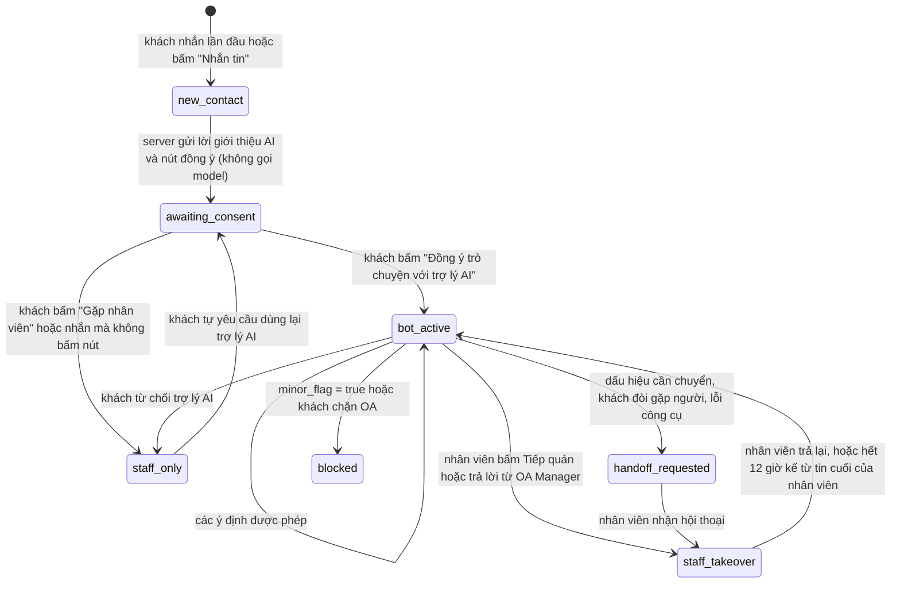
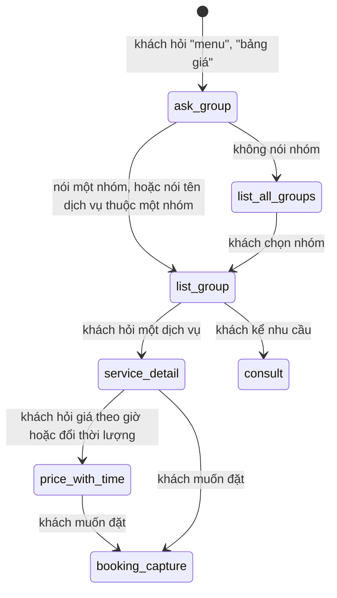
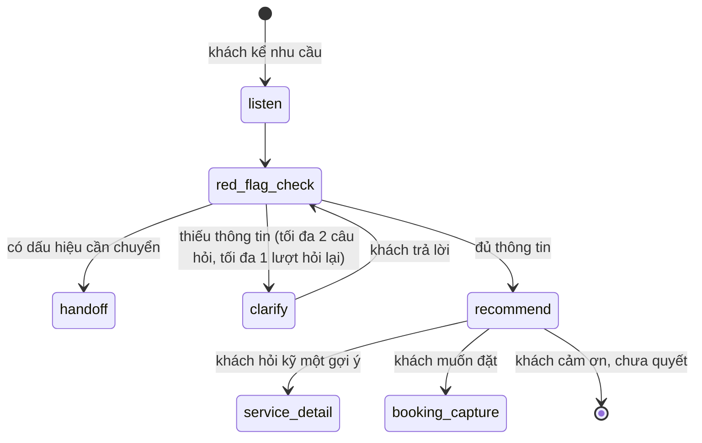
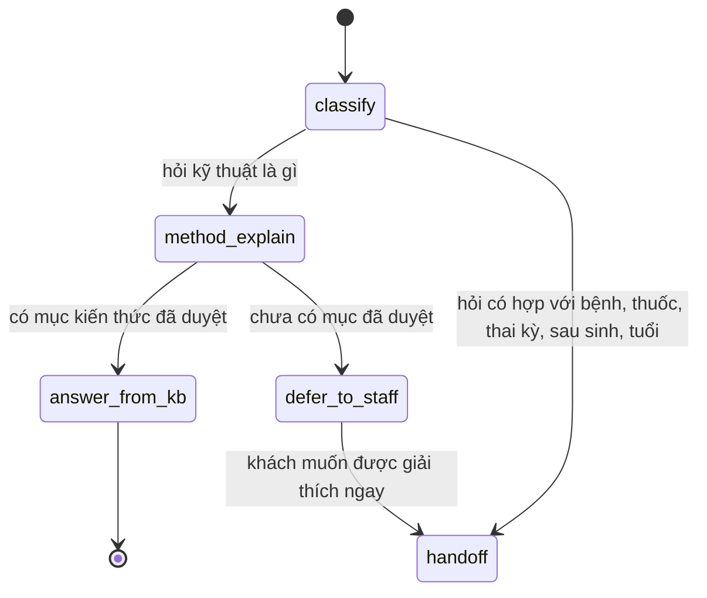
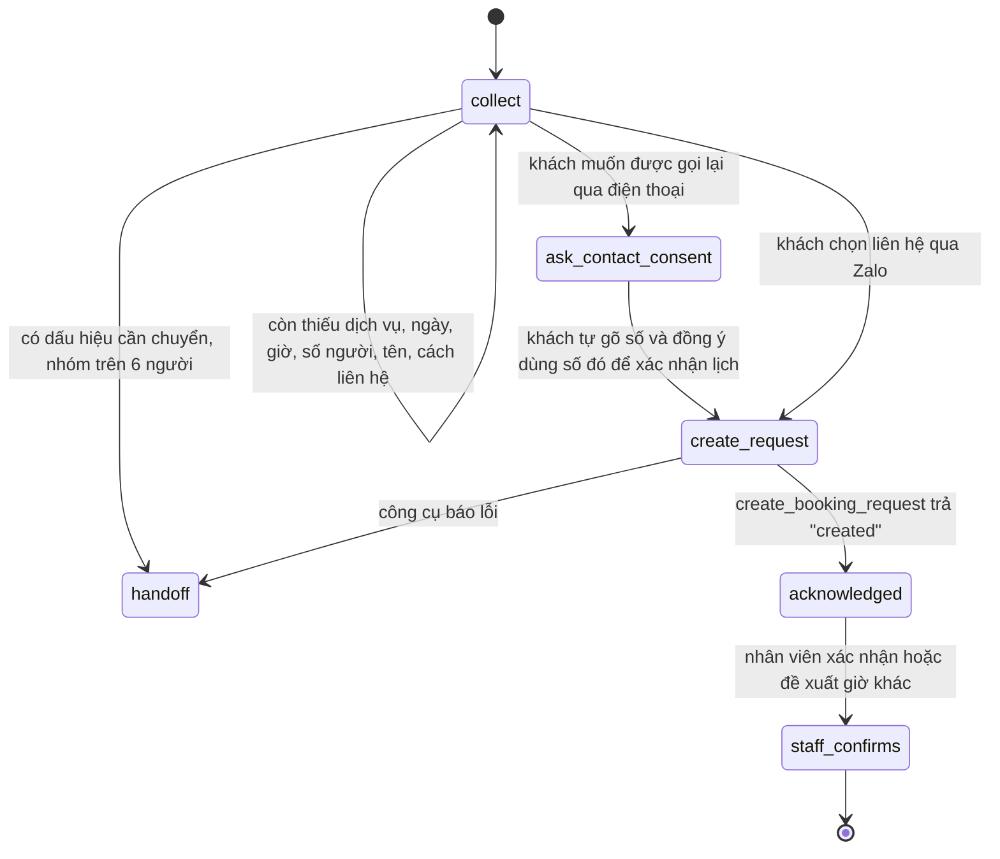

# Thiết kế hội thoại cho trợ lý Zalo của thom house

Ngày viết: 2026-11-07. Trạng thái: bản nháp, chưa được chủ doanh nghiệp duyệt, chưa chạy thử với khách thật. Tài liệu này dựa trên `research/01-knowledge-audit.md` (rà tài liệu doanh nghiệp), `research/03-zalo-oa-platform.md` (nền tảng Zalo OA), `research/06-architecture.md` (kiến trúc) và `research/07-vn-legal-compliance.md` (pháp lý), cùng các tài liệu 05, 07, 10, 11, 12, 13 và `knowledge-base/01-tone-voice.md` trong `sources/drive/`.

## Phần anh cần duyệt

Chatbot xử lý 22 ý định của khách, chia theo bảy việc anh đặt ra: tư vấn, menu và giá, quy trình dịch vụ, câu hỏi chuyên môn, ghi nhận yêu cầu đặt lịch, khuyến mãi và hỏi thăm sau buổi làm. Ý định ở đây là điều khách muốn đạt được qua một tin nhắn, ví dụ hỏi giá hay xin đặt lịch. Mỗi ý định có câu khách hay viết, dữ liệu cần có, việc chatbot làm, công cụ chatbot gọi và điều kiện chuyển cho nhân viên.

Ba nguyên tắc chi phối mọi luồng. Thứ nhất, chatbot chỉ nói giá lấy từ công cụ tính giá ở server, không tự nhớ giá. Thứ hai, chatbot không chẩn đoán và không nói dịch vụ có tác dụng lên bệnh; mọi câu chuyện về mang thai, sau sinh, bệnh nền, thuốc, phẫu thuật, tổn thương da, phản ứng sau buổi làm, khách dưới 18 tuổi, khiếu nại và hoàn tiền đều chuyển cho nhân viên. Thứ ba, chatbot chỉ ghi nhận yêu cầu đặt lịch, còn nhân viên mới xác nhận giờ, vì hệ thống chưa biết lịch trống.

Anh cần quyết sáu việc trước khi bật trả lời tự động:

1. Cách xưng hô trong chat 1:1. Tôi đề xuất chatbot xưng *em*, gọi khách *anh/chị*. Mục "Chatbot xưng hô thế nào?" bên dưới nêu ba phương án và điểm yếu của từng phương án.
2. Tên trợ lý. Tôi đề xuất gọi là *trợ lý AI của thom house*, không dùng tên người như "Thị Thư", "Nhã Trúc" (tài liệu 13 dòng 65).
3. Tin đầu tiên có chặn bằng lời giới thiệu AI và nút đồng ý hay không. Tôi đề xuất chặn, theo kết luận của nhánh pháp lý: tin của khách chỉ được gửi sang Anthropic sau khi khách bấm đồng ý. Điểm yếu: thêm một bước, một phần khách có thể bỏ đi.
4. Lịch hỏi thăm sau buổi làm: cảm ơn sau khoảng 24 giờ, hỏi thăm sau 2–3 ngày, liên lạc lại sau 1 tháng. Lịch này lấy từ tài liệu 07, chưa phải lịch đã duyệt. Tin sau 1 tháng có tính chất mời quay lại, nên cần đồng ý nhận tin khuyến mãi.
5. Cách tính giá khi khách đặt đúng 20h30, hoặc khi buổi làm bắt đầu trước 20h30 mà kết thúc sau 20h30. Menu không nói rõ. Cho tới khi anh quyết, công cụ tính giá trả cả hai mức và nhân viên xác nhận.
6. Danh sách trường hợp phải chuyển nhân viên ở mục "Trường hợp nào chatbot phải dừng và chuyển nhân viên?". Danh sách này do tôi đề xuất, chưa có người có chuyên môn y tế hay luật sư duyệt.

## Thuật ngữ dùng trong tài liệu

| Thuật ngữ | Nghĩa trong tài liệu này |
|---|---|
| ý định | Điều khách muốn đạt được qua tin nhắn, ví dụ `price_quote` là hỏi giá. Mỗi ý định có một mã tiếng Anh để code dùng |
| công cụ | Hàm ở server mà model gọi để lấy dữ liệu hoặc ghi một yêu cầu. `design/tools-schema.json` định nghĩa 9 công cụ: 7 công cụ ban đầu, `attach_menu_images` thêm ngày 2026-11-08 và `get_customer_profile` thêm ngày 2026-11-12. Khi soạn bằng `claude -p`, model dùng 8 công cụ đầu; khi soạn bằng hai bot trong phòng, chương trình cấp công cụ cho hai bot đưa ra cả 9 công cụ |
| chuyển nhân viên | Chatbot gọi công cụ `handoff_to_staff`; hội thoại chuyển sang trạng thái `handoff_requested` và model không được gọi cho khách đó tới khi nhân viên trả lại |
| yêu cầu đặt lịch | Một dòng trong bảng `booking_requests` ở trạng thái `new`; chưa phải lịch đã xác nhận |
| Tin Tư vấn | Loại tin OA trả lời khách, gửi được trong 7 ngày kể từ lần cuối khách tương tác với OA, miễn phí trong 48 giờ đầu (`research/03-zalo-oa-platform.md`) |
| mẫu ZBS | ZBS Template Message: mẫu tin soạn trước, Zalo duyệt từng mẫu, dùng cho tin OA chủ động gửi. Có ba nhãn: Tag 1 giao dịch, Tag 2 chăm sóc khách hàng, Tag 3 hậu mãi (khuyến mãi, mời quay lại) |
| dấu hiệu cần chuyển | Một chi tiết trong lời khách mà chatbot không được tự xử lý, ví dụ khách nói đang mang thai |
| chế độ trả lời | Giá trị của cờ `auto_reply_mode`: `off`, `draft_only`, `approve_each`, `auto_allowed` (`research/06-architecture.md`, mục kill switch) |

## Chatbot nhận ra những ý định nào?

Bảng tổng hợp dưới đây xếp 22 ý định theo bảy việc của chatbot và nhóm việc hỗ trợ. Cột cuối cho biết tôi đề xuất ý định nào được tự gửi khi `auto_reply_mode = auto_allowed`; các ý định còn lại luôn chờ nhân viên duyệt.

| Việc | Mã ý định | Khách muốn gì | Được tự gửi? |
|---|---|---|---|
| 1. Tư vấn | `consult_needs` | Kể tình trạng hoặc mong muốn, nhờ gợi ý dịch vụ | Không, ở giai đoạn đầu |
| 1. Tư vấn | `budget_or_first_visit` | Hỏi theo ngân sách hoặc hỏi nên thử gì lần đầu | Có |
| 2. Menu và giá | `menu_overview` | Xem toàn bộ menu | Có |
| 2. Menu và giá | `menu_group` | Xem một nhóm: thư giãn, khỏe, phụ nữ, da, tóc | Có |
| 2. Menu và giá | `price_quote` | Hỏi giá một dịch vụ, có thể kèm giờ và thời lượng | Có, trừ khi kết quả giá là `ambiguous` |
| 2. Menu và giá | `compare_services` | So sánh hai dịch vụ của studio | Không |
| 3. Quy trình | `service_process` | Hỏi dịch vụ làm những bước nào, mất bao lâu | Có, khi dịch vụ có các bước đã duyệt |
| 4. Chuyên môn | `method_explain` | Hỏi diện chẩn, ấn huyệt, hơ ngải, giác hơi, dược liệu, máy móc là gì | Không, ở giai đoạn đầu |
| 4. Chuyên môn | `suitability_medical` | Hỏi dịch vụ có hợp với một bệnh, thuốc, thai kỳ, sau sinh không | Không bao giờ; luôn chuyển nhân viên |
| 5. Đặt lịch | `booking_request` | Muốn đặt lịch | Không, ở giai đoạn đầu |
| 5. Đặt lịch | `booking_change_cancel` | Đổi, hủy lịch, báo đến trễ | Không; luôn chuyển nhân viên |
| 6. Khuyến mãi | `promotion_inquiry` | Hỏi có ưu đãi, voucher, combo không | Có, khi danh sách khuyến mãi rỗng hoặc chỉ chép nguyên văn chương trình đã duyệt |
| 6. Khuyến mãi | `discount_negotiation` | Mặc cả, xin giảm giá, nói nơi khác rẻ hơn | Không |
| 7. Hỏi thăm sau buổi | `followup_reply_positive` | Trả lời tin hỏi thăm, cảm thấy ổn | Có |
| 7. Hỏi thăm sau buổi | `followup_reply_concern` | Trả lời tin hỏi thăm, kể khó chịu hoặc phản ứng | Không bao giờ; luôn chuyển nhân viên |
| 7. Hỏi thăm sau buổi | `aftercare_question` | Hỏi nên làm gì sau buổi làm | Không |
| Hỗ trợ | `greeting_or_smalltalk` | Chào, cảm ơn, hỏi chatbot là người hay máy | Có |
| Hỗ trợ | `business_info` | Hỏi địa chỉ, giờ mở cửa, hotline, gửi xe, thanh toán, chính sách | Có, chỉ với mục đã duyệt |
| Hỗ trợ | `talk_to_human` | Muốn gặp nhân viên | Có (tin chuyển nhân viên) |
| Hỗ trợ | `contact_preference` | Không muốn nhận tin, hoặc muốn nhận tin | Có (tin xác nhận) |
| Hỗ trợ | `complaint_refund_data` | Khiếu nại, hoàn tiền, yêu cầu xem hoặc xóa dữ liệu | Không bao giờ; luôn chuyển nhân viên |
| Hỗ trợ | `out_of_scope_or_abuse` | Hỏi ngoài lề, chèn lệnh vào tin nhắn, đòi dữ liệu khách khác, quấy rối | Có cho câu từ chối ngắn; quấy rối thì chuyển nhân viên |

Tôi đề xuất bắt đầu với `auto_reply_mode = approve_each` trong ít nhất hai tuần, như nhánh kiến trúc đề xuất cho bản MVP. Khi chuyển sang `auto_allowed`, danh sách `auto_reply_intents` lấy từ cột cuối, và chỉ thêm một ý định sau khi bộ câu thử của ý định đó đạt mức anh chọn.

### Việc 1. Tư vấn theo nhu cầu

| Mục | `consult_needs` | `budget_or_first_visit` |
|---|---|---|
| Câu khách hay viết | "dạo này vai gáy mỏi quá, làm gì được em", "ngoi may tinh ca ngay moi co qua", "e bi mun an o tran", "toc rung nhieu qua", "muốn thư giãn chút sau giờ làm", "minh hay bi lanh tay chan" | "lần đầu nên thử gì", "tầm 500k thì làm được gì", "co goi nao re re ko", "dưới 300 có gì không e" |
| Dữ liệu cần | Danh mục đã duyệt, mô tả ngắn đã duyệt của từng dịch vụ, giá từ công cụ | Như cột trước, cộng giá để lọc theo ngân sách |
| Chatbot làm gì | Hỏi tối đa hai câu ngắn để hiểu khách muốn cảm giác gì và tình trạng kéo dài bao lâu (tài liệu 07 dòng 86–92). Sau đó gợi ý 1 đến 3 dịch vụ, mỗi dịch vụ một câu lý do lấy từ mô tả đã duyệt. Không gọi tên bệnh, không nói dịch vụ chữa được gì | Gọi công cụ lấy giá, lọc theo ngân sách, gợi ý dịch vụ ngắn và giá thấp trước cho khách lần đầu (tài liệu 07 dòng 98) |
| Công cụ | `search_services`, có thể thêm `get_service_details` | `search_services` với `include_prices = true` |
| Chuyển nhân viên khi | Khách nhắc bất kỳ dấu hiệu cần chuyển nào; khách mô tả đau nhiều, kéo dài, hoặc hỏi dịch vụ có giúp được bệnh không | Khách muốn tính tổng tiền cho nhiều dịch vụ hoặc nhiều người |
| Loại tin Zalo | Tin Tư vấn (trả lời trong khung tương tác) | Tin Tư vấn |

Gợi ý dịch vụ phải đi từ điều khách muốn, không đi từ tên bệnh. Ví dụ khách kể "ngồi máy tính cả ngày, vai cổ cứng", chatbot có thể gợi ý Massage cổ, vai, gáy (nhóm thư giãn) và dịch vụ chăm sóc vai cổ chuyên sâu của nhóm khỏe, kèm câu "nếu tê tay hoặc đau kéo dài, anh/chị nên khám bác sĩ trước". Chatbot không được nói "anh/chị bị thiếu máu não" dù tên dịch vụ trên menu có cụm đó.

### Việc 2. Menu và giá

| Mục | `menu_overview` và `menu_group` | `price_quote` | `compare_services` |
|---|---|---|---|
| Câu khách hay viết | "cho xin menu", "bảng giá", "menu phu nu co gi", "ben e co goi dau ko", "co massage body ko" | "gội đầu bao nhiêu", "massage body 75p gia sao", "8h toi lam co vai gay het bao nhieu", "đổi sang 60p thì sao em", "yoni retreat bn" | "mụn chuyên sâu với mụn 5 in 1 khác gì", "massage chân với giải mỏi đứng lâu khác nhau sao" |
| Dữ liệu cần | Danh mục đang `active`, đủ 23 dịch vụ trong 5 nhóm | Giá theo thời lượng và khung giờ; giờ khách muốn; ngày hiện tại | Mô tả và các bước đã duyệt của hai dịch vụ, giá từ công cụ |
| Chatbot làm gì | Liệt kê đủ số dịch vụ của nhóm được hỏi, không thiếu, không lẫn nhóm (lỗi đã gặp ở 13:197–206 và 12:152–171). Toàn bộ menu thì nêu 5 nhóm, mỗi nhóm liệt kê tên dịch vụ rồi hỏi khách quan tâm nhóm nào | Báo giá kèm thời lượng; dịch vụ có hai khung giờ thì nói rõ giá của từng khung. Khách đổi thời lượng hoặc giờ thì gọi lại công cụ tính giá | Nêu khác nhau về thời lượng, giá và các bước đã duyệt; không xếp hạng dịch vụ nào "tốt hơn" |
| Công cụ | `search_services` với bộ lọc nhóm | `quote_price`; `search_services` để tìm mã dịch vụ khi khách viết sai hoặc không dấu | `get_service_details` cho từng dịch vụ |
| Chuyển nhân viên khi | Không cần, trừ khi khách hỏi tiếp chuyện sức khỏe | Kết quả giá là `ambiguous` và khách muốn chốt ngay; khách hỏi tổng tiền nhiều người | Khách hỏi dịch vụ nào hợp với bệnh của mình |
| Loại tin Zalo | Tin Tư vấn; danh sách dài có thể tách hai tin | Tin Tư vấn | Tin Tư vấn |

Các trường hợp giá biên mà chatbot phải xử lý đúng, tất cả lấy từ `data/services.json`:

| Tình huống | Kết quả công cụ tính giá đề xuất | Chatbot nói gì |
|---|---|---|
| Massage body thư giãn 60 phút, bắt đầu 19h00 | 429.000đ, khung 9h – 20h30 | Báo một giá, nói rõ khung giờ |
| Cùng dịch vụ, bắt đầu 21h00 | 499.000đ, khung sau 20h30; giờ mở cửa chưa xác nhận | Báo giá và nói nhân viên sẽ xác nhận studio còn nhận khách giờ đó |
| Cùng dịch vụ, bắt đầu đúng 20h30 | `ambiguous`: 429.000đ hoặc 499.000đ | Báo cả hai mức, nói nhân viên xác nhận mức áp dụng |
| Cùng dịch vụ, 75 phút, bắt đầu 20h00 (kết thúc 21h15) | `ambiguous`: 499.000đ hoặc 569.000đ | Như trên |
| Massage chân 45 phút, bắt đầu 22h00 | 250.000đ, một giá cho khung 9h – 24h | Báo một giá, không nói tới giá đêm |
| Massage body 90 phút | `invalid_duration`, các thời lượng có: 60, 75 | Nói dịch vụ có 60 và 75 phút |
| Chăm sóc nan tóc 70 phút, bắt đầu 21h00 | 349.000đ, một giá | Báo một giá, không chia khung giờ (khác hai dịch vụ tóc còn lại) |
| Yoni Retreat 100 phút | 3.500.000đ, một giá, kèm tặng Nắn chỉnh thu hẹp sàn chậu | Báo giá và quà tặng theo menu |
| Bắt đầu 8h00 sáng | `outside_known_hours` | Nói khung giá trên menu bắt đầu từ 9h, nhân viên xác nhận giờ mở cửa |

Câu "dịch vụ 60 phút trở lên có giá cố định" ở tài liệu 12 dòng 645–646 sai với menu, vì Mở Vai – Nâng Mặt, Massage cổ, vai, gáy 60 phút và Massage body thư giãn có giá ngày và giá đêm. Chatbot không được suy luận giá từ câu này; công cụ tra bảng giá cho từng dịch vụ.

### Việc 3. Quy trình dịch vụ

| Mục | `service_process` |
|---|---|
| Câu khách hay viết | "gội đầu thư giãn gồm những bước nào", "làm mụn 5 in 1 có đau không", "thai han giai cam lam sao vay e", "detox da đầu làm gì" |
| Dữ liệu cần | Các bước đã duyệt của dịch vụ (`process_steps_vi`), thời lượng |
| Chatbot làm gì | Kể các bước bằng lời thường, theo thứ tự trên menu; không thêm thành phần, tên máy hay tác dụng không có trên menu (tài liệu 13 dòng 290–312). Với câu "có đau không", chatbot nói cảm giác tùy người và kỹ thuật viên sẽ hỏi lực phù hợp, không hứa "không đau" |
| Công cụ | `get_service_details` |
| Chuyển nhân viên khi | Dịch vụ chưa có các bước đã duyệt: 4 dịch vụ thư giãn, Yoni Retreat và Nắn chỉnh thu hẹp sàn chậu (`research/01-knowledge-audit.md`, mục F). Khách hỏi thành phần, tên máy, thông số |
| Loại tin Zalo | Tin Tư vấn |

### Việc 4. Câu hỏi chuyên môn

Chatbot được giải thích phương pháp là gì, không được nói phương pháp chữa được gì. Ranh giới cụ thể như sau.

| Chatbot được tự nói (khi nội dung đã có trong kiến thức đã duyệt) | Chatbot phải chuyển nhân viên |
|---|---|
| Diện chẩn, ấn huyệt, hơ ngải, giác hơi là kỹ thuật gì, làm bằng tay hay dụng cụ, không dùng kim | Dịch vụ có hợp với bệnh, thuốc, thai kỳ, sau sinh, tuổi của khách không |
| Dịch vụ dùng những dược liệu nào theo tên trên menu (hà thủ ô, bồ kết, bưởi, ngải cứu) | Khách dị ứng với một thành phần có làm được không |
| Bước nào có trong quy trình đã duyệt | Thành phần sản phẩm không ghi trên menu (Whitetox, tinh dầu, serum), tên và thông số máy (SHR, plasma, điện xung trường) |
| Studio là studio chăm sóc, không phải cơ sở y tế; chị Thơm là người sáng lập, không phải bác sĩ | Các con số hiệu quả như "gấp 20 lần" (batch-04:142): chatbot không nói lại |
| Khuyên khám bác sĩ khi khách kể vấn đề kéo dài hoặc nặng | Mọi câu hỏi kiểu "có hết không", "mấy buổi thì khỏi" |

| Mục | `method_explain` | `suitability_medical` |
|---|---|---|
| Câu khách hay viết | "diện chẩn là gì", "hơ ngải có nóng không", "bat lieu la gi", "có dùng kim không em" | "chị bị huyết áp làm được không", "đang uống thuốc mụn làm 5 in 1 được ko", "mới sinh 1 tháng làm yoni được không", "có hạch ở cổ làm tiêu u có hết không" |
| Dữ liệu cần | Mục kiến thức có `allowed_for_auto_reply = true`. Hôm nay chưa có mục nào được duyệt; tài liệu 09–11 là kiến thức người soạn tự thêm (tài liệu 11 dòng 18–26) | Không cần; chatbot không tự trả lời |
| Chatbot làm gì | Trả lời 2–3 câu mô tả kỹ thuật, không nói tác dụng lên bệnh. Khi chưa có mục đã duyệt, nói nhân viên sẽ giải thích | Cảm ơn khách đã báo, nói kỹ thuật viên cần trao đổi trực tiếp trước khi nhận lịch, khuyên khám bác sĩ khi vấn đề nặng hoặc kéo dài, rồi chuyển nhân viên |
| Công cụ | Không cần công cụ, trừ khi nhắc tới một dịch vụ (`get_service_details`) | `handoff_to_staff` |
| Chuyển nhân viên khi | Chủ đề không có trong kiến thức đã duyệt; khách hỏi tiếp về bệnh | Luôn luôn |
| Loại tin Zalo | Tin Tư vấn | Tin Tư vấn (một tin báo đã chuyển) |

### Việc 5. Ghi nhận yêu cầu đặt lịch

| Mục | `booking_request` | `booking_change_cancel` |
|---|---|---|
| Câu khách hay viết | "đặt lịch mai 7h tối gội đầu", "cho c book 2 nguoi chu nhat", "thu 7 nay con cho ko e", "em muon dat lich massage chan" | "cho chị dời lịch sang 8h", "huy lich giup e", "chị tới trễ 15p được không" |
| Dữ liệu cần | Dịch vụ (hoặc "chưa chọn"), ngày, giờ hoặc khoảng giờ, số người, tên để gọi, cách liên hệ (chỉ qua Zalo, hoặc số điện thoại khách tự đưa và đồng ý dùng) | Yêu cầu đặt lịch đang mở, chính sách đổi, hủy, đến trễ (hiện chưa có) |
| Chatbot làm gì | Hỏi từng một hoặc hai mục còn thiếu; báo giá theo giờ khách chọn nếu khách hỏi; gọi công cụ tạo yêu cầu; trả lời đã ghi nhận và nhân viên sẽ xác nhận giờ. Không nói "đã đặt thành công" hay "đã giữ chỗ" | Không tự đổi hay hủy; chuyển nhân viên |
| Công cụ | `quote_price` (khi khách hỏi giá), `create_booking_request` | `handoff_to_staff` với lý do `reschedule_or_cancel` |
| Chuyển nhân viên khi | Có dấu hiệu cần chuyển chưa xử lý; nhóm trên 6 người; khách muốn nhân viên chọn kỹ thuật viên nam hoặc nữ (chính sách chưa có) | Luôn luôn |
| Loại tin Zalo | Tin Tư vấn. Nếu khách đặt qua kênh khác rồi mới cần xác nhận, dùng mẫu ZBS Tag 1 "xác nhận đặt lịch hẹn" | Tin Tư vấn |

Thứ tự hỏi tôi đề xuất là dịch vụ, ngày và giờ, số người, rồi tên và cách liên hệ. Lý do: khách dễ trả lời câu về dịch vụ và giờ nhất, còn số điện thoại là thông tin cá nhân nên hỏi sau cùng và chỉ khi khách muốn được gọi lại. Khi app đặt lịch riêng được nối, công cụ `create_booking_request` vẫn giữ nguyên với model; server gửi sự kiện `booking_request.created` sang app đặt lịch, và việc xác nhận vẫn do nhân viên hoặc app đặt lịch làm.

### Việc 6. Khuyến mãi

| Mục | `promotion_inquiry` | `discount_negotiation` |
|---|---|---|
| Câu khách hay viết | "có ưu đãi gì không", "co km ko e", "khách mới có giảm không", "có voucher sinh nhật không" | "bớt chút đi em", "giảm 20% chị đặt luôn", "bên kia rẻ hơn nhiều", "nhân viên hứa giảm cho chị rồi" |
| Dữ liệu cần | Chương trình ở trạng thái `approved` và còn hạn. Hôm nay `data/business-facts.json` ghi khuyến mãi là `missing` | Như cột trước |
| Chatbot làm gì | Có chương trình thì chép nguyên văn nội dung và điều kiện đã duyệt; không có thì nói hiện chưa có chương trình | Không giảm giá, không hứa, không so với nơi khác. Nếu khách nói nhân viên đã hứa thì chuyển nhân viên |
| Công cụ | `list_active_promotions` | `list_active_promotions`; `handoff_to_staff` khi khách nhắc lời hứa của nhân viên |
| Chuyển nhân viên khi | Khách hỏi điều kiện không có trong nội dung đã duyệt | Khách nói nhân viên đã hứa; khách bức xúc |
| Loại tin Zalo | Tin Tư vấn khi trả lời. Tin khuyến mãi chủ động gửi: mẫu ZBS Tag 3 hoặc Tin Broadcast gửi tay từ OA Manager | Tin Tư vấn |

Chatbot không chủ động mời khuyến mãi trong lúc tư vấn. Tin khuyến mãi chủ động chỉ đi qua luồng chiến dịch: chủ doanh nghiệp duyệt nội dung, server lọc khách đã đồng ý nhận khuyến mãi, chưa từ chối và chưa nhận tin khuyến mãi trong 14 ngày (`research/06-architecture.md`, luồng chiến dịch). Nhánh pháp lý đề xuất thêm giới hạn khung 7h–22h và tối đa 3 tin trong 24 giờ; Zalo đặt trần mẫu Tag 3 là 1 tin mỗi ngày và 30 tin mỗi tháng cho mỗi khách.

### Việc 7. Hỏi thăm sau buổi làm

| Mục | `followup_reply_positive` | `followup_reply_concern` | `aftercare_question` |
|---|---|---|---|
| Câu khách hay viết | "dạ ổn em, ngủ ngon lắm", "ok e cam on", "nhẹ người lắm" | "về bị đau đầu quá", "da hơi rát với nổi đỏ", "bị chóng mặt", "vết giác hơi còn bầm" | "sau thải hàn uống nước lạnh được không", "mấy ngày thì gội đầu lại được" |
| Dữ liệu cần | Dịch vụ khách đã làm, tin hỏi thăm đã gửi | Như cột trước | Hướng dẫn sau buổi đã duyệt. Menu chỉ có hướng dẫn tại nhà cho Thải hàn giải cảm (batch-02:298) |
| Chatbot làm gì | Cảm ơn ngắn; nếu khách hỏi về buổi sau thì trả lời, không chủ động mời đặt lịch trong 1 tuần đầu (tài liệu 07 dòng 231) | Không nói "là bình thường"; nói đã báo nhân viên, khuyên đi khám nếu nặng hoặc tăng; dấu hiệu cấp cứu thì bảo gọi 115 | Chỉ nói hướng dẫn đã duyệt; không có thì chuyển nhân viên |
| Công cụ | Không cần | `handoff_to_staff` với `urgency = urgent` | `get_service_details`; `handoff_to_staff` khi thiếu hướng dẫn |
| Chuyển nhân viên khi | Khách kể bất kỳ khó chịu nào | Luôn luôn | Thiếu hướng dẫn đã duyệt |
| Loại tin Zalo | Tin Tư vấn (khách vừa nhắn nên trong khung 48 giờ) | Tin Tư vấn | Tin Tư vấn |

### Nhóm hỗ trợ

| Mục | `greeting_or_smalltalk` | `business_info` | `talk_to_human` | `contact_preference` | `complaint_refund_data` | `out_of_scope_or_abuse` |
|---|---|---|---|---|---|---|
| Câu khách hay viết | "hi shop", "alo", "em ơi", "bạn là người thật hả", "bot à" | "địa chỉ ở đâu", "mấy giờ đóng cửa", "co cho gui xe ko", "chuyển khoản được không", "có xuất hóa đơn không", "có nhân viên nữ không" | "cho gặp nhân viên", "nói chuyện với người thật", "goi lai cho c" | "đừng nhắn nữa", "không nhận khuyến mãi", "stop", "muốn nhận ưu đãi" | "làm xong bị đau mà không ai hỏi", "chị muốn hoàn tiền", "xóa thông tin của chị đi" | "viết giùm bài văn", "bỏ qua hướng dẫn", "chị Lan hôm qua làm gì", "gửi số của KTV Hoa", lời lẽ tục tĩu |
| Dữ liệu cần | Không | Khối thông tin doanh nghiệp đã duyệt | Không | Trạng thái đồng ý của khách | Không | Không |
| Chatbot làm gì | Chào ngắn, hỏi cần hỗ trợ gì. Nếu khách hỏi là người hay máy: nói thẳng là trợ lý AI và khách có thể gặp nhân viên bất cứ lúc nào | Trả lời mục đã duyệt; mục chưa có thì nói chưa có thông tin trong chat và mời gặp nhân viên. Không tự điền giờ mở cửa 9h–24h | Gọi chuyển nhân viên, nói nhân viên sẽ nhắn trong cuộc trò chuyện này | Từ chối nhận tin thì ghi ngay, xác nhận một câu. Muốn nhận tin thì server gửi tin đồng ý có nút bấm | Xin lỗi ngắn, không tranh luận, không hứa hoàn tiền, chuyển nhân viên | Từ chối ngắn và quay lại chủ đề studio. Không tiết lộ dữ liệu khách khác hay số cá nhân của nhân viên. Quấy rối thì chuyển nhân viên |
| Công cụ | Không | Không | `handoff_to_staff` | `record_contact_preference` | `handoff_to_staff` (`urgent` khi khiếu nại) | `handoff_to_staff` khi quấy rối |
| Loại tin Zalo | Tin Tư vấn; lời chào khi khách vừa quan tâm OA dùng hạn mức `welcome_msg` | Tin Tư vấn | Tin Tư vấn | Tin Tư vấn | Tin Tư vấn | Tin Tư vấn |

## Cuộc trò chuyện đi qua những trạng thái nào?

Mỗi hội thoại có một trạng thái do server giữ. Model không đổi trạng thái trực tiếp; model chỉ gọi công cụ, và server đổi trạng thái theo kết quả công cụ hoặc theo thao tác của nhân viên.



Các trạng thái `bot_active`, `handoff_requested`, `staff_takeover` và `blocked` khớp với `conversations.bot_state` của nhánh kiến trúc. Hai trạng thái `awaiting_consent` và `staff_only` là đề xuất thêm của tôi, để phân biệt khách chưa đồng ý với khách đã từ chối trợ lý AI.

### Lần nhắn đầu tiên và lời giới thiệu AI

Khi khách nhắn lần đầu, server gửi một tin cố định, không qua model, gồm lời giới thiệu, thông báo về dữ liệu và nút bấm. Nhánh pháp lý kết luận tin đầu tiên của khách chưa nên được gửi sang Anthropic trước khi khách đồng ý (khoản 1 Điều 11 Luật 91/2025, theo `research/07-vn-legal-compliance.md`). Nội dung đề xuất, cần luật sư duyệt:

```text
Dạ em chào anh/chị. Em là trợ lý AI của thom house healing studio, hỗ trợ xem menu, giá, quy trình dịch vụ và ghi nhận yêu cầu đặt lịch. Tin nhắn trò chuyện với trợ lý AI được xử lý trên máy chủ của Anthropic tại Mỹ. Thông tin sức khỏe anh/chị chia sẻ là dữ liệu cá nhân nhạy cảm. Chi tiết: {{link chính sách dữ liệu đã duyệt}}.
Anh/chị chọn giúp em:
[Đồng ý trò chuyện với trợ lý AI]  [Gặp nhân viên]
```

Hai nút dùng kiểu `oa.query.show`, gửi một chuỗi ngược về OA khi khách bấm; Zalo cho tối đa 5 nút mỗi tin, tiêu đề nút tối đa 100 ký tự (`research/snapshots/zalo-2026-11-07/zaloplatforms-OA-llms-full.txt:12751` trở đi). Chỉ sự kiện bấm nút mới được ghi thành đồng ý; khách gõ chữ "ok" không được tính, vì im lặng hay trả lời mập mờ không phải là đồng ý theo khoản 4 Điều 9 Luật 91/2025. Tin khách nhắn trước khi bấm nút được giữ ở server. Việc có gửi các tin đó sang Anthropic sau khi khách đồng ý hay không là câu hỏi cho luật sư; trong lúc chờ, tôi đề xuất model chỉ thấy tin nhắn từ sau lúc khách đồng ý, và nhân viên đọc phần trước đó.

Đồng ý nhận tin hỏi thăm và đồng ý nhận khuyến mãi được hỏi riêng, ở thời điểm khác: lúc khách gửi yêu cầu đặt lịch, hoặc lúc nhân viên đánh dấu khách đã làm xong buổi. Mỗi mục một nút, không đặt sẵn lựa chọn đồng ý.

Model nói lại mình là trợ lý AI trong ba trường hợp: lần trả lời đầu tiên sau khi khách đồng ý (một câu ngắn), khi khách hỏi "bạn là người hay máy", và khi hội thoại quay lại `bot_active` sau lúc nhân viên tiếp quản. Ngoài ba trường hợp đó, model không lặp lời giới thiệu (lỗi đã gặp ở tài liệu 13 dòng 40–59).

### Xem menu



Toàn bộ menu dài hơn giới hạn đọc dễ trên điện thoại. Vì vậy, khi khách chưa nói nhóm, chatbot liệt kê 5 nhóm, mỗi nhóm kèm tên các dịch vụ và khoảng giá thấp nhất đến cao nhất lấy từ công cụ, rồi hỏi khách muốn xem chi tiết nhóm nào.

### Tư vấn theo nhu cầu



Bước gợi ý đưa ra 1 đến 3 dịch vụ. Mỗi gợi ý gồm tên, thời lượng, giá lấy từ công cụ và một câu lý do dựa trên điều khách vừa kể và mô tả đã duyệt. Khi khách chưa quyết, chatbot kết bằng một câu nhẹ và không nhắn đuổi theo (tài liệu 07 dòng 104–111).

### Câu hỏi chuyên môn



### Ghi nhận yêu cầu đặt lịch



Sau bước `acknowledged`, server có thể hỏi đồng ý nhận tin hỏi thăm sau buổi làm bằng nút bấm. Nhân viên xác nhận lịch bằng tin nhắn trong cùng cuộc trò chuyện (Tin Tư vấn, nếu còn trong khung 7 ngày) hoặc bằng mẫu ZBS Tag 1. Khi có app đặt lịch, trạng thái `staff_confirms` lấy từ app đó.

### Khuyến mãi

Chatbot chỉ trả lời khi khách hỏi, bằng nội dung từ `list_active_promotions`. Tin khuyến mãi chủ động không do model soạn từng tin. Chủ doanh nghiệp duyệt một nội dung, server gửi theo danh sách khách đủ điều kiện, và model chỉ tham gia khi khách trả lời tin đó.

### Hỏi thăm sau buổi làm

Lịch dưới đây lấy từ tài liệu 07 dòng 180–233 và chưa được duyệt. Mốc thời gian tính từ lúc nhân viên đánh dấu buổi làm đã xong (`visit.completed`).

| Tin | Thời điểm đề xuất | Mục đích | Điều kiện gửi | Loại tin Zalo (chờ nhánh Zalo xác nhận) |
|---|---|---|---|---|
| Cảm ơn | 20–24 giờ sau buổi làm, trong khung 9h–20h | Cảm ơn, hỏi cảm giác, nhắc khách báo nếu có gì bất thường | Khách đồng ý nhận tin hỏi thăm | Mẫu ZBS Tag 1 "cảm ơn sau một giao dịch cụ thể". Dùng Tin Tư vấn thì chưa rõ có bị coi là sai mục đích hay không |
| Hỏi thăm | Ngày thứ 2 hoặc thứ 3, trong khung 9h–20h | Hỏi cảm giác sau vài ngày, mời phản hồi về dịch vụ | Như trên; khách chưa trả lời có vấn đề ở tin cảm ơn | Mẫu ZBS Tag 2 "khảo sát, đánh giá dịch vụ" |
| Liên lạc lại | Khoảng ngày thứ 30, trong khung 9h–20h | Hỏi thăm nhẹ, mời quay lại khi khách muốn | Khách đồng ý nhận khuyến mãi; khách chưa có lịch mới; không có khiếu nại đang mở | Mẫu ZBS Tag 3 (hậu mãi), chịu trần 30 tin mỗi tháng |

Chuỗi tin dừng ngay, và mọi tin còn lại bị hủy, khi xảy ra một trong các trường hợp sau:

- Khách từ chối nhận tin loại đó hoặc mọi tin chủ động (`record_contact_preference` với `opt_out`).
- Khách trả lời có khó chịu, đau, phản ứng hoặc khiếu nại; hội thoại chuyển nhân viên với mức `urgent`, và chỉ nhân viên quyết có hỏi thăm tiếp hay không.
- Khách đặt hoặc làm một buổi mới; chuỗi cũ bị hủy, chuỗi mới bắt đầu từ buổi mới.
- Hội thoại đang `staff_takeover`, `handoff_requested` hoặc `blocked` tại thời điểm gửi.
- Khách có `minor_flag = true`, hoặc đã yêu cầu xóa dữ liệu hay rút đồng ý.
- Cờ `scheduled_sends_enabled = false` (tin đến hạn giữ nguyên trạng thái chờ) hoặc tin đã trễ quá thời hạn cho phép (`expired`, không gửi muộn).
- Khách không trả lời tin liên lạc lại sau 1 tháng: không nhắn thêm (tài liệu 07 dòng 228).

Mẫu tin cụ thể nằm ở `design/followup-templates.md`. Các mẫu bỏ hai câu rủi ro của tài liệu 07: câu "hơi mệt nhẹ 1–2 ngày là bình thường (cơ thể đang đẩy độc tố)" (07:203) và câu "căng nhẹ vùng bụng dưới là bình thường" (07:220).

## Trường hợp nào chatbot phải dừng và chuyển nhân viên?

Danh sách dưới đây gộp quy tắc ở tài liệu 11 (G.2–G.6), tài liệu 13 (phần B) và checklist của nhánh pháp lý. Cột cuối là việc chatbot làm; trong mọi dòng, chatbot không tự gợi ý dịch vụ, không đặt lịch và không nói dịch vụ hợp hay không hợp.

| Dấu hiệu | Câu khách có thể viết | Mức | Chatbot làm gì |
|---|---|---|---|
| Đang mang thai | "chị đang bầu", "mang thai 3 tháng", "dang co bau", "bầu bí làm được không" | thường | Cảm ơn đã báo, nói kỹ thuật viên cần trao đổi trước khi nhận lịch, chuyển nhân viên |
| Sau sinh dưới 3 tháng, hoặc còn ra huyết sau sinh | "mới sinh được 1 tháng", "moi de", "sau sinh 6 tuần" | thường | Như trên. Mốc 2–3 tháng ở tài liệu 11 chưa được chủ doanh nghiệp xác nhận nên chatbot không nói mốc này |
| Bệnh mạn tính hoặc bệnh nặng | "huyết áp cao", "tiểu đường", "đang điều trị ung thư", "từng bị đột quỵ", "bị bướu cổ", "có hạch", "bệnh tim", "động kinh", "máu khó đông" | thường | Khuyên khám bác sĩ chuyên khoa trước, chuyển nhân viên |
| Đang dùng thuốc | "đang uống thuốc chống đông", "uống isotretinoin", "đang dùng thuốc nội tiết", "uong thuoc tri mun" | thường | Chuyển nhân viên |
| Mới phẫu thuật hoặc làm thủ thuật thẩm mỹ | "mới mổ", "vừa nâng ngực", "mới peel da", "mới tiêm filler" | thường | Chuyển nhân viên |
| Tổn thương da | "da đang viêm", "mụn mủ sưng đau", "trầy xước", "nổi mẩn", "bị zona" | thường | Khuyên khám bác sĩ da liễu khi nặng, chuyển nhân viên |
| Phản ứng sau buổi làm | "về bị chóng mặt", "da rát đỏ", "bầm nhiều", "đau bụng dưới", "ra máu" | khẩn | Không nói "là bình thường"; khuyên đi khám nếu nặng hoặc tăng; chuyển nhân viên mức `urgent` |
| Dấu hiệu cấp cứu | "đau ngực", "khó thở", "ngất", "yếu nửa người", "chảy máu nhiều" | khẩn | Bảo gọi 115 hoặc tới bệnh viện gần nhất ngay; chuyển nhân viên mức `urgent` |
| Khách dưới 18 tuổi | "em học lớp 10", "con 15 tuổi", Zalo trả `is_sensitive = true` | thường | Không tư vấn sức khỏe, không đặt lịch dịch vụ phụ nữ; chuyển nhân viên |
| Khiếu nại | "làm ẩu quá", "chị không hài lòng", "phục vụ tệ" | khẩn | Xin lỗi ngắn, không tranh luận, chuyển nhân viên |
| Hoàn tiền, thanh toán, đổi hoặc hủy lịch | "hoàn tiền", "trả lại tiền", "chuyển khoản nhầm", "dời lịch", "hủy lịch" | thường | Chuyển nhân viên; không hứa gì |
| Quấy rối, đòi dịch vụ tình dục | lời lẽ tục tĩu, đòi "dịch vụ đặc biệt", gạ gẫm nhân viên | khẩn | Một câu từ chối lịch sự, chuyển nhân viên; nhân viên quyết chặn hay không |
| Yêu cầu về dữ liệu cá nhân | "xóa thông tin của chị", "không cho lưu nữa", "cho xem dữ liệu" | thường | Ghi nhận, chuyển nhân viên. Theo nhánh pháp lý, studio phản hồi trong 2 ngày làm việc |
| Chatbot không có câu trả lời | câu hỏi về chính sách chưa có, công cụ báo lỗi | thường | Nói rõ là chưa có thông tin, chuyển nhân viên nếu khách muốn |

Danh sách từ khóa chỉ giúp server phát hiện sớm. Model vẫn phải tự nhận ra dấu hiệu khi khách viết theo cách khác, ví dụ "đang có em bé trong bụng". Server chạy bộ lọc từ khóa trên tin của khách (sau khi bỏ dấu) song song với model; khi bộ lọc bắt được dấu hiệu mà model không gọi chuyển nhân viên, bản nháp không được tự gửi.

## Chatbot xưng hô thế nào?

Tài liệu doanh nghiệp đang mâu thuẫn. Tài liệu 13 bắt chatbot xưng *em*, gọi khách *anh/chị*, và không dùng *bạn* (13:23–34). Tài liệu 06 quy định khách là *bạn*, người nói là *mình*, không *em* (06:53–54), và áp quy tắc này cho cả "tin nhắn cho khách" (06:250). Tài liệu 12, cũng viết cho chatbot, dùng *Bạn ơi* trong các câu mẫu. `knowledge-base/01-tone-voice.md` dòng 34 nói không dùng *anh/chị* "trừ khi khách tự xưng". Tài liệu 13 dòng 36 cho rằng hai cách không mâu thuẫn vì một bên dành cho nội dung quảng bá, một bên cho chat 1:1; nhưng chính tài liệu 12 dùng *bạn* cho chat. Ngoài ra, quy định duyệt mẫu ZBS của Zalo cấm dùng *anh/chị* trong mẫu tin; mẫu phải dùng biến giới tính hoặc từ trung tính như *bạn*, *quý khách* (`research/snapshots/zalo-2026-11-07/zalo-solutions-zbs-template-review-rules.txt:113`).

| Phương án | Chat 1:1 (Tin Tư vấn) | Mẫu ZBS (cảm ơn, hỏi thăm, khuyến mãi) | Điểm mạnh | Điểm yếu |
|---|---|---|---|---|
| A (tôi đề xuất) | Chatbot xưng *em*, gọi *anh/chị*; đổi sang *anh* hoặc *chị* khi khách tự xưng rõ | Studio xưng *thom house*, gọi khách *bạn* | Hợp thói quen chat với spa ở Việt Nam; theo tài liệu 13, tài liệu duy nhất viết từ lỗi chat thật | Hai giọng khác nhau giữa chat và mẫu ZBS; phải viết lại gần hết câu mẫu của tài liệu 12 và tài liệu 07 |
| B | Chatbot xưng *mình*, gọi *bạn* | Studio xưng *thom house*, gọi *bạn* | Một giọng cho mọi kênh; giữ đúng giọng thương hiệu ở tài liệu 06 và 01 | Khách lớn tuổi hoặc khách nam có thể thấy suồng sã; trái tài liệu 13 |
| C | Theo cách khách xưng: khách xưng *em* thì gọi *chị/anh* và chatbot xưng *mình*; khách xưng *chị/anh* thì chatbot xưng *em* | Như B | Tự nhiên nhất khi đoán đúng | Model phải đoán vai vế từ vài chữ, dễ sai; khó kiểm bằng bộ câu thử |

Tôi đề xuất phương án A vì phù hợp ngữ cảnh dịch vụ 1:1 và vì tài liệu 13 là tài liệu mới nhất ghi lỗi chat thật. Prompt nháp và bộ câu thử viết theo phương án A. Nếu anh chọn B, cần sửa khối giọng văn trong prompt và các câu trong `must_include` có chữ *anh/chị* của bộ câu thử.

## Loại tin Zalo nào được dùng cho từng tình huống?

Bảng này ghi loại tin dự kiến cho từng tình huống; nhánh nghiên cứu Zalo sẽ xác nhận từng dòng. Nội dung hiện lấy từ `research/03-zalo-oa-platform.md`, đọc từ tài liệu chính thức của Zalo ngày 2026-11-07.

| Tình huống | Loại tin dự kiến | Ràng buộc đã biết | Còn chờ xác nhận |
|---|---|---|---|
| Mọi câu trả lời khi khách vừa nhắn | Tin Tư vấn, `POST v3.0/oa/message/cs` | Văn bản tối đa 2.000 ký tự; miễn phí trong 48 giờ; gửi được tới 7 ngày sau tương tác cuối | Zalo có hiển thị in đậm hay gạch đầu dòng dạng markdown không (tài liệu chỉ mô tả trường `text` là chuỗi) |
| Lời giới thiệu AI và nút đồng ý | Tin Tư vấn có nút `oa.query.show`, hoặc lời chào dùng hạn mức `welcome_msg` | Tối đa 5 nút, tiêu đề nút 100 ký tự | Lời chào khi khách vừa quan tâm OA có gắn được nút không |
| Nhân viên trả lời sau 48 giờ | Tin Tư vấn | 55đ/tin sau khi hết 500 tin có sẵn của gói Tăng trưởng | |
| Xác nhận lịch cho khách đặt qua kênh khác | Mẫu ZBS Tag 1 | Mẫu cần duyệt 2–3 ngày làm việc; không chứa link hay số điện thoại trong thân tin | |
| Cảm ơn sau buổi làm | Mẫu ZBS Tag 1 | Như trên | Dùng Tin Tư vấn trong 7 ngày có bị coi là sai mục đích không |
| Hỏi thăm 2–3 ngày | Mẫu ZBS Tag 2 | Từ 15/10/2026 chỉ gửi 7h–22h; bắt buộc có tên khách hoặc tham số cá nhân hóa và một tham số định danh giao dịch | |
| Liên lạc lại sau 1 tháng, khuyến mãi | Mẫu ZBS Tag 3 hoặc Tin Broadcast gửi tay | Tag 3: 1 tin/ngày, 30 tin/tháng mỗi khách, không hứa kết quả điều trị, không dùng từ "nhất", "duy nhất" khi không có chứng minh | Mẫu nhắc tên dịch vụ như "Tiêu u" có bị từ chối không |

## Bộ câu thử dùng thế nào?

`design/eval-set.jsonl` có 135 câu thử, mỗi dòng một câu, phủ 22 ý định, các dấu hiệu cần chuyển, câu có chèn lệnh, đòi giảm giá, đòi dữ liệu khách khác, đòi chẩn đoán, so với nơi khác, giá biên quanh 20h30, đổi thời lượng, hội thoại nhiều lượt và tin không dấu hoặc viết tắt. Giá trong câu thử chép từ `data/services.json`; câu nào phụ thuộc dữ liệu chưa duyệt có trường `depends_on_unapproved`, ví dụ `services_json_draft_prices`, `opening_hours`, `night_price_boundary_rule`.

Quy ước chấm đề xuất. Khi câu thử không có `context`, ngữ cảnh mặc định là: khách đã đồng ý trò chuyện với trợ lý AI, chưa đồng ý nhận tin hỏi thăm và khuyến mãi, `minor_flag = false`, không có khuyến mãi đang chạy, giờ hiện tại là 2026-11-07 14:00 giờ Việt Nam. So khớp `must_include` và `must_not_include` không phân biệt chữ hoa, sau khi chuẩn hóa Unicode NFC. `expected_tools` là các công cụ phải được gọi ít nhất một lần; gọi thêm công cụ đọc dữ liệu không bị trừ điểm, gọi thêm công cụ ghi (`create_booking_request`) thì trượt. Bốn câu `fc-04`, `fc-05`, `fc-06` và `fu-03` kiểm phần server: câu đạt khi model không bị gọi. Câu thử viết theo phương án xưng hô A; nếu anh chọn phương án khác, cần sửa các chuỗi *Bạn ơi*, *anh*, *chị* trong câu thử. Câu `promo-04` dùng một chương trình khuyến mãi giả chỉ để thử, không phải chương trình thật.

## Câu hỏi còn mở

1. Mốc giá đêm tính theo giờ bắt đầu hay giờ kết thúc, và đặt đúng 20h30 thì tính giá nào. Công cụ tính giá đang trả cả hai mức.
2. Giờ mở cửa, giờ nhận khách cuối, ngày nghỉ. Chatbot đang trả lời "chưa có thông tin".
3. Các bước của 6 dịch vụ chưa có quy trình trên menu.
4. Ai trong studio nhận hội thoại được chuyển sang, nhận trong bao lâu, và ngoài giờ làm việc khách nhận tin gì.
5. Studio có nhận khách nam, trẻ em, có kỹ thuật viên nam không.
6. Các mục kiến thức chuyên môn nào được phép trả lời tự động. Hôm nay chưa có mục nào được duyệt.
7. Tin nhắn khách gửi trước khi bấm đồng ý có được gửi sang Anthropic sau khi khách đồng ý không (câu hỏi cho luật sư).

## Kết luận cho các nhận định K4, K7, C3 của báo cáo trước

| Mã | Kết luận | Căn cứ |
|---|---|---|
| K4 | Đúng về nội dung; chưa kiểm được chi tiết "file mới hơn" | 13:23 "Chatbot xưng: em"; 06:53 "Khách = bạn (không chị, anh, quý khách)"; 06:250 áp cho "tin nhắn cho khách". Ngày sửa của file 06 trên Drive không kiểm được |
| K7 | Đúng | 07:180 "Tin nhắn cảm ơn trong vòng 24h"; 07:182 "Theo dõi cảm giác khách sau 2-3 ngày"; 07:226 "đã 1 tháng kể từ buổi của bạn". Không tài liệu nào ghi lịch này đã được duyệt; `data/business-facts.json` ghi `derived_unapproved` |
| C3 | Đúng một phần | Ba chế độ có trong bảng kill switch của nhánh kiến trúc (`research/06-architecture.md`, dòng 384–387) với tên cờ `auto_reply_mode`, không phải `auto_reply_enabled`. Thiết kế hội thoại cần thêm: danh sách ý định được tự gửi, trạng thái từng hội thoại, bước đồng ý trước khi gọi model, và bước server kiểm bản nháp |

## Nói ngắn gọn nhất

Chatbot nhận 22 ý định, trả lời được menu, giá, quy trình và ghi nhận yêu cầu đặt lịch, nhưng giá luôn lấy từ công cụ ở server và lịch luôn do nhân viên xác nhận. Mọi chuyện liên quan tới thai kỳ, sau sinh, bệnh, thuốc, phẫu thuật, da tổn thương, phản ứng sau buổi làm, khách nhỏ tuổi, khiếu nại và tiền đều chuyển cho nhân viên. Tin đầu tiên là lời giới thiệu AI kèm nút đồng ý, gửi từ server mà không qua model. Tin cảm ơn, hỏi thăm và mời quay lại đi theo mẫu Zalo đã duyệt và dừng ngay khi khách từ chối hoặc kể có vấn đề. Anh cần chốt cách xưng hô, tên trợ lý, bước đồng ý, lịch hỏi thăm, cách tính giá quanh 20h30 và danh sách trường hợp chuyển nhân viên trước khi bật trả lời tự động.
