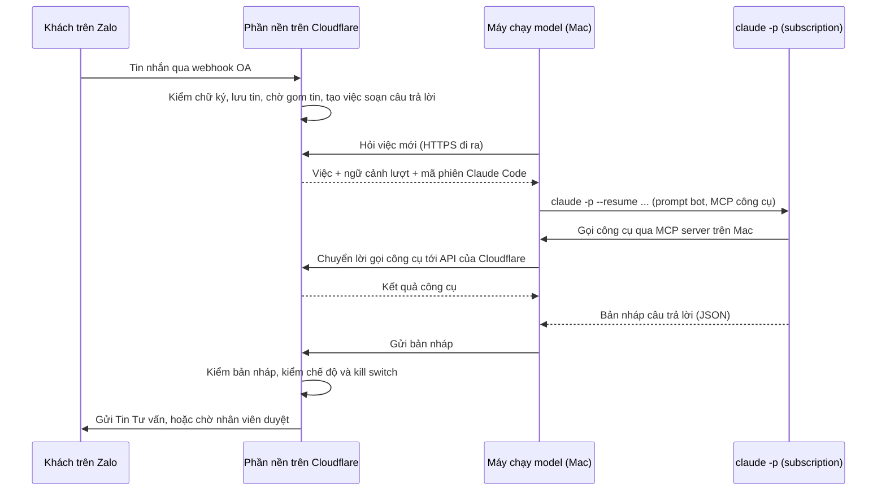

# Chạy model bằng subscription Claude, theo cách của Kai

Ngày viết: 2026-11-07. Trạng thái: bản thiết kế, chưa có code chạy thật; phần gọi model đã chạy thử trên 132 câu thử ([report/ket-qua-chay-thu-opus-5-5.md](../report/ket-qua-chay-thu-opus-5-5.md)).

## Phần anh cần duyệt

### Anh đã quyết gì?

Ngày 2026-11-07, anh quyết chatbot gọi model Opus 5.5 hoàn toàn bằng subscription Claude qua lệnh `claude -p`, giống project Kai, kể cả khi bot tự gửi tin cho khách. Bot không dùng API key của Claude Console. Anh chấp nhận rủi ro tài khoản bị khóa vì trái điều khoản, và các hạn chế về hạn mức tuần, đăng nhập và máy chạy. Anh cũng yêu cầu bot dùng được nhiều tài khoản subscription và đổi qua lại giữa các tài khoản đó: khi một tài khoản hết hạn mức hay hết đăng nhập, bot chuyển sang tài khoản khác, và anh chọn tay được tài khoản bot đang dùng.

Quyết định này đổi một phần của thiết kế trước. Phần nhận tin Zalo, lưu hội thoại, kiểm bản nháp trước khi gửi, gửi tin và chạy lịch chăm sóc vẫn nằm trên Cloudflare. Phần gọi model chuyển từ Cloudflare về một máy Mac có đăng nhập Claude Code. Theo báo cáo chính, tin cảm ơn, hỏi thăm và khuyến mãi đi bằng mẫu tin soạn sẵn mà Zalo duyệt trước (mẫu ZBS), không gọi model, nên các tin này không bị ảnh hưởng khi subscription gặp sự cố.

### Rủi ro đã chấp nhận là gì?

Trang pháp lý của Claude Code cấm "route requests through Free, Pro, Max, or Ultra plan credentials on behalf of their users" và ghi Anthropic có thể thực thi mà không báo trước ([code.claude.com/docs/en/legal-and-compliance](https://code.claude.com/docs/en/legal-and-compliance), đọc ngày 2026-11-07 trong [research/05-anthropic-plan-model-cost.md](../research/05-anthropic-plan-model-cost.md)). Chatbot trả lời khách của studio, nên rơi đúng trường hợp bị cấm. Khi tài khoản bị khóa, bot ngừng soạn câu trả lời và người dùng tài khoản đó mất quyền dùng Claude.

Consumer Terms, điều khoản của các gói subscription, còn hai điểm liên quan theo research/05. Mục 3 cấm truy cập dịch vụ bằng bot hay script, trừ khi dùng API key. Mục 2 cấm cho người khác dùng tài khoản. Vì vậy, một tài khoản riêng cho bot vẫn trái điều khoản như tài khoản của anh. Theo suy luận của tôi từ câu chữ của mục 2, việc nhân viên đăng nhập lại tài khoản của bot cũng có thể bị coi là cho người khác dùng tài khoản.

Thiết kế dưới đây không làm mất rủi ro này. Thiết kế chỉ làm bốn việc: cho bot đổi qua lại giữa nhiều tài khoản subscription, để một tài khoản hết hạn mức hay bị khóa không làm dừng bot; tách các tài khoản của bot khỏi tài khoản anh dùng hằng ngày nếu anh muốn; chuyển mọi tin sang nhân viên khi không còn tài khoản nào dùng được; và giữ đường dự phòng bằng API key để bật khi cần.

### Anh cần quyết thêm gì?

Việc thứ nhất: nhóm tài khoản của bot gồm những tài khoản nào và theo thứ tự nào. Bot dùng tài khoản đứng đầu còn dùng được, và chuyển sang tài khoản kế tiếp khi tài khoản đó hết hạn mức hay hết đăng nhập. Tôi đề xuất xếp tài khoản Ultra anlnt26101997@gmail.com đứng đầu và tài khoản Max luuphuc6297@gmail.com đứng sau, vì hai tài khoản này đã có sẵn. Điểm yếu: hai tài khoản này cũng là tài khoản anh dùng cho Kai và cho lập trình, nên bot và việc của anh cùng trừ một hạn mức tuần, và một lần khóa tài khoản làm dừng cả hai. Nếu anh thêm một tài khoản riêng của bot, đăng ký bằng email của studio, và xếp lên đầu, việc của anh ít bị ảnh hưởng hơn, đổi lại anh trả thêm một gói mỗi tháng. Mục "Bot đổi tài khoản thế nào?" bên dưới mô tả cách đổi.

Việc thứ hai: máy nào chạy model. Tôi đề xuất một máy Mac để bật liên tục ở studio, không dùng làm máy làm việc. Mục "Máy nào chạy model?" bên dưới so sánh các lựa chọn.

## Các thuật ngữ dùng trong tài liệu

| Thuật ngữ | Nghĩa trong tài liệu này |
|---|---|
| subscription | Gói trả theo tháng của Claude (Pro, Max, Ultra), dùng bằng đăng nhập tài khoản claude.ai thay cho API key |
| `claude -p` | Lệnh chạy Claude Code một lần không cần màn hình tương tác: nhận một tin, trả một câu trả lời dạng JSON |
| máy chạy model | Máy Mac có cài Claude Code và đăng nhập các tài khoản trong nhóm tài khoản, nhận việc soạn câu trả lời từ Cloudflare rồi gọi `claude -p` |
| nhóm tài khoản | Danh sách các tài khoản subscription bot được dùng, có thứ tự ưu tiên; bot dùng tài khoản đứng đầu còn dùng được |
| thư mục cấu hình | Thư mục Claude Code lưu cài đặt và đăng nhập, chọn bằng biến môi trường `CLAUDE_CONFIG_DIR`. Mỗi tài khoản trong nhóm có một thư mục cấu hình riêng |
| phần nền trên Cloudflare | Phần chạy liên tục đã thiết kế trong [research/06-architecture.md](../research/06-architecture.md): nhận webhook Zalo, lưu hội thoại, kiểm bản nháp, gửi tin, chạy lịch |
| Durable Object `Conversation` | Đối tượng trên Cloudflare xử lý lần lượt từng việc của một khách, theo research/06; mỗi khách có một đối tượng riêng |
| MCP server | Chương trình cung cấp công cụ cho Claude Code theo chuẩn MCP (Model Context Protocol). Khi soạn bằng `claude -p`, Claude Code gọi tám công cụ của bot qua chương trình này. Phòng hai bot (có từ 2026-11-12) dùng một chương trình khác, đưa ra chín công cụ, thêm công cụ đọc hồ sơ khách `get_customer_profile` |
| hạn mức tuần | Lượng dùng Claude tối đa mỗi tuần của một gói. Khi chạm hạn mức, `claude -p` trả lỗi cho tới khi hạn mức được đặt lại; lượt chạy thử chưa gặp lỗi này |
| phiên Claude Code | Một cuộc hội thoại Claude Code có mã riêng, lưu trên máy chạy model; cờ `--resume` nối tin mới vào phiên cũ |
| thời hạn giữ việc | Thời điểm mà tới đó máy chạy model phải trả bản nháp cho một việc đã nhận, ghi ở trường `lease_until` của bảng `jobs` trong research/06 |
| kill switch | Cờ cấu hình cho phép dừng ngay một loại hành động tự động, như bảng kill switch trong research/06 |

## Một tin của khách đi qua hệ thống thế nào?

Khi khách nhắn OA, phần nền trên Cloudflare nhận webhook, kiểm chữ ký và lưu tin như research/06. Sau khoảng chờ gom tin (mặc định 10 giây trong research/06), Durable Object `Conversation` của khách đó tạo một việc soạn câu trả lời. Tôi đề xuất ghi việc này vào bảng `jobs` với một `job_type` mới, ví dụ `draft_reply`; research/06 hiện chỉ dùng bảng `jobs` cho việc hẹn giờ như tin cảm ơn và quét hộp thư. Máy chạy model hỏi Cloudflare có việc mới không, qua HTTPS đi ra ngoài, nên không cần mở port hay tunnel vào máy Mac. Khi máy chạy model nhận một việc, Cloudflare ghi thời hạn giữ việc. Trong thời hạn đó, Durable Object `Conversation` không giao việc thứ hai của cùng khách, nên hai lượt trả lời của một khách không được soạn song song.

Máy chạy model gọi `claude -p` với prompt của bot. Tám công cụ của bot do một MCP server chạy trên máy Mac cung cấp. MCP server này không giữ dữ liệu mà chuyển từng lời gọi tới API của phần nền trên Cloudflare. Nhờ vậy, Cloudflare vẫn kiểm mọi quyền ghi (ghi yêu cầu đặt lịch, chuyển nhân viên, ghi ý muốn nhận tin) như thiết kế cũ. Khi `claude -p` trả kết quả, máy chạy model gửi bản nháp về Cloudflare. Cloudflare đọc lại kill switch, chạy bước kiểm bản nháp (giá, từ cấm, định dạng, lời hứa đặt lịch), rồi gửi tin hoặc đưa vào hàng chờ nhân viên duyệt theo giá trị của `auto_reply_mode`.



### Người dựng hệ thống còn phải chốt gì ở luồng này?

Research/06 viết cho trường hợp Cloudflare tự gọi model, nên bốn vấn đề dưới đây chưa có thiết kế. Cách xử lý ghi ở từng vấn đề là đề xuất của tôi, chưa có code và chưa chạy thử.

- Máy chạy model và MCP server xác thực với Cloudflare bằng một token riêng cho máy chạy model, lưu trong Keychain của macOS. Cloudflare chỉ nhận lời gọi công cụ cho đúng hội thoại của việc đang giữ: máy chạy model ghi mã việc vào file `--mcp-config` của từng lần gọi, và Cloudflare từ chối lời gọi khi việc đó đã hết thời hạn giữ hoặc thuộc hội thoại khác. Nhờ vậy, một tin của khách có chèn lời dặn bot (prompt injection) không làm bot ghi vào hồ sơ của khách khác. Anh phải thu hồi được token này từ app desktop khi máy Mac bị mất.
- Khi hết thời hạn giữ việc mà Cloudflare chưa nhận bản nháp, ví dụ vì máy chạy model chết giữa chừng, Cloudflare chuyển tin sang hàng chờ nhân viên và từ chối bản nháp tới muộn của việc đó. Thời hạn giữ việc phải dài hơn thời gian tối đa của một lần gọi `claude -p` (60 giây, mục "Khi máy chạy model hỏng thì sao?"). Trước khi chết, `claude -p` có thể đã gọi một công cụ ghi, ví dụ ghi yêu cầu đặt lịch. Vì vậy, mỗi lời gọi công cụ ghi phải mang khóa chống ghi trùng, ví dụ mã việc cộng tên công cụ, theo cách `idempotency_key` của research/06.
- Phiên Claude Code chỉ nhớ bản nháp model viết, không nhớ tin đã tới tay khách. Khi khách nhắn thêm lúc bot đang soạn, research/06 bỏ bản nháp cũ và soạn lại một lần với cả tin mới, nhưng bản nháp bị bỏ vẫn nằm trong phiên. Khi nhân viên sửa bản nháp trước khi gửi hay tự trả lời, phiên cũng không biết. Tôi đề xuất Cloudflare ghi vào ngữ cảnh của lượt sau các tin Cloudflare đã gửi cho khách kể từ lượt trước, và ghi rõ bản nháp nào không được gửi.
- Bảng `messages` trong research/06 có cột `model`, `input_tokens` và `output_tokens`. Máy chạy model gửi kèm bản nháp số token và giá quy đổi theo API của lượt đó, để Cloudflare điền các cột này và anh theo dõi được lượng dùng.

## Lệnh `claude -p` phải chạy với những cờ nào?

Lượt chạy thử ngày 2026-11-07 cho thấy phiên của bot phải được cách ly khỏi cài đặt của máy. Nếu không, quy tắc viết trong `~/.claude/CLAUDE.md` của người dùng máy lọt vào phiên và đổi giọng của bot. Mỗi lần gọi dùng đủ các cờ sau, giống `scripts/eval/run_eval_cli.py`:

| Cờ hoặc biến môi trường | Tác dụng |
|---|---|
| `--system-prompt` | Thay system prompt của Claude Code bằng prompt của bot |
| `--tools ""` | Tắt mọi công cụ có sẵn của Claude Code (Bash, đọc ghi file, web) |
| `--mcp-config` và `--strict-mcp-config` | Chỉ nạp MCP server công cụ của bot, bỏ qua mọi MCP server khác trên máy |
| `--allowedTools mcp__thom` | Cho bot gọi công cụ của chính bot mà không bị hỏi quyền |
| `--setting-sources project` | Chỉ nạp cài đặt cấp project, bỏ cài đặt người dùng như hook và plugin; lượt chạy thử cho thấy cờ này không chặn được `~/.claude/CLAUDE.md` |
| `CLAUDE_CODE_DISABLE_CLAUDE_MDS=1` | Không nạp file CLAUDE.md nào |
| `CLAUDE_CODE_DISABLE_AUTO_MEMORY=1` | Không nạp và không ghi bộ nhớ tự động |
| `--model claude-opus-5-5 --effort low` | Model và mức suy nghĩ đã đo |
| `--output-format json` | Trả kết quả dạng JSON để đọc lỗi, mã phiên, số token và giá quy đổi theo API |
| `--resume <mã phiên>` | Nối tin mới vào phiên của hội thoại này |
| stdin đóng, `--` trước nội dung tin | Chặn hai lỗi Kai đã gặp: nội dung stdin bị đọc thành một phần tin, và tin bắt đầu bằng dấu gạch bị hiểu là cờ |

Mỗi hội thoại Zalo có một thư mục làm việc riêng trên máy chạy model. Claude Code lấy đường dẫn thư mục làm việc để đặt tên thư mục lưu phiên trong `~/.claude/projects` (thấy trên máy này sau lượt chạy thử). Vì vậy, tôi đề xuất đặt tên thư mục làm việc theo mã hội thoại nội bộ, không theo `zalo_user_id`. Máy chạy model đọc cả mã thoát lẫn trường `is_error` trong JSON, vì Kai từng gặp lỗi đăng nhập trả mã thoát 0 kèm `is_error: true`.

Trường `total_cost_usd` là giá quy đổi theo API, không phải tiền anh trả. Với `--resume`, trường này là tổng của cả phiên, nên máy chạy model phải lấy hiệu giữa hai lần gọi liên tiếp trong cùng phiên. Script chạy thử ban đầu cộng thẳng trường này nên tính dư giá ở 13 lượt nối tiếp. Lượt rà độc lập ngày 2026-11-07 phát hiện lỗi đó, và `scripts/eval/run_eval_cli.py` hiện đã trừ phần của các lượt trước.

Hai cờ khác ảnh hưởng tới thiết kế, theo `claude --help` của Claude Code 2.1.319; tôi chưa chạy thử cờ nào trong hai cờ này. Cờ `--system-prompt-snapshot` mặc định là `on`: Claude Code ghi system prompt ở request đầu của phiên, rồi gửi lại đúng bản đó ở mọi lần `--resume`, kể cả khi lần gọi sau truyền prompt khác. Prompt của bot chứa danh mục dịch vụ (khối B trong `scripts/eval/run_eval.py`), nên khi anh duyệt bảng giá hay danh mục mới, các phiên đang mở vẫn dùng danh mục cũ. Bước kiểm bản nháp so giá với bảng giá đang dùng nên chặn được giá cũ, nhưng không chặn được mô tả dịch vụ cũ. Tôi đề xuất bỏ mọi phiên đang mở khi `catalog_version` đổi; cách khác là truyền `--system-prompt-snapshot off`. Cờ thứ hai là `--bare`: cờ này cũng tắt CLAUDE.md, hook và bộ nhớ tự động, nhưng chỉ nhận API key và không đọc đăng nhập subscription, nên máy chạy model không dùng được cờ này.

## Phiên Claude Code của mỗi khách sống bao lâu?

Mỗi hội thoại Zalo dùng một phiên Claude Code, nối bằng `--resume`, để bot nhớ các tin trước mà không phải gửi lại prompt mỗi lần. Kai đo được phiên nối mãi thì phình to: một phiên 43 lượt gửi lại khoảng 95.000 token mỗi câu hỏi (`~/Projects/kai/packages/core/src/kai/config.py`), và Kai bỏ phiên sau 30 lượt. Hai phần ba số token đó là tiếng TV bị phiên âm nhầm, nên hội thoại Zalo có thể phình chậm hơn; tôi chưa đo. Dù vậy, phiên của bot cũng phải có tuổi. Tôi đề xuất bỏ phiên và mở phiên mới khi phiên quá 20 tin của khách, khi khách im lặng quá 24 giờ, khi nhân viên trả hội thoại lại cho bot, hoặc khi `catalog_version` đổi. Phiên mới nhận tóm tắt các tin gần nhất từ cơ sở dữ liệu trên Cloudflare, vì cơ sở dữ liệu mới là nơi lưu hội thoại chính thức.

Phiên Claude Code lưu toàn bộ tin nhắn của khách thành file trên máy chạy model, trong thư mục `~/.claude/projects`. Các file này là dữ liệu cá nhân, có thể gồm thông tin sức khỏe, nên phải có ba việc: mã hóa ổ đĩa bằng FileVault, xóa file phiên khi bỏ phiên, và xóa mọi file phiên của một khách khi khách yêu cầu xóa dữ liệu. Số ngày giữ file phải khớp chính sách lưu dữ liệu mà luật sư duyệt.

Máy chạy model phải tự viết phần xóa file phiên. Hàm `forget_session` của Kai chỉ xóa file ghi mã phiên của Kai, không xóa file phiên trong `~/.claude/projects`. Tài liệu của Kai cũng ghi cách Claude Code xếp file trong thư mục này là chuyện nội bộ của Claude Code, không có cam kết giữ nguyên (`kai-nuro/08 Data/Entities/DATA-103-truc-session-json.md`). `claude --help` có lệnh `claude purge [path]` để xóa transcript và dữ liệu khác của một thư mục project trên máy; tôi chưa chạy lệnh này. Nếu máy chạy model được sao lưu bằng Time Machine, bản sao lưu vẫn giữ file phiên sau khi xóa, nên thư mục này phải nằm ngoài phạm vi sao lưu.

## Máy nào chạy model?

| Lựa chọn | Điểm mạnh | Điểm yếu |
|---|---|---|
| Máy Mac nhân viên đang dùng để duyệt tin | Không mua thêm máy | Máy ngủ, tắt hay mất mạng thì bot ngừng soạn; Claude Code trên máy làm việc dễ bị lẫn cài đặt và đăng nhập của người dùng máy |
| Một máy Mac riêng bật liên tục ở studio | Tách khỏi máy làm việc; dễ cài, dễ đăng nhập lại; không giữ token đăng nhập trên máy chủ thuê | Mua thêm máy; mất điện hay mất mạng ở studio thì bot ngừng |
| Máy chủ thuê (VPS) dùng `claude setup-token` | Chạy liên tục, không phụ thuộc điện và mạng ở studio | Token đăng nhập dài hạn nằm trên máy chủ thuê; theo suy luận của tôi, chưa có nguồn, đăng nhập từ trung tâm dữ liệu dễ bị nhìn như tự động hóa; phải tự vá hệ điều hành |

Lệnh `claude setup-token` tạo một token đăng nhập dài hạn và đòi tài khoản có subscription (`claude setup-token --help`, Claude Code 2.1.319). Tôi chưa thử lệnh này, chưa biết token sống bao lâu và chưa biết máy chạy model nạp token bằng cách nào.

Tôi đề xuất một máy Mac riêng bật liên tục ở studio, tắt chế độ ngủ, cắm điện qua bộ lưu điện. Lý do: máy này giữ đăng nhập Claude ở nơi anh kiểm soát, và khi đăng nhập hết hạn, nhân viên ở studio đăng nhập lại được ngay. Điểm yếu: muốn đăng nhập lại, nhân viên phải biết mật khẩu hoặc vào được email của tài khoản bot, và việc này chạm vào mục 2 của Consumer Terms đã nêu ở phần rủi ro.

## Bot đổi tài khoản thế nào?

Claude Code giữ một đăng nhập cho mỗi thư mục cấu hình. Ngày 2026-11-07, tôi kiểm trên máy này: với một thư mục cấu hình mới, `claude auth status` báo chưa đăng nhập, trong khi thư mục mặc định `~/.claude` vẫn đăng nhập anlnt26101997@gmail.com, và Keychain có một mục đăng nhập riêng cho mỗi thư mục. Vì vậy, đổi tài khoản chỉ là đổi biến `CLAUDE_CONFIG_DIR` cho từng lần gọi `claude -p`; không phải đăng xuất rồi đăng nhập lại như tôi nhờ anh làm hôm nay.

Bộ chọn tài khoản nằm ở [scripts/runner/claude_pool.py](../scripts/runner/claude_pool.py). Mỗi tài khoản được thêm vào nhóm một lần, rồi đăng nhập một lần trong trình duyệt:

```bash
python3 scripts/runner/claude_pool.py add ultra-anlnt --priority 1
```

```bash
CLAUDE_CONFIG_DIR=~/.thomhouse-bot/accounts/ultra-anlnt claude auth login
```

Mỗi lần gọi, bộ chọn lấy tài khoản đứng đầu còn dùng được. Khi lần gọi lỗi, bộ chọn đọc nội dung lỗi để quyết có đổi tài khoản hay không:

| Lỗi | Bộ chọn làm gì |
|---|---|
| Hết hạn mức (ví dụ "You've hit your weekly limit · resets Nov 11 at 2pm") | Đánh dấu tài khoản tạm nghỉ tới giờ đặt lại đọc từ thông báo, rồi gọi lại bằng tài khoản kế tiếp. Tới giờ đặt lại, tài khoản tự dùng được trở lại. Nếu thông báo không có giờ, bộ chọn cho nghỉ 1 giờ |
| Hết đăng nhập ("Not logged in", `oauth`, `401`) | Đánh dấu tài khoản cần đăng nhập lại, gọi lại bằng tài khoản kế tiếp. Tài khoản này chỉ dùng lại sau khi có người đăng nhập và chạy `claude_pool.py reset` |
| Có dấu hiệu bị khóa (`403`, `forbidden`, `suspended`) | Đánh dấu bị khóa, gọi lại bằng tài khoản kế tiếp, chờ anh xem |
| Lỗi khác (phiên hỏng, model lỗi, quá giờ) | Không đổi tài khoản, vì lỗi không do tài khoản; trả lỗi để máy chạy model xử lý như mục sau |

Khi không còn tài khoản nào dùng được, bộ chọn trả lỗi "no usable Claude account", và Cloudflare chuyển tin sang nhân viên. Anh chọn tay tài khoản bằng `claude_pool.py use <tên>` và trả về chế độ tự chọn bằng `claude_pool.py use auto`. Tài khoản chọn tay vẫn bị bỏ qua nếu đang hết hạn mức hay hết đăng nhập. Lệnh `claude_pool.py status` cho biết từng tài khoản đang đăng nhập email nào, gói gì, đang dùng được hay đang nghỉ tới khi nào. Sau này app desktop sẽ gọi các lệnh này thay cho dòng lệnh.

Bộ chọn bỏ biến `ANTHROPIC_API_KEY` và `ANTHROPIC_AUTH_TOKEN` khỏi môi trường của mỗi lần gọi. Lý do: hai biến này được Claude Code ưu tiên hơn đăng nhập subscription, nên nếu lỡ đặt trên máy, bot sẽ âm thầm trả tiền theo token.

Thư mục `projects/` của mọi tài khoản trong nhóm trỏ về một thư mục phiên chung `~/.thomhouse-bot/sessions`. Mục đích: một hội thoại bắt đầu trên tài khoản này vẫn nối được bằng `--resume` khi lượt sau chạy trên tài khoản khác. Tôi chưa thử được việc này vì máy chỉ có một tài khoản đăng nhập. Nếu `--resume` không chạy qua tài khoản khác, máy chạy model mở phiên mới kèm tóm tắt từ cơ sở dữ liệu, như khi phiên hỏng.

Tôi đã chạy thử bộ chọn ngày 2026-11-07 trong một thư mục thử. Nhóm có hai tài khoản: một tài khoản chưa đăng nhập xếp đầu, và tài khoản anlnt26101997@gmail.com xếp sau. Bộ chọn đánh dấu tài khoản đầu cần đăng nhập lại, gọi lại bằng tài khoản sau, và bot trả lời sau 4,5 giây. Khi tôi chọn tay tài khoản chưa đăng nhập, bộ chọn vẫn dùng tài khoản còn dùng được. Hai câu thử nhiều lượt chạy qua bộ chọn bằng `run_eval_cli.py --pool` cũng trả lời đủ. Tôi thử phần đọc giờ đặt lại trên đúng thông báo lỗi tài khoản Max gặp hôm nay, và bộ chọn đọc ra 14:00 ngày 11/11.

## Khi máy chạy model hỏng thì sao?

Máy chạy model phân loại từng lỗi theo nguyên nhân rồi xử lý riêng từng loại, theo cách hàm `_brain_failure` của Kai phân loại lỗi (`~/Projects/kai/apps/truc/truc.py`). Ở mọi loại lỗi, hệ thống không gửi cho khách câu trả lời rỗng hay lời báo lỗi kỹ thuật. Các ngưỡng thời gian trong bảng là giá trị tôi đề xuất, chưa đo.

| Lỗi | Dấu hiệu | Hệ thống làm gì |
|---|---|---|
| Đăng nhập hết hạn | Kết quả lỗi có `oauth`, `authenticate`, `unauthorized` hoặc `401`, theo danh sách của Kai | Bộ chọn tài khoản chuyển sang tài khoản kế tiếp và giữ phiên. Khi không còn tài khoản nào dùng được, máy chạy model ngừng nhận việc mới và Cloudflare chuyển mọi tin mới sang hàng chờ nhân viên. App desktop báo tài khoản nào hết đăng nhập và lệnh đăng nhập lại của tài khoản đó |
| Hết hạn mức | Kết quả lỗi có `429`, `rate limit`, `usage limit`, `limit reached` hoặc `quota`, gộp danh sách của Kai và của script chạy thử | Bộ chọn tài khoản cho tài khoản đó nghỉ tới giờ đặt lại và chuyển sang tài khoản kế tiếp. Khi mọi tài khoản đều đang nghỉ, tin chuyển sang nhân viên như dòng trên, và app desktop hiện giờ đặt lại sớm nhất. Thông báo hết hạn mức tuần có giờ đặt lại, ví dụ "resets Nov 11 at 2pm (Asia/Saigon)" |
| Tài khoản bị khóa | Lỗi quyền hoặc lỗi tài khoản vẫn còn sau khi đăng nhập lại; chưa ai thấy thông báo lỗi thật của trường hợp này | Bộ chọn bỏ tài khoản đó ra và dùng tài khoản kế tiếp; anh xem lại tài khoản bị khóa. Khi không còn tài khoản nào, anh quyết bật đường dự phòng bằng API key hay để nhân viên trả lời tay |
| Máy chạy model mất kết nối | Cloudflare không nhận lời hỏi việc quá 2 phút | Cloudflare tự chuyển tin sang hàng chờ nhân viên, kể cả tin của việc đã hết thời hạn giữ |
| Một lần gọi chậm | `claude -p` chạy quá 60 giây | Máy chạy model dừng lần gọi đó và Cloudflare chuyển tin đó cho nhân viên. Kai đặt mức này là 120 giây, script chạy thử đặt 600 giây |
| Phiên hỏng | Lỗi không thuộc các loại trên khi gọi với `--resume` | Máy chạy model bỏ phiên như Kai làm, rồi thử lại một lần với phiên mới và tóm tắt từ cơ sở dữ liệu. Kai không thử lại trong cùng lượt; bước thử lại là đề xuất của tôi |

Khi tin chuyển sang nhân viên ngoài giờ làm việc, Cloudflare gửi một tin cố định do server soạn, không do model soạn, báo khách là nhân viên sẽ trả lời. Tin này dùng câu chữ anh duyệt trước.

## Cần thêm kill switch nào?

Thiết kế cũ có các cờ `auto_reply_mode` và `ai_calls_enabled` ([research/06-architecture.md](../research/06-architecture.md), mục kill switch). Tôi đề xuất thêm cờ `ai_engine` để chọn nơi soạn câu trả lời:

| Giá trị của `ai_engine` | Hệ thống làm gì |
|---|---|
| `subscription` | Máy chạy model soạn câu trả lời bằng `claude -p`. Đây là giá trị mặc định theo quyết định của anh |
| `api_key` | Phần nền trên Cloudflare gọi Messages API bằng API key của Console, như thiết kế cũ. Chỉ bật được khi đã có API key; dùng khi tài khoản subscription bị khóa |
| `off` | Không gọi model; mọi tin vào hàng chờ nhân viên |

Giá trị `off` trùng việc với `ai_calls_enabled = false`. Tôi đề xuất `ai_calls_enabled = false` luôn thắng: khi cờ này là `false`, hệ thống không gọi model dù `ai_engine` mang giá trị nào. Cloudflare đọc cả hai cờ lúc tạo việc và lúc nhận bản nháp về. Nếu một trong hai cờ đổi trong lúc máy chạy model đang soạn, bản nháp vào hàng chờ nhân viên thay vì được gửi.

Tôi đề xuất viết sẵn đường `api_key` và chạy thử bằng `scripts/eval/run_eval.py`, nhưng không bật. Hiện phần nền chưa có code cho đường này, và bộ câu thử chưa chạy qua API key vì chưa có key. Lý do giữ: nếu tài khoản bị khóa, chuyển `ai_engine` sang `api_key` có thể cho bot chạy lại trong vài phút, thay vì mất vài tuần viết code (ước tính). Điều kiện là anh đã tạo tổ chức Console và API key từ trước, như báo cáo chính mô tả.

## Hạn mức tuần có đủ không?

Tôi chưa trả lời được. Tôi chưa tìm thấy nơi Anthropic công bố hạn mức tuần theo số token hay số tiền, nên tôi không quy đổi được lượng dùng của bot thành phần trăm hạn mức.

Hiện có một số đo và một ước tính. Số đo: mỗi lượt trả lời ở mức `low` tốn khoảng 0,026 USD nếu tính theo giá API. Ước tính: nếu mỗi tháng có 3.000 lượt (giả định 1.000 cuộc hội thoại, mỗi cuộc 3 tin khách, như báo cáo chạy thử), tổng tương đương khoảng 78 USD, tức khoảng 18 USD mỗi tuần.

Ngày 2026-11-07, máy này chạy ba lượt đủ 132 câu thử kèm lượt chấm và hai lượt thử 6 câu, bằng tài khoản anlnt26101997@gmail.com mà báo cáo chạy thử ghi, và chưa chạm hạn mức. Theo các file `summary.json` trong `results/`, tổng các lượt này tương đương khoảng 23 USD theo giá API; số này hơi cao vì lỗi cộng dồn giá đã nêu ở mục cờ. Cùng ngày, tài khoản luuphuc6297@gmail.com (Max 20x) đã chạm hạn mức tuần vì việc khác; thông tin này chưa được ghi trong repo. Hai sự việc này cho thấy hạn mức có thể bị chạm thật, nhưng chưa cho biết bot dùng hết bao nhiêu phần hạn mức.

Cách biết chắc là đo: cho bot chạy ở chế độ soạn nháp với tin thật trong một tuần, ghi lại phần trăm hạn mức mà trang cài đặt Claude hiển thị mỗi ngày. Khi bot chạy bằng subscription, dòng cảnh báo chi phí Claude trong research/06 nên đổi thành cảnh báo theo phần trăm hạn mức tuần.

## Khách phải chờ bao lâu?

Lượt chạy thử đo được thời gian một lượt trả lời từ lúc gọi `claude -p` tới lúc có kết quả: trung vị 7,3 giây, 95% lượt dưới 11,0 giây ở mức suy nghĩ `low`. Thời gian này gồm cả lúc khởi động Claude Code. Trước đó, khách còn chờ khoảng gom tin 10 giây mà research/06 đặt mặc định; sau đó là thời gian máy chạy model hỏi việc và gửi bản nháp về Cloudflare. Theo ước tính của tôi, chưa đo, khách nhận câu trả lời sau khoảng 20 đến 25 giây khi bot tự gửi. Ở chế độ nhân viên duyệt, khách chờ thêm thời gian nhân viên duyệt.

Mỗi lượt chạy thử chạy 3 câu thử song song (`--workers` mặc định là 3), và lượt mức `low` chạy cùng lúc với lượt mức `medium`: hai thư mục kết quả được tạo cách nhau 2 giây và xong lúc 07:51 và 07:52. Theo suy luận từ các mốc giờ này, tài khoản đã chạy tới khoảng 6 lần gọi `claude -p` cùng lúc mà không gặp lỗi; script không ghi số lần gọi đồng thời. Máy chạy model nên giới hạn 3 lần gọi `claude -p` cùng lúc cho tới khi đo được giới hạn thật.

## Những tài liệu nào đã đổi theo quyết định này?

[report/bao-cao-chatbot-thomhouse.md](../report/bao-cao-chatbot-thomhouse.md) có ghi chú ở đầu về quyết định này; các đoạn về tổ chức Console, tín dụng API và chi phí model ở báo cáo đó là phương án dự phòng. [research/06-architecture.md](../research/06-architecture.md) có ghi chú ở đầu chỉ tới tài liệu này cho phần gọi model; các phần khác của kiến trúc giữ nguyên, trừ các phần tài liệu này bổ sung (việc `draft_reply` trong bảng `jobs`, cờ `ai_engine`, API cho máy chạy model).

Pháp lý Việt Nam không đổi: tin của khách vẫn được gửi sang Anthropic và Cloudflare ở nước ngoài, nên hồ sơ chuyển dữ liệu ra nước ngoài vẫn cần. Cam kết dữ liệu của Anthropic thì đổi. Báo cáo chính đề xuất chính sách dữ liệu của studio ghi Anthropic xóa dữ liệu trong 30 ngày, và dẫn Commercial Terms mục B cấm Anthropic huấn luyện model trên dữ liệu khách hàng doanh nghiệp. Các nguồn đó áp cho API và tổ chức Console; tin đi qua `claude -p` trên subscription thuộc Consumer Terms. Tôi chưa đọc chính sách lưu dữ liệu và huấn luyện model của gói subscription, nên luật sư cần biết thay đổi này trước khi duyệt chính sách dữ liệu.

## Những gì chưa kiểm

Tôi chưa viết máy chạy model và MCP server chuyển tiếp tới Cloudflare; bộ chọn tài khoản đã viết và đã chạy thử với một tài khoản đăng nhập. Tôi chưa thử `--resume` nối một phiên qua hai tài khoản khác nhau; lượt chạy thử dùng MCP server với dữ liệu giả lập. Tôi chưa thử `claude setup-token`, `claude purge`, `--system-prompt-snapshot off` và chưa đo phần trăm hạn mức tuần bot dùng. Tôi chưa thấy thông báo lỗi thật khi hết hạn mức hay khi tài khoản bị khóa. Tôi chưa thử điều gì xảy ra khi nhiều phiên `--resume` chạy song song trên một tài khoản trong nhiều ngày, và chưa đọc chính sách dữ liệu của gói subscription. Việc Anthropic có phát hiện và khóa cách dùng này hay không là điều không kiểm trước được.

## Nói ngắn gọn nhất

Theo quyết định của anh, bot gọi Opus 5.5 bằng `claude -p` trên subscription, chạy trên một máy Mac riêng bật liên tục ở studio, và dùng một nhóm tài khoản subscription. Mỗi tài khoản có thư mục cấu hình và đăng nhập riêng; khi một tài khoản hết hạn mức hay hết đăng nhập, bộ chọn tài khoản tự chuyển sang tài khoản kế tiếp, và anh chọn tay được tài khoản đang dùng. Phần nhận tin, kiểm bản nháp, gửi tin và lịch chăm sóc vẫn chạy trên Cloudflare, nên khi không còn tài khoản nào dùng được, mọi tin tự chuyển sang nhân viên và tin chăm sóc vẫn gửi đúng lịch. Cách này không trả tiền model theo token, nhưng tốn thêm một máy Mac, và trái điều khoản của Anthropic, nên từng tài khoản trong nhóm có thể bị khóa bất cứ lúc nào. Anh cần quyết nhóm tài khoản gồm những tài khoản nào và theo thứ tự nào, rồi quyết máy nào chạy model.
