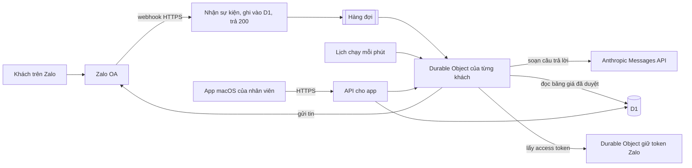

# Chatbot Zalo OA cho thom house: báo cáo để anh quyết định

Ngày lập: 2026-11-07. Người đọc: anh, chủ thom house healing studio. Báo cáo gom kết quả của bảy nhánh nghiên cứu và một lượt đối chiếu chéo trong thư mục [research/](../research/), bản thiết kế trong [design/](../design/), dữ liệu trong [data/](../data/) và các script trong [scripts/](../scripts/). Mọi trang web được dẫn đều được các nhánh mở ngày 2026-11-07.

## Cập nhật ngày 2026-11-07: anh chọn chạy model bằng subscription

Sau khi đọc báo cáo này, anh quyết bot gọi Opus 5.5 hoàn toàn bằng subscription Claude qua lệnh `claude -p`, giống project Kai, kể cả khi bot tự gửi tin cho khách, và chấp nhận rủi ro tài khoản bị khóa vì trái điều khoản của Anthropic. Thiết kế phần gọi model theo quyết định này nằm ở [design/subscription-runner.md](../design/subscription-runner.md). Theo quyết định này, các đoạn bên dưới về tổ chức Console, tín dụng API, API key và tiền model giờ là phương án dự phòng, dùng khi bật cờ `ai_engine=api_key`. Kết quả chạy thử bot trên 132 câu thử nằm ở [report/ket-qua-chay-thu-opus-5-5.md](ket-qua-chay-thu-opus-5-5.md).

Ba đoạn bên dưới đã cũ so với quyết định này. Thứ nhất, câu "chưa ai gọi model" ở mục điểm yếu không còn đúng, vì model đã chạy thử trên 132 câu. Thứ hai, bảng chi phí chưa có hai khoản mới: một máy Mac bật liên tục để chạy model, và một gói Claude nếu anh chọn tài khoản riêng cho bot. Thứ ba, đoạn về thời hạn Anthropic lưu dữ liệu và việc Anthropic không huấn luyện model trên dữ liệu khách dựa trên nguồn áp cho API và Commercial Terms. Tin đi qua subscription thuộc Consumer Terms, và tôi chưa đọc chính sách dữ liệu của gói subscription.

## Phần anh cần duyệt

### Tôi đề xuất làm gì?

Tôi đề xuất làm chatbot theo đường chính thức của Zalo và Anthropic, chia làm hai phần. Phần thứ nhất chạy liên tục trên Cloudflare, một dịch vụ cloud trả theo tháng: phần này nhận tin khách gửi vào Zalo OA của studio, gọi model Opus 5.5 để soạn câu trả lời, gửi tin và chạy lịch gửi tin. Phần thứ hai là ứng dụng cài trên máy Mac ở studio: nhân viên đọc hội thoại, duyệt hoặc sửa câu trả lời do model soạn, tự trả lời khi cần, và tắt nhanh một loại tin tự động khi có sự cố.

Ở giai đoạn đầu, bot chỉ soạn nháp và nhân viên duyệt từng tin trước khi gửi. Bot trả lời được menu, giá, các bước của dịch vụ và ghi nhận yêu cầu đặt lịch. Bot không chẩn đoán, không nói dịch vụ chữa hay ngừa bệnh, và chuyển cho nhân viên mọi câu chuyện về mang thai, sau sinh, bệnh nền, thuốc, phản ứng sau buổi làm, khiếu nại và hoàn tiền. Tin cảm ơn, hỏi thăm và khuyến mãi đi bằng mẫu tin Zalo duyệt trước, không do model soạn từng tin.

Gói Ultra của anh không được dùng làm tài khoản đăng nhập cho chatbot, vì điều khoản của Anthropic cấm việc này. Anh vẫn dùng được 200 USD tín dụng API mỗi tháng mà gói Ultra cho, bằng cách liên kết gói với một tổ chức Claude Console của thom house rồi để chatbot gọi model bằng API key của tổ chức đó.

### Đề xuất này tốn bao nhiêu và mất bao lâu?

Theo ước tính, tiền gọi model cho 1.000 cuộc hội thoại mỗi tháng là khoảng 120 USD nếu khối dữ liệu menu gửi kèm mỗi lần gọi được rút gọn còn khoảng 15.000 token, và khoảng 154 USD nếu gửi nguyên file `data/services.json` hiện tại (khoảng 31.700 token); cả hai mức nằm trong 200 USD tín dụng. Nếu model viết câu trả lời và phần suy nghĩ dài hơn giả định cơ bản của mô hình chi phí, con số lên khoảng 206 đến 240 USD và vượt tín dụng. Các khoản cố định khác (gói Zalo OA, Cloudflare, phí Apple cho app Mac, phí mẫu tin Zalo) cộng lại khoảng 680.000đ mỗi tháng. Hai con số này chưa gồm tiền thuê lập trình viên, tiền luật sư và tiền thuê người phụ trách bảo vệ dữ liệu. Từ hôm nay tới lúc bot soạn nháp cho khách thật có nhân viên duyệt, tôi ước tính 6 đến 9 tuần, nếu giấy đăng ký kinh doanh có sẵn và luật sư trả lời kịp.

### Đề xuất này yếu ở đâu?

Đề xuất có bốn điểm yếu anh cần biết trước khi duyệt. Thứ nhất, dữ liệu khách, kể cả chuyện sức khỏe phụ nữ khách kể trong chat, nằm trên máy chủ Cloudflare và Anthropic ở nước ngoài, nên studio phải làm hồ sơ chuyển dữ liệu ra nước ngoài và cần luật sư xem cách xin đồng ý. Thứ hai, công thức Zalo dùng để ký mỗi tin gửi tới chatbot mới chỉ được đọc trong tài liệu, chưa thử trên OA thật, và hai repo tham khảo dùng một công thức khác. Thứ ba, tài liệu của studio có nhiều câu hứa chữa bệnh và tên dịch vụ mang tên bệnh; bot không được nhắc lại các câu đó, và tên dịch vụ vẫn là rủi ro cho tới khi anh quyết đổi hay giữ. Thứ tư, mọi con số chi phí, thời gian và mọi kết luận pháp lý là ước tính hoặc suy luận: chưa ai gọi model, chưa có OA thật và chưa hỏi luật sư.

### Anh cần quyết những việc gì?

Mỗi việc dưới đây cần anh quyết vì việc đó gắn với tiền, với trách nhiệm pháp lý của studio, hoặc với lời lẽ thương hiệu mà chỉ anh có quyền chốt.

1. Anh chọn nơi đặt phần chạy liên tục. Chạy hết trên Mac gần như không tốn tiền, nhưng Mac ngủ hay mất mạng khoảng 1 đến 2 giờ là Zalo tắt đường nhận tin của bot. Cloudflare tốn khoảng 5 USD mỗi tháng và ít việc vận hành, đổi lại dữ liệu nằm ở nước ngoài và code gắn với Cloudflare. Máy chủ riêng (VPS) từ khoảng 6,49 EUR mỗi tháng cho studio kiểm soát dữ liệu, nhưng cần người vá hệ điều hành và sao lưu. Tôi đề xuất Cloudflare, và chỉ dùng Mac để thử nội bộ ([research/06-architecture.md](../research/06-architecture.md)).

2. Anh quyết có bỏ hướng "Claude Desktop cộng Zalo MCP" hay không. Hướng này chạy trên tài khoản Zalo cá nhân qua thư viện không chính thức, nên có rủi ro bị khóa tài khoản và không có tính năng OA; giấy phép repo Arden còn cấm dùng trong kinh doanh khi chưa xin giấy phép thương mại riêng. Tôi đề xuất bỏ hẳn và tự viết một bộ nối OA nhỏ ([research/04-zalo-repos-audit.md](../research/04-zalo-repos-audit.md)).

3. Anh chọn tổ chức Console nhận tín dụng Ultra. Mỗi gói chỉ liên kết một tổ chức và anh không tự đổi được. Nếu anh liên kết một tổ chức Console đang dùng cho việc khác, chatbot và việc khác cùng trừ vào một số dư tín dụng. Tôi đề xuất tạo tổ chức mới tên thom house, đặt hạn mức chi dưới 200 USD cho workspace của chatbot và chưa bật tự nạp tiền. Điểm yếu: hết tín dụng giữa tháng thì bot ngừng soạn tới chu kỳ sau ([research/05-anthropic-plan-model-cost.md](../research/05-anthropic-plan-model-cost.md)).

4. Anh chọn danh mục OA và gói Zalo. Danh mục "Mỹ phẩm và làm đẹp" dành cho spa không điều trị; danh mục "Y tế" đòi giấy phép khám chữa bệnh. Gói Tăng trưởng 2.500.000đ một năm là gói rẻ nhất có API và không hoàn tiền. Tôi đề xuất "Mỹ phẩm và làm đẹp" và gói Tăng trưởng 12 tháng ([research/03-zalo-oa-platform.md](../research/03-zalo-oa-platform.md)).

5. Anh quyết cách xử lý tên dịch vụ và câu mô tả mang tên bệnh, như "Diện chẩn ngừa đột quỵ", "Tiêu u – Thông kinh ngực", "Thiếu máu não", "hỗ trợ chữa sa tử cung". Giữ nguyên và để bot đọc lại menu thì studio có nguy cơ bị phạt vì quảng cáo dịch vụ chữa bệnh khi không có giấy phép. Đổi tên ngay thì khách quen có thể không nhận ra dịch vụ. Tôi đề xuất bản đầu giữ tên, bot không đọc câu mô tả lợi ích, server chặn các cụm từ cấm, và luật sư xem việc đổi tên. Điểm yếu: tên dịch vụ, dù không kèm câu mô tả, vẫn gợi ý chữa bệnh ([research/07-vn-legal-compliance.md](../research/07-vn-legal-compliance.md)).

6. Anh chọn nguồn bot được tự trả lời. Tôi đề xuất bot chỉ dùng [data/services.json](../data/services.json), [data/business-facts.json](../data/business-facts.json) và câu mẫu anh đã duyệt, không dùng tài liệu 09 đến 11, vì các tài liệu đó có thông tin máy móc, thành phần và quy tắc an toàn do người soạn tự đặt ra ([research/01-knowledge-audit.md](../research/01-knowledge-audit.md)). Nếu cho bot dùng cả tài liệu 09 đến 11, bot trả lời được nhiều câu hơn, nhưng có thể nói lại với khách thông tin chưa ai duyệt.

7. Anh chỉ định người duyệt câu trả lời sức khỏe cho từng khách. Usage Policy (chính sách về cách dùng dịch vụ) của Anthropic, bản có hiệu lực 2026-11-12, đòi người có chuyên môn xem và có quyền sửa lời khuyên y khoa cho một người cụ thể trước khi gửi. Nếu có người này, bot soạn nháp và người đó duyệt, khách chờ lâu hơn. Nếu không, bot từ chối loại câu hỏi đó và mời khách gặp nhân viên hoặc bác sĩ. Tôi đề xuất cách thứ nhất, kèm tên người duyệt và chứng chỉ hành nghề nếu có.

8. Anh chọn cách xưng hô. Tài liệu 13 bắt bot xưng em, gọi khách anh/chị; tài liệu 06 và 12 dùng mình và bạn; mẫu tin Zalo duyệt trước cấm cụm anh/chị. Nếu bot xưng mình, gọi bạn như tài liệu 06, studio có một giọng cho mọi kênh, nhưng khách lớn tuổi hoặc khách nam có thể thấy suồng sã. Tôi đề xuất trong chat bot xưng em, gọi anh/chị, còn trong mẫu tin studio xưng thom house, gọi khách là bạn, vì tài liệu 13 viết từ lỗi chat thật. Điểm yếu: hai giọng khác nhau, và phải viết lại câu mẫu ở tài liệu 07 và 12 ([design/conversation-design.md](../design/conversation-design.md)).

9. Anh quyết có chặn tin đầu tiên bằng lời giới thiệu AI và nút đồng ý hay không. Chặn thì studio xin đồng ý trước khi thu thập như luật đòi, nhưng thêm một bước và một phần khách có thể bỏ đi. Không chặn thì tin đầu tiên, có thể chứa thông tin sức khỏe, ra nước ngoài trước khi khách đồng ý. Tôi đề xuất chặn, nêu cả Anthropic và Cloudflare trong lời xin đồng ý, và chuyển khách từ chối sang nhân viên. Lời xin đồng ý chỉ được ghi xử lý "tại Mỹ" nếu studio trả thêm khoảng 10% tiền model để chọn xử lý tại Mỹ; chi tiết ở mục "Khách nhắn lần đầu".

10. Anh chọn chế độ trả lời lúc ra mắt: bot chỉ soạn nháp, nhân viên duyệt từng tin, hay bot tự gửi vài loại câu hỏi hẹp. Khi nhân viên duyệt từng tin, khách chờ tới lúc nhân viên rảnh, nhưng lỗi giá hay lời hứa sức khỏe bị chặn trước khi tới khách. Khi bot tự gửi, khách nhận câu trả lời ngay, nhưng lỗi của model đi thẳng tới khách. Tôi đề xuất nhân viên duyệt từng tin ít nhất hai tuần, và chỉ cho tự gửi khi bộ câu thử đạt mức anh chấp nhận.

11. Anh duyệt lịch hỏi thăm. Tôi đề xuất bản đầu chỉ nhắc nhân viên tự hỏi thăm; bản sau gửi mẫu tin cảm ơn sau khoảng 24 giờ và hỏi thăm sau 2 đến 3 ngày; tin liên lạc lại sau 1 tháng chỉ gửi cho khách đã đồng ý nhận khuyến mãi. Khi chỉ nhắc nhân viên, studio không tốn phí mẫu ZBS và không phải chờ Zalo duyệt mẫu, nhưng tin hỏi thăm chỉ đi khi nhân viên nhớ gửi. Khi gửi tự động bằng mẫu ZBS, lịch hỏi thăm đều hơn, nhưng mỗi tin tốn phí và mỗi mẫu phải chờ Zalo duyệt 2 đến 3 ngày làm việc.

12. Anh chốt quy tắc giá đêm. Menu không nói đặt đúng 20h30, hay bắt đầu trước rồi kết thúc sau 20h30, thì tính giá nào. Nếu tính theo giờ bắt đầu, khách đặt 20h15 trả giá ngày dù buổi làm kéo qua 20h30; nếu tính theo giờ kết thúc, cùng khách đó trả giá đêm. Tôi chưa có căn cứ để chọn thay anh, nên đề xuất anh chọn đúng cách nhân viên đang tính ở quầy. Trong lúc chờ, công cụ tính giá trả cả hai mức để nhân viên xác nhận.

13. Anh quyết có trả phí Apple Developer Program 99 USD mỗi năm hay không. Trả phí thì app Mac được ký, tự cập nhật được và macOS không chặn khi mở. Không trả thì nhân viên dùng giao diện web trong trình duyệt, mất phần lưu khóa trong Keychain và thông báo hệ thống. Tôi đề xuất trả phí.

14. Anh quyết làm hồ sơ bảo vệ dữ liệu ngay hay chờ luật sư. Hồ sơ chuyển dữ liệu ra nước ngoài phải nộp trong 60 ngày sau lần chuyển đầu tiên. Nhánh pháp lý suy luận rằng hồ sơ đánh giá tác động xử lý và người phụ trách bảo vệ dữ liệu cũng bắt buộc, vì luật bỏ miễn trừ cho bên trực tiếp xử lý dữ liệu nhạy cảm; luật sư cần xác nhận suy luận này. Nếu làm ngay, studio kịp hạn 60 ngày nhưng có thể phải sửa hồ sơ theo ý luật sư. Nếu chờ luật sư, studio chỉ làm một lần, nhưng luật sư trả lời chậm thì studio có nguy cơ trễ hạn và bị phạt 30 đến 50 triệu đồng theo mức của tổ chức. Tôi đề xuất làm cả ba cùng lúc vì nội dung trùng nhau nhiều. Điểm yếu là tốn công hoặc tốn tiền thuê dịch vụ ngoài.

Ngoài các quyết định trên, anh còn phải cung cấp một số thông tin mà tài liệu chưa có, như giờ mở cửa và chính sách hủy lịch. Danh sách đầy đủ nằm ở mục "Còn thiếu thông tin gì?".

### Báo cáo này không bao gồm những gì?

Báo cáo không thiết kế app đặt lịch; bot chỉ ghi nhận yêu cầu đặt lịch, còn phần nối với app đặt lịch sau này chỉ có bản hợp đồng sự kiện. Báo cáo không phải ý kiến pháp lý: phần luật là kết quả đọc văn bản và suy luận, cần luật sư xác nhận. Báo cáo không tính tiền thuê lập trình viên, luật sư và người phụ trách bảo vệ dữ liệu. Bot ở bản đầu không gửi ảnh hay tin thoại của khách sang model. Zalo có tính năng Zalo Chatbot dựng sẵn trong OA Manager, chạy theo kịch bản và chỉ mở ở gói Tăng trưởng trở lên; báo cáo không đánh giá tính năng này, vì chatbot đề xuất chạy ngoài Zalo.

### Báo cáo đã kiểm tới đâu?

Các nhánh đã chạy script đối chiếu bảng giá (33 trên 33 mức giá khớp dòng menu gốc), chạy mô hình chi phí [scripts/cost_model.py](../scripts/cost_model.py) và kiểm định dạng các file JSON. Các nhánh đã đọc trực tiếp trang chính thức của Zalo, Anthropic, Cloudflare, Apple và bản Công báo của ba văn bản luật chính. Các nhánh chưa gọi API Anthropic, chưa kết nối OA thật, chưa chạy code của các repo tham khảo và chưa hỏi luật sư. Các file nghiên cứu của từng nhánh chưa qua lượt rà văn phong độc lập, vì các nhánh không có công cụ gọi subagent. Riêng báo cáo này đã qua một lượt rà độc lập ngày 2026-11-07. Lượt rà đối chiếu số liệu với các file nghiên cứu, chạy lại mô hình chi phí, mở lại các trang gốc quyết định nhất (Anthropic, Zalo, Apple, Cloudflare và bản Công báo của Luật 91/2025), soát văn phong và chạy công cụ soát `lint_vi.py`.

## Các thuật ngữ dùng trong báo cáo

| Thuật ngữ | Nghĩa trong báo cáo này |
|---|---|
| OA | Zalo Official Account, tài khoản doanh nghiệp của thom house trên Zalo |
| Tin Tư vấn | Loại tin OA gửi qua API để trả lời khách; gửi được trong 7 ngày kể từ lần cuối khách tương tác với OA |
| mẫu ZBS | ZBS Template Message: mẫu tin soạn trước, Zalo duyệt từng mẫu, dùng cho tin OA chủ động gửi. Tag 1 là tin giao dịch, Tag 2 là tin chăm sóc khách hàng, Tag 3 là tin hậu mãi như khuyến mãi và mời quay lại |
| UID | Mã định danh của một khách, riêng cho từng OA; OA chỉ có UID sau khi khách tương tác với OA |
| webhook | Địa chỉ HTTPS của chatbot mà Zalo gọi tới mỗi khi có sự kiện, ví dụ khách gửi tin |
| access token, refresh token | Hai chuỗi bí mật Zalo cấp để chatbot gọi API thay mặt OA; access token sống 25 giờ, refresh token dùng để lấy access token mới |
| token | Khi nói về model: đơn vị model dùng để đếm chữ đầu vào và đầu ra; giá model tính theo triệu token |
| tổ chức Console | Tài khoản doanh nghiệp trên Claude Console (platform.claude.com), nơi tạo API key và nhận tín dụng API |
| API key | Chuỗi bí mật để phần mềm gọi model Claude, thay cho việc đăng nhập bằng tài khoản claude.ai |
| prompt caching | Tính năng của API giữ lại phần đầu giống hệt nhau của lời dặn gửi kèm mỗi lần gọi model, để các lần sau đọc lại phần đó với giá bằng 5% giá đầu vào |
| chuyển nhân viên | Bot dừng soạn cho một khách và báo nhân viên nhận hội thoại đó |
| kill switch | Cờ cấu hình cho phép dừng ngay một loại hành động tự động, ví dụ dừng mọi tin hẹn giờ |
| chuyển dữ liệu xuyên biên giới | Cách Luật 91/2025/QH15 gọi việc đưa dữ liệu cá nhân thu ở Việt Nam ra hệ thống hoặc nền tảng ở nước ngoài |
| MVP | Bản đầu tiên đủ dùng với khách thật, cắt bớt các tính năng chưa cần |

## Bot sẽ làm được gì cho thom house và không làm gì?

Bot nhận ra 22 ý định của khách, chia theo bảy việc anh đặt ra và một nhóm hỗ trợ ([design/conversation-design.md](../design/conversation-design.md)). Ý định là điều khách muốn qua một tin nhắn, ví dụ hỏi giá hay xin đặt lịch. Với mỗi ý định, bản thiết kế ghi câu khách hay viết (kể cả viết không dấu và viết tắt), dữ liệu cần có, việc bot làm, công cụ bot gọi và điều kiện chuyển nhân viên. Công cụ ở đây là hàm chạy ở server mà model gọi để lấy dữ liệu hoặc ghi một yêu cầu; bản thiết kế có 7 công cụ ([design/tools-schema.json](../design/tools-schema.json)).

Bảng dưới so sánh phần đã có và phần còn thiếu cho từng việc, theo [research/08-cross-check.md](../research/08-cross-check.md).

| Việc anh đặt ra | Bản thiết kế đã có | Còn thiếu trước khi bot làm được |
|---|---|---|
| Tư vấn theo nhu cầu | Ý định tư vấn; danh sách 14 trường hợp phải chuyển nhân viên | Giai đoạn đầu bot không tự gửi câu tư vấn; danh sách chuyển nhân viên cần người có chuyên môn duyệt |
| Trả lời menu và giá | 23 dịch vụ, 33 mức giá có dòng nguồn; công cụ `quote_price` tính giá ở server | Quy tắc giá khi đặt đúng 20h30 hoặc khi buổi làm vắt qua 20h30 |
| Giải thích quy trình dịch vụ | Các bước của 17 dịch vụ lấy từ menu | 6 dịch vụ chưa có quy trình: 4 dịch vụ thư giãn, Yoni Retreat và Nắn chỉnh sàn chậu |
| Trả lời câu hỏi chuyên môn | Luồng chuyển nhân viên; giới hạn theo Usage Policy và luật quảng cáo | Chưa có mục kiến thức nào được duyệt để bot tự trả lời |
| Ghi nhận yêu cầu đặt lịch | Công cụ `create_booking_request`; hợp đồng sự kiện cho app đặt lịch sau này | Chính sách đổi, hủy, đến trễ, đặt cọc |
| Gửi chương trình khuyến mãi | Luồng chiến dịch, mẫu Tag 3, Broadcast gửi tay | Studio chưa có chương trình nào; mỗi chương trình cần một mẫu mới chờ Zalo duyệt 2 đến 3 ngày làm việc |
| Hẹn lịch hỏi thăm khách | Lịch 24 giờ, 2 đến 3 ngày, 1 tháng; điều kiện dừng chuỗi tin | Chưa rõ ai đánh dấu buổi làm đã xong; khách chưa từng nhắn OA thì cần số điện thoại và sự đồng ý |

Bot có ba giới hạn cố định. Bot chỉ nói giá lấy từ công cụ tính giá ở server và không tự nhớ giá; server chặn bản nháp nào có số tiền không khớp kết quả công cụ ([design/system-prompt-draft.md](../design/system-prompt-draft.md), mục kiểm trước khi gửi). Bot không chẩn đoán và không nói dịch vụ tác động lên bệnh. Bot chỉ ghi nhận yêu cầu đặt lịch; nhân viên mới xác nhận giờ, vì hệ thống chưa biết lịch trống của studio. Khi có app đặt lịch trả được lịch trống, bot mới được đề xuất giờ cụ thể ([research/06-architecture.md](../research/06-architecture.md), mục app đặt lịch).

Việc "chốt lịch" mà anh nêu vì vậy chỉ làm được một nửa ở bản đầu: bot thu dịch vụ, ngày giờ mong muốn, số người, tên và cách liên hệ, rồi báo khách rằng nhân viên sẽ xác nhận. Bot không được viết "đã đặt lịch thành công" hay "đã giữ chỗ"; server chặn các cụm này.

Khách gửi ảnh, tin thoại hay sticker là trường hợp chưa nhánh nào thiết kế. Ở một spa, khách hay gửi ảnh da, ảnh vùng cơ thể hoặc ảnh đơn thuốc, và các ảnh này là dữ liệu sức khỏe. Tôi đề xuất bản đầu không gửi ảnh và tin thoại sang model: server lưu tin, báo nhân viên và gửi một câu cố định rằng nhân viên sẽ xem. Điểm yếu là khách gửi ảnh chụp menu hay ảnh khuyến mãi cũng phải chờ người ([research/08-cross-check.md](../research/08-cross-check.md)).

## Tài liệu hiện có đủ chưa, cần sửa gì?

### Bảng giá dùng được chưa?

Bảng giá dùng được. Nhánh tài liệu đếm được 23 dịch vụ trong 5 nhóm và 33 mức giá, từ 139.000đ (Detox da đầu ban ngày) tới 3.500.000đ (Yoni Retreat). Script [scripts/build_services.py](../scripts/build_services.py) kiểm từng mức giá với dòng chép menu tương ứng, và 33 trên 33 mức khớp. Script [scripts/check_price_pairs.py](../scripts/check_price_pairs.py) kiểm 746 dòng có cả tên dịch vụ và giá hoặc thời lượng và báo 48 dòng; nhánh tài liệu đọc từng dòng bị báo và không thấy dòng nào gán sai giá cho một dịch vụ ([research/01-knowledge-audit.md](../research/01-knowledge-audit.md), mục C). Kết quả nằm trong [data/services.json](../data/services.json), mỗi mức giá kèm đường dẫn và số dòng nguồn. File này chưa được anh duyệt.

| Nhóm | Số dịch vụ | Số mức giá | Khoảng giá | Cách chia giá |
|---|---|---|---|---|
| Thư giãn | 4 | 12 | 199.000đ – 569.000đ | Theo thời lượng và khung giờ; riêng Massage chân chỉ chia theo thời lượng, không chia khung giờ |
| Khỏe | 6 | 6 | 599.000đ – 2.990.000đ | Một giá |
| Phụ nữ | 5 | 5 | 500.000đ – 3.500.000đ | Một giá |
| Da | 5 | 5 | 329.000đ – 629.000đ | Một giá |
| Tóc | 3 | 5 | 139.000đ – 349.000đ | Detox da đầu và Gội đầu thư giãn chia khung giờ; Chăm sóc nan tóc một giá |

Ba điểm về giá mà menu không nói rõ: giá đêm tính theo giờ bắt đầu hay giờ kết thúc; khung "sau 20h30" kết thúc lúc mấy giờ; và bước ánh sáng xanh SHR của Gói Mụn 5 in 1 ghi "theo thời gian khuyến mại" có nằm trong giá 599.000đ hay không. Tài liệu còn có một quy tắc tóm tắt sai: "dịch vụ 60 phút trở lên giá cố định", trong khi Mở Vai – Nâng Mặt, Massage cổ vai gáy 60 phút và Massage body 60–75 phút đều có giá ngày và giá đêm. Bot vì vậy phải tra bảng, không suy giá từ quy tắc.

### Câu nào trong tài liệu nguy hiểm khi bot nói lại?

Rủi ro lớn nhất nằm ngay trên menu. Menu hứa tác dụng lên bệnh, ví dụ "Diện chẩn ngừa đột quỵ", "hỗ trợ chữa sa tử cung", "Giảm u hạch, tuyến giáp", "giải các tắt nghẽn có nguy cơ gây tức, lối ngực và ung thư vú" và "hiệu quả gấp 20 lần điện di ion bình thường". Tài liệu 13 cấm đúng các lời hứa này, nhưng tài liệu 09, 11, 12 và 13 vẫn lặp lại; ngay mẫu câu "đã sửa" của tài liệu 13 (dòng 455) vẫn ghi "Hỗ trợ giảm u hạch, tuyến giáp" ([research/01-knowledge-audit.md](../research/01-knowledge-audit.md), mục E).

Tài liệu 11 và 12 còn thêm thông tin mà menu không có. Hai tài liệu khẳng định plasma là "plasma lạnh, an toàn cho da", khẳng định SHR là đèn LED, tự đoán thành phần sản phẩm Whitetox, và lập bảng dịch vụ nào "thường OK" với người mang thai. Người soạn tài liệu (một trợ lý AI, theo cách xưng trong tài liệu) tự viết các thông tin này và chưa ai duyệt. Vì vậy, tôi đề xuất bot không dùng tài liệu 09 đến 11 làm nguồn trả lời, và bảng an toàn thai kỳ chỉ dùng làm danh sách chủ đề phải chuyển nhân viên.

Mẫu tin sau buổi làm ở tài liệu 07 có hai câu coi phản ứng cơ thể là bình thường: "hơi mệt nhẹ 1-2 ngày là bình thường (cơ thể đang đẩy độc tố)" sau Thải hàn (07:203) và "hơi căng nhẹ vùng bụng dưới là bình thường" sau Yoni Retreat (07:220). Bản mẫu mới trong [design/followup-templates.md](../design/followup-templates.md) đã bỏ hai câu này và thay bằng lời dặn: khách thấy khó chịu, đau tăng hoặc có biểu hiện lạ thì nhắn studio ngay và đi khám nếu nặng.

### Tài liệu tự mâu thuẫn ở đâu?

Tài liệu mâu thuẫn ở đúng những điểm khách hỏi nhiều. Giờ mở cửa: file gom dòng 57 và tài liệu 13 dòng 330 ghi 9h–24h, còn tài liệu 13 dòng 178 và 486 ghi đang chờ xác nhận. Địa chỉ: phần lớn các file ghi phường Tân Hưng, riêng menu phụ nữ ghi Tân Kiểng (batch-03:164). Theo Nghị quyết 1685/NQ-UBTVQH15, bốn phường Tân Phong, Tân Quy, Tân Kiểng và Tân Hưng được nhập thành phường Tân Hưng mới từ 01/7/2025, nên hai cách ghi có thể cùng chỉ một nơi; nhánh tài liệu chỉ đọc văn bản này qua bản dịch trên english.luatvietnam.vn. Xưng hô và tên trợ lý cũng mâu thuẫn: cụm *Bạn ơi* xuất hiện 96 lần trong 12 file, kể cả câu mẫu cho chatbot ở tài liệu 12, còn *anh/chị* chỉ có ở tài liệu 13; tài liệu 13 ghi lại hai tên "Thị Thư" và "Nhã Trúc" xuất hiện khi thử chatbot.

Một số con số trong tài liệu sai so với chính menu. File gom dòng 9044 gọi Yoni Retreat là dịch vụ "đắt thứ 2", trong khi 3.500.000đ là giá cao nhất. Tài liệu 11 và 12 nói diện chẩn có trong "11/23 dịch vụ", trong khi menu chỉ ghi diện chẩn trong quy trình của 7 dịch vụ. Chi tiết từng điểm nằm ở [research/01-knowledge-audit.md](../research/01-knowledge-audit.md), mục D.

### Tài liệu còn thiếu gì?

Tài liệu không có các thông tin sau: chính sách hủy lịch, đến trễ, đặt cọc, thanh toán, hoàn tiền, xuất hóa đơn; thẻ quà tặng, hội viên, gói nhiều buổi; chương trình khuyến mãi hiện có; số hotline, địa chỉ Zalo OA, website; nơi gửi xe; giới tính kỹ thuật viên; studio có nhận khách nam và trẻ em hay không. Với mỗi mục còn thiếu, bot trả lời rằng nhân viên sẽ trả lời và không tự suy ra. File [data/business-facts.json](../data/business-facts.json) ghi 36 mục thông tin doanh nghiệp, mục nào thiếu có trạng thái `missing`, mục nào mâu thuẫn có trạng thái `conflict`.

## Zalo OA cho phép gửi những gì, khi nào, tốn bao nhiêu?

### OA cần điều kiện gì để chatbot gọi API được?

OA phải được xác thực bằng giấy đăng ký kinh doanh và phải mua gói Tăng trưởng hoặc Toàn diện. Khi OA chưa xác thực, API trả mã lỗi -221; khi gói chưa đủ, API trả mã lỗi -224. Hai gói Cơ bản và Tiêu chuẩn không có API. Bộ gói hiện tại áp dụng từ 01/06/2026 ([research/03-zalo-oa-platform.md](../research/03-zalo-oa-platform.md); bản chép trang giá tại [research/snapshots/zalo-2026-11-07/zalo-solutions-oa-pricing.txt](../research/snapshots/zalo-2026-11-07/zalo-solutions-oa-pricing.txt)).

| Hạng mục | Tăng trưởng | Toàn diện |
|---|---|---|
| Giá, đã gồm VAT | 1.400.000đ cho 6 tháng hoặc 2.500.000đ cho 1 năm | 3.400.000đ cho 6 tháng hoặc 6.000.000đ cho 1 năm |
| Giới hạn gọi API của OA | 100 request mỗi phút | 2.000 request mỗi phút |
| Số ứng dụng được cấp quyền | 3 | Không giới hạn |
| Tin Tư vấn ngoài 48 giờ có sẵn mỗi tháng | 500 tin | 2.000 tin |
| Broadcast miễn phí cho mỗi người quan tâm mỗi tháng | 4 tin | 4 tin |

Gói đã mua không được hoàn tiền và không chuyển sang OA khác. Khi gói hết hạn mà không gia hạn, OA quay về gói Cơ bản và mất quyền gọi API. Với lượng khách của một studio, giới hạn của gói Tăng trưởng là đủ; đây là ước tính, chưa đo lượng tin thật.

### Loại tin nào gửi được lúc nào?

Mốc quyết định là thời điểm khách tương tác với OA lần cuối, không phải ngày khách tới studio. Bảng dưới tóm tắt các loại tin liên quan tới thom house.

| Loại tin | Dùng để làm gì | Khi nào gửi được | Giá |
|---|---|---|---|
| Tin Tư vấn | Trả lời khi khách hỏi | Trong 7 ngày kể từ tương tác cuối nếu gửi qua API; 365 ngày nếu nhân viên gửi tay trong OA Manager | Miễn phí trong 48 giờ; sau đó 55đ mỗi tin khi đã dùng hết 500 tin có sẵn của gói |
| Lời chào | Chào khách vừa quan tâm OA hoặc vừa bấm "Nhắn tin" | Ngay sau hành động đó | Không có giá riêng |
| Mẫu ZBS Tag 1 | Xác nhận lịch hẹn, cảm ơn sau giao dịch, nhắc hẹn | Khách đã có giao dịch với studio; mọi giờ | 200đ mỗi tin gửi qua số điện thoại, chưa gồm VAT; gửi qua UID rẻ hơn nhưng Zalo chưa công bố giá |
| Mẫu ZBS Tag 2 | Khảo sát, hướng dẫn sau dịch vụ | Như Tag 1; từ 15/10/2026 chỉ 7h–22h | Như Tag 1 |
| Mẫu ZBS Tag 3 | Khuyến mãi, mời quay lại | Như Tag 2; mỗi khách tối đa 1 tin mỗi ngày và 30 tin mỗi tháng | Như Tag 1; mẫu voucher 300đ |
| Broadcast | Gửi đồng loạt cho người quan tâm OA | Chỉ gửi tay trong OA Manager bản web, không qua API | 4 tin miễn phí mỗi người mỗi tháng ở gói Tăng trưởng |

Ba quy tắc ảnh hưởng trực tiếp tới thiết kế. Thứ nhất, khi khách chỉ bấm quan tâm OA, OA chỉ được gửi lời chào, chưa được gửi Tin Tư vấn tùy ý. Thứ hai, sau 7 ngày, API từ chối Tin Tư vấn (mã lỗi -230), nên tin liên lạc lại sau 1 tháng phải dùng mẫu Tag 3. Thứ ba, mẫu ZBS gửi qua UID cần `user_id` mà OA chỉ có khi khách đã nhắn OA; khách đặt lịch qua điện thoại hay Facebook thì studio chỉ gửi mẫu qua số điện thoại, và cần số điện thoại cùng sự đồng ý nhận tin của khách ([research/08-cross-check.md](../research/08-cross-check.md)).

Nhánh kiến trúc ban đầu gửi tin cảm ơn và hỏi thăm bằng Tin Tư vấn, ở mốc 4 giờ sau buổi làm. Lượt đối chiếu chéo sửa lại thành mẫu ZBS. Tài liệu Zalo ghi Tin Tư vấn dùng để "Phản hồi khách hàng" khi khách yêu cầu, và chính sách tương tác của OA cấm "Sử dụng sai mục đích các loại tin" ([research/snapshots/zalo-2026-11-07/oa-zalo-me-policy_tuong-tac-cua-oa-voi-nguoi-dung.txt](../research/snapshots/zalo-2026-11-07/oa-zalo-me-policy_tuong-tac-cua-oa-voi-nguoi-dung.txt), dòng 34). Zalo chưa trả lời việc dùng Tin Tư vấn cho tin cảm ơn có bị coi là sai mục đích hay không; câu hỏi này cần gửi tới oa@zalo.me.

### Webhook và token đòi hỏi gì ở phần chạy nền?

Zalo gửi mỗi sự kiện tới webhook của chatbot và đòi phản hồi HTTP 200 trong tối đa 2 giây. Khi không kết nối được, Zalo gửi lại sau 30 giây, 5 phút, 15 phút, 30 phút và 1 giờ, rồi hủy đăng ký nhận sự kiện; studio phải xin quyền lại. Tài liệu không nói các mốc gửi lại cộng dồn hay tính từ lần đầu, nên khoảng chịu đựng là khoảng 1 đến 2 giờ (suy luận của nhánh kiến trúc từ câu chữ tài liệu).

Access token sống 25 giờ. Refresh token sống 3 tháng và chỉ dùng được một lần; khi đổi thành công, access token cũ hết hiệu lực ngay. Hệ quả là chỉ một tiến trình được giữ và làm mới token. Nếu cả máy Mac và cloud cùng làm mới, bên chậm hơn dùng refresh token đã bị hủy, và studio mất quyền gửi tin cho tới khi người quản trị OA cấp quyền lại ([research/06-architecture.md](../research/06-architecture.md)).

Tài liệu Zalo ghi chữ ký của mỗi sự kiện là `sha256(appId + data + timeStamp + OAsecretKey)`, tức một phép băm SHA-256 trên chuỗi ghép. Cả hai repo tham khảo lại tính HMAC-SHA256 của body, một công thức khác. Chưa ai thử trên OA thật để biết `data` là body nguyên văn hay JSON đã chuẩn hóa, `timeStamp` lấy từ đâu và khóa nào được dùng. Vì vậy, thiết kế cho phần nhận tin chạy ở chế độ chỉ ghi lại kết quả kiểm chữ ký (`WEBHOOK_SIGNATURE_MODE=observe`) trong giai đoạn thử, và chỉ chuyển sang chế độ từ chối sự kiện sai chữ ký (`enforce`) sau khi đo được công thức đúng. Nếu bật từ chối với công thức sai, mọi sự kiện thật bị từ chối và Zalo tắt webhook.

### Zalo quy định gì về nội dung sức khỏe?

Quy định duyệt mẫu ZBS bản 10/2026 có ba điểm liên quan tới thom house ([research/03-zalo-oa-platform.md](../research/03-zalo-oa-platform.md), mục nội dung sức khỏe). Mẫu Tag 3 không được dùng từ tuyệt đối như "nhất", "duy nhất" khi không có tài liệu chứng minh, và không được hứa chắc kết quả điều trị. Spa có massage kèm vật lý trị liệu phải nộp chứng chỉ hành nghề bác sĩ khi gửi mẫu Tag 3; spa, gội đầu, làm móng không có vật lý trị liệu thì chưa cần nộp thêm. Mọi mẫu không được dùng cụm *anh/chị*, không chèn link hay số điện thoại vào thân tin và không dùng icon.

Nhánh Zalo suy luận rằng người duyệt mẫu có thể coi tên dịch vụ như "Tiêu u" là lời hứa điều trị và từ chối mẫu. Chưa có mẫu nào được nộp thử. Tôi đề xuất nộp sớm một mẫu Tag 3 viết bằng lời lẽ thư giãn, chăm sóc để biết kết quả duyệt. Nhánh Zalo không thấy quy định riêng của Zalo về chatbot AI trong các trang chính sách đã tải.

## Dùng gói Anthropic và Opus 5.5 thế nào cho đúng điều khoản, chi phí bao nhiêu?

### Gói Ultra cho gì, và vì sao không dùng đăng nhập Ultra cho bot?

Gói Ultra giá 200 USD mỗi tháng và kèm 200 USD tín dụng API mỗi tháng ([claude.com/pricing](https://claude.com/pricing); [platform.claude.com/docs/en/about-claude/api-credits-for-subscribers](https://platform.claude.com/docs/en/about-claude/api-credits-for-subscribers)). Để nhận tín dụng, anh phải dùng gói đủ 7 ngày, có vai trò Owner, Admin hoặc Billing trong tổ chức Console, rồi liên kết gói với tổ chức đó trong mục Settings, Billing của claude.ai. Tín dụng chưa dùng hết sẽ hết hạn cuối chu kỳ, không cộng dồn. Tín dụng trả cho Messages API, Message Batches, Managed Agents, Agent SDK và Playground, nhưng không trả cho Claude Code. Khi tín dụng hết, API ngừng trả lời nếu tổ chức không có tín dụng mua thêm hoặc chưa bật tự nạp tiền. Tổ chức liên kết với Ultra được nâng lên ít nhất bậc Start.

Việc lấy phiên đăng nhập Ultra trên máy Mac để trả lời khách Zalo là sai điều khoản. Trang pháp lý của Claude Code cấm "route requests through Free, Pro, Max, or Ultra plan credentials on behalf of their users" ([code.claude.com/docs/en/legal-and-compliance](https://code.claude.com/docs/en/legal-and-compliance)). Consumer Terms mục 3 cấm truy cập bằng bot hay script, trừ khi dùng API key của Anthropic ([anthropic.com/legal/consumer-terms](https://www.anthropic.com/legal/consumer-terms)). Đường hợp lệ là tổ chức Console chịu Commercial Terms; mục A.1 của Commercial Terms cho phép dùng dịch vụ để phục vụ khách hàng của chính doanh nghiệp ([anthropic.com/legal/commercial-terms](https://www.anthropic.com/legal/commercial-terms)).

Gói Ultra giá 200 USD và cho đúng 200 USD tín dụng. Nếu anh không dùng app Claude cho việc khác, giữ Ultra chỉ để lấy tín dụng không rẻ hơn tự nạp 200 USD vào tổ chức Console. Khác biệt chính là tín dụng Ultra hết hạn mỗi chu kỳ, còn trang tài liệu mà lượt đối chiếu chéo đọc không ghi hạn cho tín dụng mua thêm ([research/08-cross-check.md](../research/08-cross-check.md)).

### Opus 5.5 giá bao nhiêu?

Opus 5.5 có mã `claude-opus-5-5`. Giá mỗi triệu token là 4 USD đầu vào, 20 USD đầu ra, 5 USD ghi cache 5 phút, 8 USD ghi cache 1 giờ và 0,20 USD đọc cache. Message Batches giảm 50%. Chọn xử lý chỉ tại Mỹ (`inference_geo: "us"`) nhân giá với 1,1 ([platform.claude.com/docs/en/about-claude/pricing](https://platform.claude.com/docs/en/about-claude/pricing)). Opus 5.5 không cho tắt thinking, tức phần suy nghĩ nội bộ của model trước khi trả lời, và phần thinking tính giá như token đầu ra. Opus 5.5 trả lỗi 400 khi bị ép gọi một công cụ, nên bản thiết kế để model tự chọn công cụ ([platform.claude.com/docs/en/agents-and-tools/tool-use/define-tools](https://platform.claude.com/docs/en/agents-and-tools/tool-use/define-tools)).

### Mỗi tháng tiền gọi model là bao nhiêu?

Nhánh Anthropic viết và chạy [scripts/cost_model.py](../scripts/cost_model.py) (`python3 -I scripts/cost_model.py`). Nhánh Anthropic đo các file menu và bảng giá dạng markdown được 75.553 ký tự, rồi ước tính 21.586 đến 30.221 token, với giả định tiếng Việt có dấu tốn 2,5 đến 3,5 ký tự cho mỗi token. Lượt rà độc lập chạy lại mô hình ngày 2026-11-07, khi [data/services.json](../data/services.json) đã có; mô hình đo file này được 79.205 ký tự, tức 22.630 đến 31.682 token theo cùng giả định. Tỷ lệ ký tự trên token chưa đo, vì đo đúng phải gọi API đếm token mà nghiên cứu không được gọi. Bảng dưới lấy từ [research/05-anthropic-plan-model-cost.md](../research/05-anthropic-plan-model-cost.md) cho 1.000 cuộc hội thoại mỗi tháng, mỗi cuộc 6 lần gọi model, chưa gồm VAT. Bảng giả định khối kiến thức gửi kèm mỗi lần gọi chỉ có 15.000 token, tức menu phải được nén gọn hơn file services.json hiện có; giả định này cũng chưa đo.

| Cách gọi model | Ước tính mỗi tháng |
|---|---|
| Chỉ Opus, không dùng prompt caching | 619,14 USD |
| Chỉ Opus, có prompt caching | 130,50 USD |
| Haiku 5.5 lọc ý định rồi Opus viết câu trả lời, không cache | 334,42 USD |
| Haiku 5.5 lọc ý định rồi Opus viết câu trả lời, có cache | 105,36 USD |

Con số 105 USD của nhánh Anthropic tính cho một kiến trúc có bước lọc bằng Haiku và có Opus soạn tin hỏi thăm qua Batches. Bản thiết kế hội thoại không có hai thứ đó: prompt chỉ gọi Opus, và tin hỏi thăm là mẫu cố định do server điền. Lượt đối chiếu chéo lấy kịch bản "chỉ Opus, có cache" là 130,50 USD, trừ khoảng 10,5 USD tiền soạn tin hỏi thăm, ra khoảng 120 USD mỗi tháng. Đây là suy luận từ mô hình, chưa đo token thật.

Kết quả nhạy với vài giả định. Cache 1 giờ cho phần dùng chung quan trọng hơn cache 5 phút, vì khoảng 33 cuộc hội thoại mỗi ngày rải trên nhiều giờ, nên hai khách thường cách nhau hơn 5 phút. Khi đã bật cache, phần lớn chi phí nằm ở token đầu ra và thinking, nên giảm mức suy nghĩ (`effort`) tiết kiệm nhiều hơn cắt bớt menu. Lượt rà độc lập chạy lại mô hình với kịch bản chỉ Opus có cache, 1.000 cuộc hội thoại, 6 lần gọi, rồi trừ cùng khoản 10,5 USD tiền soạn tin hỏi thăm. Khi khối kiến thức là 31.682 token, chi phí khoảng 154 USD. Khi đầu ra theo hồ sơ cao của mô hình (câu trả lời 600 token và phần suy nghĩ 1.200 token mỗi lượt), chi phí khoảng 206 USD. Khi cả hai cùng xảy ra, chi phí khoảng 240 USD. Hai trường hợp sau vượt 200 USD tín dụng. Với 3.000 cuộc hội thoại mỗi tháng, kịch bản chỉ Opus có cache tốn khoảng 227 đến 338 USD với 4 đến 6 lần gọi mỗi cuộc, vượt 200 USD tín dụng, và anh phải mua thêm. Mô hình chưa tính token ảnh, lần gọi lỗi phải chạy lại, phí Zalo và VAT.

Việc Anthropic thu VAT 10% với giao dịch từ Việt Nam chưa có nguồn chính thức, vì bài trợ giúp về thuế trả lỗi 404. Dấu hiệu gián tiếp mà các nhánh tìm được là lời kể của một doanh nghiệp trên trang hỏi đáp của Bộ Tài chính ([portal.mof.gov.vn/hoidapcstc/home/cthoidap/166120](https://portal.mof.gov.vn/hoidapcstc/home/cthoidap/166120)).

### Usage Policy bắt bot làm gì?

Usage Policy bản có hiệu lực từ 2026-11-12 bắt chatbot giao tiếp với khách báo cho khách biết đang nói chuyện với AI, ít nhất ở đầu mỗi phiên chat hoặc trong giao diện sản phẩm ([anthropic.com/legal/aup](https://www.anthropic.com/legal/aup)). Trang hồ sơ OA có được coi là giao diện sản phẩm hay không thì chưa ai kiểm, nên bản thiết kế vẫn báo trong chat. Bản 2025-09-15, đang có hiệu lực tới ngày đó, cũng đòi điều này. Trên Zalo, khách và OA chỉ có một luồng chat kéo dài nhiều tháng, nên "phiên" cần định nghĩa. Lượt đối chiếu chéo đề xuất coi một phiên mới bắt đầu khi khách nhắn lại sau 24 giờ im lặng; mốc 24 giờ là đề xuất, chưa dựa trên văn bản nào.

Bản 2026 xếp lời khuyên y khoa cho một người cụ thể vào nhóm rủi ro cao: diễn giải triệu chứng của một khách để gợi ý cách xử lý, hay gợi ý bắt đầu hoặc dừng một cách điều trị. Lời khuyên loại này phải được người có chuyên môn xem và có quyền sửa trước khi tới khách, và khách phải được báo AI đã tạo ra lời khuyên đó. Nội dung chung về giấc ngủ, căng thẳng, dinh dưỡng, vận động và thông tin chung về cách một liệu trình diễn ra được loại trừ. Câu hỏi menu, giá, quy trình gội đầu hay massage thư giãn vì vậy nằm ngoài nhóm rủi ro cao. Câu hỏi kiểu "đau bụng kinh, sa tử cung thì nên làm gói nào" nằm sát ranh giới, nên bản thiết kế chuyển nhân viên.

### Anthropic giữ dữ liệu khách bao lâu?

Hai trang chính thức nói khác nhau. Trang quyền riêng tư ghi Anthropic xóa đầu vào và đầu ra "within 30 days" ([privacy.claude.com/en/articles/7996866](https://privacy.claude.com/en/articles/7996866)). Trang tài liệu API ghi nội dung hội thoại "not retained by default", trừ nhóm Covered Models phải lưu 30 ngày; Opus 5.5 không thuộc nhóm này ([platform.claude.com/docs/en/manage-claude/api-and-data-retention](https://platform.claude.com/docs/en/manage-claude/api-and-data-retention)). Cả hai trang cùng ghi một ngoại lệ: khi hệ thống an toàn tự động của Anthropic gắn cờ một cuộc chat, Anthropic có thể giữ đầu vào và đầu ra tới 2 năm. Commercial Terms mục B cấm Anthropic huấn luyện model trên dữ liệu của khách hàng doanh nghiệp. Tôi đề xuất chính sách dữ liệu của studio ghi 30 ngày là thời hạn lưu thông thường và nêu kèm ngoại lệ 2 năm, thay vì ghi 30 ngày là mức trần cho mọi trường hợp. Nơi xử lý chỉ có hai lựa chọn, toàn cầu hoặc Mỹ; không có lựa chọn xử lý tại Việt Nam.

## Ứng dụng desktop và phần chạy nền chia việc ra sao?

### Vì sao không chạy hết trên Mac?

Zalo chỉ giao tin tới một địa chỉ HTTPS luôn bật, và tắt webhook nếu địa chỉ đó im lặng khoảng 1 đến 2 giờ. Một chiếc Mac ở quầy không giữ được cam kết này: Mac ngủ, mất mạng hay cập nhật hệ điều hành là bot mất tin, và tin hẹn gửi trong lúc Mac ngủ không chạy. Tunnel, tức đường hầm mạng cho một máy trong nhà có địa chỉ công khai, chỉ giải được việc có địa chỉ HTTPS, không giải được việc Mac phải thức ([research/06-architecture.md](../research/06-architecture.md)).

| Tiêu chí | Chạy hết trên Mac | Cloudflare chạy nền, Mac là màn hình làm việc | Máy chủ riêng (VPS) chạy nền |
|---|---|---|---|
| Nhận tin khi Mac ngủ hoặc tắt | Không nhận được; Zalo tắt webhook sau khoảng 1 đến 2 giờ | Nhận được | Nhận được |
| Tin hẹn giờ khi Mac ngủ | Không chạy | Chạy mỗi phút trên cloud | Chạy trên máy chủ |
| Chi phí hạ tầng mỗi tháng | Khoảng 0 đến 10 USD cho tunnel | Khoảng 5 USD (Workers Paid) | Từ khoảng 6,49 EUR, chưa gồm sao lưu |
| Việc vận hành của studio | Nhiều: giữ Mac thức, theo dõi tunnel, tự sao lưu | Ít: không có máy chủ cần vá; vẫn cần người theo dõi cảnh báo | Nhiều: vá hệ điều hành, tự chạy và sao lưu cơ sở dữ liệu |
| Nơi đặt dữ liệu khách | Trên một máy ở quầy, dễ mất hoặc bị nhìn trộm | Hạ tầng Cloudflare ở nước ngoài | Nơi studio chọn khi thuê máy |
| Nên dùng khi nào | Chỉ để thử nội bộ | Đề xuất cho bản chạy thật | Khi luật sư yêu cầu dữ liệu nằm trên máy studio kiểm soát |

### Hệ thống đề xuất gồm những phần nào?

Sơ đồ dưới rút gọn từ sơ đồ của nhánh kiến trúc. Durable Object là một đối tượng của Cloudflare xử lý tuần tự mọi việc của một khóa; thiết kế dùng một đối tượng cho mỗi khách, để tin của cùng một khách không bị xử lý chồng lên nhau, và chỉ một đối tượng giữ token Zalo. D1 là cơ sở dữ liệu của Cloudflare.



Phần nhận sự kiện chỉ kiểm chữ ký, ghi sự kiện vào cơ sở dữ liệu rồi trả 200, không gọi model và không gửi tin, để luôn kịp mốc 2 giây. Khi nhân viên trả lời khách từ công cụ chat của Zalo, Zalo báo lại cho webhook kèm mã nhân viên, nên hệ thống tự chuyển hội thoại sang trạng thái nhân viên tiếp quản.

### Nhân viên dừng bot bằng cách nào?

Thiết kế có các kill switch sau ([research/06-architecture.md](../research/06-architecture.md), mục kill switch). Hệ thống đọc cờ khi tạo bản nháp, khi bắt đầu xử lý và ngay trước khi gửi.

| Cờ | Giá trị | Hệ thống làm gì |
|---|---|---|
| `auto_reply_mode` | `off` | Lưu tin, báo nhân viên, không gọi model |
| `auto_reply_mode` | `draft_only` | Model soạn nháp; nhân viên tự gửi |
| `auto_reply_mode` | `approve_each` | Model soạn nháp; hệ thống chỉ gửi sau khi nhân viên bấm Duyệt từng tin |
| `auto_reply_mode` | `auto_allowed` | Hệ thống tự gửi khi ý định nằm trong danh sách được phép và bản nháp qua bước kiểm ở server; các trường hợp khác chờ duyệt |
| `ai_calls_enabled` | `false` | Không gọi model ở bất kỳ luồng nào |
| `outbound_enabled` | `false` | Không gửi tin nào qua API, kể cả tin đã duyệt; nhân viên vẫn trả lời trên công cụ chat của Zalo |
| `scheduled_sends_enabled` | `false` | Tin hẹn giờ đứng chờ; khi bật lại, tin đã trễ quá hạn bị hủy thay vì gửi muộn |
| `promotions_enabled` | `false` | Bỏ qua tin khuyến mãi; tin chăm sóc vẫn chạy |

Ngoài các cờ chung, mỗi hội thoại có trạng thái riêng. Khi hội thoại ở trạng thái nhân viên tiếp quản, đã yêu cầu chuyển nhân viên hoặc bị chặn, model không soạn và hệ thống không tự gửi tin cho khách đó.

### App Mac làm bằng gì?

Nhánh kiến trúc đề xuất Electron, với giao diện là web app viết bằng TypeScript. Lý do: cùng một giao diện chạy được trong app và trong trình duyệt, và Electron có sẵn cách lưu khóa vào Keychain. Điểm yếu là gói cài lớn và phải làm đủ danh sách bảo mật của Electron. Tauri cho gói cài nhỏ hơn nhiều nhưng phần native viết bằng Rust; SwiftUI cho app nhỏ nhất nhưng phải viết lại giao diện. Vì giao diện là web app, studio đổi sang Tauri sau này được mà không ảnh hưởng phần cloud.

Mọi lựa chọn đều cần Apple Developer Program, 99 USD mỗi năm, để app được ký và notarize. Notarize là bước Apple quét và chứng nhận app trước khi phát hành ([developer.apple.com/programs](https://developer.apple.com/programs/)). Không có bước này, macOS cảnh báo khi mở app và Electron không tự cập nhật được. Mọi thao tác duyệt, gửi, tiếp quản và đổi cờ được ghi nhật ký kèm mã nhân viên và mã máy.

## Ba repo Zalo tham khảo dùng được đến đâu?

Anh gửi hai repo, `ardennguyen/zalo-mcp` và `PhucMPham/zalo-agent-cli`. Repo thứ nhất chỉ là một trình khởi chạy mỏng gọi bộ máy `ardennguyen/zalo-agent-cli`, nên nhánh repo rà cả ba. Kết luận: không repo nào dùng được nguyên trạng làm phần nối chatbot với OA ([research/04-zalo-repos-audit.md](../research/04-zalo-repos-audit.md)). Nhánh repo chỉ đọc code, không chạy code của repo nào.

MCP (Model Context Protocol) là giao thức để Claude Desktop hay Claude Code gọi công cụ bên ngoài. Mọi công cụ MCP trong cả ba repo (25 công cụ ở bản Arden, 8 ở bản PhucMPham) điều khiển tài khoản Zalo cá nhân qua `zca-js`, một thư viện không chính thức dựng lại giao thức Zalo Web. Không công cụ MCP nào gọi API chính thức của OA; phần OA chỉ có ở dạng lệnh dòng lệnh. Tệp cảnh báo của hai bản `zalo-agent-cli` tự ghi tài khoản có thể bị khóa vĩnh viễn.

Phần OA của hai bản `zalo-agent-cli` thiếu đúng những thứ chatbot cần. Hai listener kiểm chữ ký bằng công thức khác tài liệu Zalo. Sự kiện không được lưu trước khi trả lời Zalo và không được lọc trùng. Token không tự làm mới. Lệnh làm mới token của bản Arden đọc refresh token trước khi khóa tệp, nên hai tiến trình chạy cùng lúc có thể dùng chung một refresh token đã bị hủy. Hai repo vẫn hỗ trợ loại tin `transaction` và `promotion` mà Zalo đã dừng từ 01/03/2026, và chưa có mẫu ZBS.

| Bản | Giấy phép | Dùng cho thom house thế nào |
|---|---|---|
| `ardennguyen/zalo-mcp` 2.0.9 | CC BY-NC-SA 4.0, không cho dùng trong hoạt động kinh doanh nếu chưa xin giấy phép riêng | Không dùng |
| `ardennguyen/zalo-agent-cli` 2.5.9 | CC BY-NC-SA 4.0, như trên | Chỉ đọc để tham khảo thiết kế (hàng đợi gửi đi, danh sách sự kiện); không chép code |
| `PhucMPham/zalo-agent-cli` 1.7.0 | MIT, được dùng thương mại nếu giữ thông báo bản quyền | Lấy kiến thức về endpoint và tham số của phần OAuth, gửi Tin Tư vấn và upload |

Nhánh repo đề xuất lấy lại code OA của PhucMPham có sửa. Lượt đối chiếu chéo thu hẹp đề xuất: file `oa-client.js` dùng thư viện riêng của Node.js để đọc ghi file và lưu token trên máy, không chạy được trên Cloudflare Workers. Vì vậy, studio chỉ lấy kiến thức về endpoint và tham số, còn phần gọi HTTP và lưu token phải viết lại. Nhánh repo ước tính bộ nối OA cần khoảng 1.250 dòng code chính và 600 dòng test; đây là ước tính, chưa đo.

Hướng "cài Zalo MCP vào Claude Desktop để Claude trả lời khách" vì vậy không dùng được: MCP không thấy tin vào OA, bot chỉ chạy khi Mac bật và Claude Desktop đang mở một phiên, và điều khoản của Anthropic cấm dùng đăng nhập gói Ultra để phục vụ khách.

## Pháp luật Việt Nam yêu cầu gì?

Nhánh pháp lý đọc văn bản qua các trang tra cứu luật. Lượt đối chiếu chéo sau đó đọc bản Công báo của Luật 91/2025/QH15, Nghị định 356/2025/NĐ-CP và Luật 134/2025/QH15, và thấy khớp với nhánh pháp lý. Lượt rà độc lập của báo cáo này mở lại bản Công báo của Luật 91/2025 và thấy khớp ở Điều 8, khoản 1 và 2 Điều 20, khoản 2 và 3 Điều 38. Các văn bản còn lại chưa được đối chiếu với Công báo, gồm hai nghị định xử phạt 330/2026 và 87/2026, Nghị định 392/2026 về thủ tục nộp hồ sơ, Nghị định 142/2026 hướng dẫn Luật Trí tuệ nhân tạo, Nghị định 91/2020 về tin nhắn rác, Luật 15/2023 và Luật 19/2023; nhánh pháp lý chỉ đọc các văn bản này qua trang đăng lại ([research/07-vn-legal-compliance.md](../research/07-vn-legal-compliance.md), [research/08-cross-check.md](../research/08-cross-check.md)). Mọi kết luận dưới đây cần luật sư xác nhận.

### Xin đồng ý thế nào thì hợp lệ?

Nghị định 356/2025 xếp tình trạng sức khỏe và đời sống tình dục vào dữ liệu cá nhân nhạy cảm (điểm d và e khoản 1 Điều 4), nên khi khách kể triệu chứng hay chuyện sau sinh trong chat, studio đang xử lý dữ liệu nhạy cảm. Khách phải đồng ý trước khi studio thu thập (khoản 1 Điều 11 Luật 91/2025). Sự đồng ý phải tách theo từng mục đích, kiểm chứng được ai đồng ý, lúc nào và với nội dung gì, và phải báo rõ có dữ liệu nhạy cảm. Im lặng không phải là đồng ý, và studio không được đặt sẵn lựa chọn đồng ý (khoản 4 Điều 9 Luật 91/2025; Điều 6 Nghị định 356/2025). Nhánh pháp lý đề xuất bốn mục đồng ý tách riêng: trò chuyện với trợ lý AI, lưu lịch sử chăm sóc, nhận tin hỏi thăm và nhận khuyến mãi. Khách từ chối trò chuyện với trợ lý AI thì chuyển sang nhân viên trả lời tay.

Bước xin đồng ý trong bản thiết kế mới che chặng gửi tin sang Anthropic. Tin đầu tiên của khách vẫn được lưu trên Cloudflare ở nước ngoài trước khi khách bấm đồng ý. Điểm c khoản 1 Điều 20 Luật 91/2025 tính cả việc "sử dụng nền tảng ở ngoài lãnh thổ" là chuyển dữ liệu xuyên biên giới. Lượt đối chiếu chéo đề xuất ghi cả Cloudflare vào lời xin đồng ý, thêm mục đồng ý `ai_chat` vào bảng đồng ý, và hỏi luật sư xem việc lưu tin đầu tiên có dựa được vào điểm d khoản 1 Điều 19 (thực hiện thỏa thuận với khách) hay không. Nếu luật sư nói không, phương án thay thế là lưu trên máy chủ ở Việt Nam, đổi lại studio phải có người vận hành máy chủ.

### Studio phải nộp hồ sơ gì?

Hồ sơ chuyển dữ liệu ra nước ngoài là bắt buộc với mọi quy mô và phải nộp trong 60 ngày kể từ lần chuyển đầu tiên (khoản 2 Điều 20 Luật 91/2025). Luật chỉ trừ các trường hợp ở khoản 6 Điều 20; nhánh pháp lý suy luận không trường hợp nào trong đó khớp với việc gửi tin của khách sang Anthropic. Từ 15/11/2026, hồ sơ nộp về cơ quan chuyên trách thuộc Bộ Công an theo Nghị định 392/2026. Luật miễn hồ sơ đánh giá tác động xử lý và người phụ trách bảo vệ dữ liệu cho hộ kinh doanh và doanh nghiệp siêu nhỏ, nhưng miễn trừ này không áp cho bên trực tiếp xử lý dữ liệu nhạy cảm (Điều 38 Luật 91/2025; Điều 41 Nghị định 356/2025). Nhánh pháp lý suy luận chatbot đưa studio vào nhóm không được miễn. Người phụ trách bảo vệ dữ liệu phải có trình độ cao đẳng trở lên và ít nhất 2 năm kinh nghiệm ở lĩnh vực liên quan; studio được thuê dịch vụ ngoài nếu không có người đủ điều kiện.

### Luật Trí tuệ nhân tạo đòi gì?

Luật 134/2025/QH15 có hiệu lực từ 01/3/2026. Studio đưa chatbot vào dùng dưới thương hiệu của mình nên là "nhà cung cấp" (khoản 4 Điều 3), kể cả khi model do Anthropic làm. Khách phải được biết mình đang tương tác với AI, trước hoặc ngay lúc bắt đầu (khoản 1 Điều 11). Nhánh pháp lý suy luận chatbot thuộc nhóm rủi ro trung bình, vì luật mô tả nhóm này là hệ thống có thể gây nhầm lẫn khi người dùng không biết đang nói với AI (điểm b khoản 1 Điều 9). Nếu đúng, studio phải lập hồ sơ phân loại rủi ro và thông báo Bộ Khoa học và Công nghệ trước khi chạy (khoản 3 Điều 10). Nghị định 356/2025 còn đòi báo khách về việc xử lý tự động, cho khách lựa chọn không tham gia, và tự đánh giá tuân thủ mỗi năm (Điều 10).

### Bot được nói gì về dịch vụ sức khỏe?

Tài liệu của studio tự ghi thom house không phải cơ sở y tế. Theo Luật Khám bệnh, chữa bệnh số 15/2023/QH15, chỉ cơ sở có giấy phép mới được cung cấp dịch vụ khám bệnh, chữa bệnh. Luật định nghĩa "chữa bệnh" gồm cả việc ngăn bệnh xuất hiện. Nghị định 87/2026 về xử phạt trong lĩnh vực văn hóa và quảng cáo phạt quảng cáo dịch vụ khám bệnh, chữa bệnh khi chưa có giấy phép từ 30 đến 40 triệu đồng với cá nhân, gấp đôi với tổ chức (khoản 3 Điều 75). Luật Bảo vệ quyền lợi người tiêu dùng số 19/2023/QH15 cấm thông tin sai lệch về công dụng dịch vụ (điểm a khoản 1 Điều 10). Nhánh pháp lý suy luận tên "Diện chẩn ngừa đột quỵ" và "Tiêu u" có nguy cơ bị coi là quảng cáo dịch vụ chữa bệnh; luật sư cần xem từng tên. Chưa rõ câu trả lời riêng cho một khách trong chat có tính là quảng cáo hay không, nên nhánh pháp lý đề xuất cùng một bộ lọc cho cả tin chat và tin khuyến mãi.

### Gửi khuyến mãi qua Zalo theo quy tắc nào?

Nghị định 91/2020 về tin nhắn rác, theo câu chữ, chỉ áp cho SMS, MMS, USSD, email và cuộc gọi. Dự thảo nghị định thay thế của Bộ Công an (tháng 9/2026) mở phạm vi sang ứng dụng nhắn tin như Zalo. Nhánh pháp lý đề xuất áp ngay các quy tắc của Nghị định 91/2020: chỉ gửi cho khách đã đồng ý, trong khung 7h–22h, tối đa 3 tin trong 24 giờ, có cách từ chối trong mỗi tin, và lưu đăng ký cùng yêu cầu từ chối ít nhất 1 năm. Cộng với giới hạn của Zalo (Tag 3 tối đa 1 tin mỗi ngày, 30 tin mỗi tháng) và nhịp của nhánh kiến trúc, lượt đối chiếu chéo đề xuất gửi khuyến mãi trong khung 9h–20h và cách nhau ít nhất 14 ngày cho mỗi khách.

### Vi phạm bị phạt bao nhiêu?

Với tổ chức, mức phạt trần là 3 tỷ đồng cho phần lớn vi phạm, và 5% doanh thu năm trước cho vi phạm về chuyển dữ liệu ra nước ngoài; nếu 5% doanh thu thấp hơn 3 tỷ đồng thì áp mức 3 tỷ đồng (khoản 4 và 5 Điều 8 Luật 91/2025). Hộ kinh doanh bị phạt theo mức của cá nhân, tức một nửa mức tổ chức (khoản 3 Điều 2 Nghị định 330/2026). Bảng dưới là các hành vi sát với chatbot, mức cho tổ chức, theo Nghị định 330/2026.

| Hành vi | Mức phạt cho tổ chức |
|---|---|
| Xử lý khi chưa có đồng ý, đặt sẵn lựa chọn đồng ý, không báo khách về dữ liệu nhạy cảm | 30 đến 50 triệu đồng |
| Coi im lặng là đồng ý | 50 đến 70 triệu đồng |
| Không lập hoặc không nộp hồ sơ chuyển dữ liệu ra nước ngoài | 30 đến 50 triệu đồng; có thể bị buộc ngừng chuyển |
| Không có hợp đồng với bên nhận, hoặc không báo khách về việc chuyển ra nước ngoài | 50 đến 100 triệu đồng |
| Không lập hồ sơ đánh giá tác động xử lý | 20 đến 30 triệu đồng |
| Không chỉ định người phụ trách bảo vệ dữ liệu | 20 đến 30 triệu đồng |
| Không thông báo việc xử lý tự động, không cho khách từ chối | 50 đến 70 triệu đồng |

## Bot nói chuyện với khách ra sao?

Bot xưng *em*, gọi khách *anh/chị*, và đổi sang *anh* hoặc *chị* khi khách tự xưng rõ, nếu anh chọn phương án đề xuất. Tên bot là "trợ lý AI của thom house", không đặt tên người, vì luật đòi khách biết mình đang nói với AI và một tên như "Thị Thư" dễ làm khách tưởng là nhân viên thật. Bot không dùng emoji, không dùng in đậm hay bảng, vì chưa biết Zalo có hiển thị cú pháp in đậm trong Tin Tư vấn hay không, và mẫu ZBS cấm icon. Mỗi câu trả lời tối đa 1.800 ký tự, dưới giới hạn 2.000 ký tự của Zalo ([design/system-prompt-draft.md](../design/system-prompt-draft.md)).

Prompt chia thành bốn khối theo thứ tự ít đổi tới hay đổi, để dùng prompt caching. Khối A là vai trò, luật và giọng văn. Khối B là danh mục dịch vụ đã duyệt, không có giá. Khối C là thông tin doanh nghiệp và kiến thức đã duyệt. Khối D là ngữ cảnh của từng lượt như giờ hiện tại và trạng thái đồng ý. Trước khi gửi, server kiểm mọi bản nháp: số tiền phải trùng kết quả công cụ tính giá, không có từ cấm, không có cú pháp định dạng, không có số điện thoại hay đường link chưa duyệt, và không có lời hứa đã giữ chỗ. Bản nháp trượt bước nào thì chờ nhân viên duyệt.

Tôi viết bốn đoạn hội thoại sau để minh họa bản thiết kế. Các đoạn này không phải câu trả lời thật của model, vì chưa ai chạy model. Giá trong ví dụ lấy từ [data/services.json](../data/services.json); khi chạy thật, giá đến từ công cụ `quote_price` đọc file đó.

### Khách nhắn lần đầu

Server gửi một tin cố định, không qua model. Nội dung lấy từ [design/conversation-design.md](../design/conversation-design.md), đã thêm Cloudflare theo đề xuất của lượt đối chiếu chéo, và cần luật sư duyệt.

```text
Khách: cho minh hoi menu goi dau
Bot (tin cố định của server): Dạ em chào anh/chị. Em là trợ lý AI của thom house healing studio, hỗ trợ xem menu, giá, quy trình dịch vụ và ghi nhận yêu cầu đặt lịch. Tin nhắn trò chuyện với trợ lý AI được lưu trên máy chủ Cloudflare và xử lý trên máy chủ của Anthropic tại Mỹ. Thông tin sức khỏe anh/chị chia sẻ là dữ liệu cá nhân nhạy cảm. Chi tiết: {link chính sách dữ liệu}.
[Đồng ý trò chuyện với trợ lý AI]  [Gặp nhân viên]
Khách: (bấm Đồng ý trò chuyện với trợ lý AI)
Bot: Dạ em cảm ơn anh/chị. Em là trợ lý AI nên với câu hỏi về sức khỏe, em sẽ nhờ nhân viên trả lời ạ. Anh/chị cần em hỗ trợ gì ạ?
Khách: menu goi dau
Bot: Dạ menu chăm sóc tóc bên em có 3 dịch vụ ạ:
- Detox da đầu 40 phút: 139.000đ (9h – 20h30), 159.000đ (sau 20h30)
- Gội đầu thư giãn 50 phút: 199.000đ (9h – 20h30), 229.000đ (sau 20h30)
- Chăm sóc nan tóc 70 phút: 349.000đ
Anh/chị muốn em nói rõ hơn dịch vụ nào ạ?
```

Đoạn này cho thấy một điểm yếu của bước xin đồng ý. Trong lúc chờ luật sư trả lời, model chỉ thấy tin nhắn từ sau lúc khách đồng ý, nên khách phải nhắn lại câu hỏi đầu tiên.

Câu "xử lý trên máy chủ của Anthropic tại Mỹ" trong lời xin đồng ý chỉ đúng khi chatbot đặt `inference_geo: "us"`, và lựa chọn này nhân giá model với 1,1. Mô hình chi phí tính theo mặc định `global`, khi đó Anthropic được chạy model ở bất kỳ vùng nào. Vì vậy, anh cần chọn một trong hai cách: trả thêm khoảng 10% tiền model để giữ câu "tại Mỹ", hoặc giữ giá mặc định và để luật sư sửa câu đó thành "máy chủ của Anthropic ở nước ngoài".

### Khách hỏi giá đúng mốc 20h30

```text
Khách: 8h30 toi lam massage body 60p bao nhieu
Bot: Dạ Massage body thư giãn 60 phút có hai mức giá theo khung giờ ạ:
- 429.000đ nếu tính theo khung 9h – 20h30
- 499.000đ nếu tính theo khung sau 20h30
Bắt đầu đúng 20h30 thì bên em cần nhân viên xác nhận mức áp dụng. Anh/chị muốn em ghi yêu cầu đặt lịch để nhân viên xác nhận luôn không ạ?
```

Công cụ tính giá trả trạng thái chưa rõ với hai mức, vì menu chưa nói giá nào áp cho mốc 20h30. Khi anh chốt quy tắc, bot báo một giá.

### Khách đang mang thai

```text
Khách: c dang bau 4 thang lam goi dau duoc ko e
Bot: Dạ em cảm ơn chị đã báo trước ạ. Với khách đang mang thai, kỹ thuật viên bên em cần trao đổi trực tiếp với chị trước khi nhận lịch. Em đã chuyển cho nhân viên, nhân viên sẽ nhắn chị trong cuộc trò chuyện này ạ.
```

Bot gọi công cụ chuyển nhân viên, và hội thoại dừng ở trạng thái chờ nhân viên. Bot không nói dịch vụ hợp hay không hợp với người mang thai, và không nhắc mốc thời gian nào từ tài liệu 11.

### Khách hỏi dịch vụ có chữa bệnh không

```text
Khách: lam tieu u co het hach co khong em
Bot: Dạ bên em là studio chăm sóc và thư giãn, không phải cơ sở y tế, nên em không nói được dịch vụ có tác động gì tới hạch ạ. Với hạch hoặc khối sưng, anh/chị nên khám bác sĩ chuyên khoa trước. Em đã nhờ nhân viên nhắn lại để trao đổi thêm ạ.
```

Bot không đọc câu mô tả lợi ích trên menu và không dùng các cụm như "giảm u hạch". Server có thêm một bộ lọc cụm từ cấm, nên nếu model lỡ viết các cụm đó, bản nháp không được tự gửi.

Bản thiết kế có 135 câu thử trong [design/eval-set.jsonl](../design/eval-set.jsonl) để đo chất lượng trước khi cho bot tự gửi. File đã được kiểm đúng định dạng JSON, nhưng chưa chạy với model.

## Xây theo thứ tự nào, mất bao lâu?

Lịch dưới đây ghép thời gian Zalo công bố, ước tính công sức của nhánh kiến trúc cho một lập trình viên TypeScript có kinh nghiệm, và thời hạn luật định ([research/08-cross-check.md](../research/08-cross-check.md), [research/06-architecture.md](../research/06-architecture.md)). Mọi con số là ước tính.

Tuần 1 đến 2 là phần giấy tờ. Anh tạo và xác thực OA (Zalo duyệt trong 2 đến 3 ngày làm việc), mua gói Tăng trưởng, tạo tổ chức Console và liên kết gói Ultra (gói phải chạy đủ 7 ngày), và gửi câu hỏi cho luật sư. Nếu tên "thom house" khác tên trên giấy đăng ký kinh doanh, Zalo đòi thêm giấy tờ chứng minh tên, ví dụ ảnh bảng hiệu.

Tuần 2 đến 3 là giai đoạn thử nền tảng trên OA thật, ứng với giai đoạn 0 trong bảng dưới. Giai đoạn này chỉ dùng tài khoản Zalo của nhân viên đã đồng ý, vì 60 ngày nộp hồ sơ chuyển dữ liệu bắt đầu đếm từ lần đầu dữ liệu khách thật đi ra nước ngoài.

Tuần 3 đến 7 là làm MVP ở chế độ nhân viên duyệt từng tin. Song song, anh duyệt bảng giá, giờ mở cửa, chính sách và danh sách chuyển nhân viên; luật sư duyệt lời xin đồng ý và chính sách dữ liệu cho khách đọc. Trước ngày mở cho khách thật, studio thông báo Bộ Khoa học và Công nghệ nếu luật sư xác nhận chatbot thuộc nhóm rủi ro trung bình.

| Giai đoạn | Việc chính | Công sức (ước tính) |
|---|---|---|
| 0. Thử nền tảng Zalo | Cấp quyền OAuth, webhook ở chế độ chỉ ghi chữ ký, đo chữ ký, làm mới token, gửi thử | 1 đến 1,5 tuần-người |
| 1. MVP | Nhận tin, model soạn nháp, nhân viên duyệt, tiếp quản, yêu cầu đặt lịch, duyệt bảng giá, kill switch, nhật ký, sao lưu, ký app | 3 đến 4,5 tuần-người |
| 2. Tự trả lời và chăm sóc | Bộ câu thử; cho tự gửi các ý định hẹp; tin cảm ơn và hỏi thăm bằng mẫu ZBS | 2 đến 3 tuần-người |
| 3. Khuyến mãi | Duyệt chương trình, lọc theo đồng ý, giới hạn tần suất, mẫu Tag 3 | 2 đến 4 tuần-người |
| 4. Nối app đặt lịch | Sự kiện hai chiều, khớp khách giữa hai hệ thống, đề xuất giờ trống | 1,5 đến 3 tuần-người |

MVP gồm giai đoạn 0 và 1, khoảng 4 đến 6 tuần-người. Nếu giai đoạn 0 cho thấy chữ ký hay sự kiện báo lại khác tài liệu, giai đoạn 1 có thể chậm thêm khoảng một tuần. Nhánh kiến trúc ước tính anh cần khoảng 3 đến 5 giờ mỗi tuần trong MVP để duyệt bảng giá, tài liệu và câu trả lời mẫu. Tổng thời gian tới lúc bot soạn nháp cho khách thật là khoảng 6 đến 9 tuần.

## Tổng cộng mỗi tháng tốn bao nhiêu?

Bảng dưới gom các khoản theo tỷ giá 25.780đ cho 1 USD (Vietcombank, giá bán, ngày 2026-11-07). Mọi dòng là ước tính ([research/08-cross-check.md](../research/08-cross-check.md)).

| Khoản | Mức | Quy ra mỗi tháng |
|---|---|---|
| Gói OA Tăng trưởng, 12 tháng | 2.500.000đ mỗi năm, đã gồm VAT | Khoảng 208.000đ |
| Cloudflare Workers Paid | 5 USD mỗi tháng | Khoảng 129.000đ |
| Apple Developer Program | 99 USD mỗi năm | Khoảng 213.000đ |
| Mẫu ZBS cảm ơn và hỏi thăm | Giả định 300 buổi làm, 2 tin mỗi buổi, 200đ mỗi tin qua số điện thoại, cộng VAT 10% | Khoảng 132.000đ; gửi qua UID rẻ hơn nhưng chưa có giá |
| Tin Tư vấn ngoài 48 giờ | 55đ mỗi tin sau 500 tin có sẵn | Gần 0đ ở quy mô studio |
| Tiền gọi model | Khoảng 120 đến 154 USD cho 1.000 cuộc hội thoại, với giả định đầu ra cơ bản; mức cao hơn ứng với việc gửi nguyên file dữ liệu menu hiện tại | Nằm trong 200 USD tín dụng Ultra; nếu đầu ra dài như hồ sơ cao của mô hình, chi phí lên khoảng 206 đến 240 USD và vượt tín dụng; chưa rõ có VAT hay không |
| Tên miền | Chưa xác minh giá | Chưa tính |

Cộng các dòng có số, chi phí cố định ngoài tiền model là khoảng 680.000đ mỗi tháng. Số buổi làm 300 mỗi tháng là giả định, chưa có số thật của studio. Bảng chưa gồm ba khoản lớn hơn nhiều: tiền lập trình viên cho 4 đến 6 tuần-người, tiền luật sư và tiền thuê dịch vụ bảo vệ dữ liệu nếu studio không có người đủ điều kiện.

## Những gì báo cáo trước đã sai hoặc đã cũ?

Báo cáo trước có 37 nhận định, liệt kê ở [research/00-prior-report-claims.md](../research/00-prior-report-claims.md). Sau khi các nhánh kiểm và lượt đối chiếu chéo kiểm lại, 30 nhận định đúng, 7 nhận định đúng một phần, và không nhận định nào sai hẳn hay đã cũ. Các nhận định đúng gồm K1 đến K13, R1 đến R6, A1 đến A4, A6, A7 và Z1 đến Z5. Bảng dưới chỉ ghi 7 nhận định đúng một phần ([research/08-cross-check.md](../research/08-cross-check.md), mục kết luận).

| Mã | Báo cáo trước nói | Phần đúng | Phần cần sửa |
|---|---|---|---|
| K14 | Mẫu tin sau buổi làm coi mệt do "thải độc" hoặc đầy bụng nhẹ là bình thường | Câu mệt nhẹ 1–2 ngày do "đẩy độc tố" có thật (07:203) | Câu thứ hai nói căng nhẹ vùng bụng dưới sau Yoni Retreat, không nói đầy bụng (07:220) |
| R7 | Repo thiếu lưu sự kiện, lọc trùng, tự làm mới token; repo PhucMPham dùng loại tin cũ | Các thiếu sót có thật | Repo Arden có hàng đợi bền cho tài khoản cá nhân; cả hai repo, không riêng PhucMPham, còn dùng loại tin `transaction` và `promotion` cũ |
| R8 | Zalo dừng định dạng UID cũ từ 01/03/2026 | Ngày 01/03/2026 đúng | Thứ dừng là tin UID Giao dịch và UID Truyền thông theo mẫu cũ; không nguồn nào nói định dạng UID đổi |
| A5 | Bản đầu nên dùng Messages API, Agent SDK chỉ khi cần điều phối phức tạp | Là lựa chọn thiết kế hợp lý | Tài liệu Anthropic không quy định việc này; cả hai đường đều cần API key và đều trả bằng tín dụng Ultra |
| C1 | App Electron cho nhân viên, cộng máy chủ TypeScript với PostgreSQL chạy liên tục | Hướng chính đúng: chạy hết trên Mac chỉ hợp để thử nội bộ | PostgreSQL trên máy chủ riêng là một lựa chọn; nhánh kiến trúc đề xuất Cloudflare Workers với D1 vì ít việc vận hành hơn |
| C2 | 1.000 hội thoại, 6 lần gọi mỗi hội thoại tốn 96 hoặc 240 USD | Phép tính đúng với giả định đã nêu | Giả định 2.000 đến 6.000 token đầu vào bỏ qua khối menu, thinking và cache; với bản thiết kế hiện tại, ước tính khoảng 120 USD |
| C3 | Ba chế độ trả lời, với cờ `auto_reply_enabled` và `scheduled_sends_enabled` kiểm ngay trước khi gửi | Ba chế độ làm được | Cờ đúng là `auto_reply_mode` có giá trị cụ thể; cần thêm trạng thái từng hội thoại, cờ dừng gọi model, cờ dừng mọi tin gửi đi, danh sách ý định được tự gửi, bước xin đồng ý và bước kiểm bản nháp ở server |

Có hai điểm trong các nhận định "đúng" cần nói rõ thêm. K1 và K2 ban đầu bị nhánh tài liệu xếp đúng một phần vì không đọc được ngày sửa trên Drive; lượt đối chiếu chéo đọc được qua kết nối Drive và nâng lên đúng. K2 nói tài liệu 06 mới hơn file gom: điều này đúng về ngày sửa (2026-11-03 so với 2026-10-25), nhưng nội dung tài liệu 06 trùng phần tương ứng trong file gom. Ngoài ra, nhánh hội thoại từng lập luận tài liệu 13 là tài liệu "mới nhất"; Drive cho thấy tài liệu 13 sửa lần cuối ngày 2026-05-16, cũ hơn tài liệu 06, nên lý do này không đứng được ([sources/drive-index.md](../sources/drive-index.md)).

## Còn thiếu thông tin gì?

Các câu dưới đây các nhánh đã tìm trong tài liệu và trên trang chính thức mà không có câu trả lời. Mỗi nhóm ghi ai trả lời được.

Anh cần trả lời:

1. Studio là hộ kinh doanh, doanh nghiệp siêu nhỏ hay công ty, và tên trên giấy đăng ký kinh doanh là gì. Câu trả lời quyết định giấy tờ xác thực OA và mức phạt áp theo cá nhân hay tổ chức.
2. Studio đã có OA chưa, và ai là người quản trị OA.
3. Giờ mở cửa, giờ nhận khách cuối, dòng địa chỉ bot gửi cho khách sau đợt sáp nhập phường năm 2025, hotline, nơi gửi xe.
4. Chính sách hủy lịch, đến trễ, đặt cọc, thanh toán, hoàn tiền, thẻ quà tặng, hội viên; giới tính kỹ thuật viên; có nhận khách nam và trẻ em hay không. Mục nào không có thì ghi "không có".
5. Quy trình của 6 dịch vụ chưa có bước: Mở Vai – Nâng Mặt, Massage chân, Massage cổ vai gáy, Massage body thư giãn, Yoni Retreat, Nắn chỉnh sàn chậu.
6. Ai nhận hội thoại được chuyển, trả lời trong bao lâu, và ngoài giờ thì khách nhận câu gì.
7. Ai ở studio đủ chuyên môn để duyệt câu trả lời sức khỏe cho một khách cụ thể.
8. Ai đánh dấu một buổi làm đã xong, để hệ thống bắt đầu lịch hỏi thăm.
9. Ai làm và duy trì phần mềm; ngân sách cho lập trình viên, luật sư và dịch vụ bảo vệ dữ liệu.
10. Các chi tiết chính tả trên menu: "nan tóc" hay "nang tóc", "Xã" hay "Xả phục hồi", "bộ nguyệt", "Đắp nạ vi sinh"; và đường link Google Maps ở tài liệu 13 dòng 176 có đúng không.

Luật sư cần trả lời:

1. Việc lưu tin đầu tiên của khách trên Cloudflare trước lúc khách đồng ý có căn cứ không, và tin trước lúc đồng ý có được gửi sang Anthropic sau khi khách đồng ý không.
2. Chatbot nhận thông tin sức khỏe khách tự kể có làm studio thành bên "trực tiếp xử lý dữ liệu cá nhân nhạy cảm" không.
3. Chatbot thuộc nhóm rủi ro trung bình hay thấp theo Luật 134/2025 khi đã báo rõ là AI, và cổng thông tin một cửa về trí tuệ nhân tạo của Bộ Khoa học và Công nghệ đã hoạt động chưa.
4. Điều khoản và thỏa thuận xử lý dữ liệu của Anthropic và Cloudflare có đáp ứng khoản 2 Điều 12 Nghị định 356/2025 không.
5. Nghị định 91/2020 có áp cho tin Zalo không, và nghị định thay thế đã ký chưa.
6. Ranh giới giữa massage thư giãn, diện chẩn, ấn huyệt và "chữa bệnh"; tên dịch vụ nào cần đổi.
7. Quy định khuyến mại (Nghị định 81/2018 sửa bởi Nghị định 128/2024) còn áp dụng thế nào năm 2026.

Chỉ OA thật hoặc Zalo trả lời được:

1. Công thức chữ ký webhook thật: `data` là body nguyên văn hay JSON chuẩn hóa, `timeStamp` lấy từ đâu, dùng khóa nào, có tiền tố `mac=` hay không.
2. Tin gửi qua API có luôn sinh sự kiện báo lại `oa_send_text` hay không.
3. Giá thật của mẫu ZBS gửi qua UID.
4. Tin cảm ơn qua Tin Tư vấn có bị coi là dùng sai mục đích không (hỏi oa@zalo.me).
5. Mẫu Tag 3 có tên "Tiêu u" có bị từ chối không, và mẫu dùng tham số danh xưng để gọi *anh* hay *chị* có được duyệt không.
6. Zalo có hiển thị in đậm trong Tin Tư vấn không, và giờ gửi Broadcast là đến 19h59 hay 21h59.

Chỉ chạy thật mới trả lời được: số token thật của prompt tiếng Việt, chất lượng trả lời của Opus 5.5 trên 135 câu thử, lượng hội thoại và số buổi làm mỗi tháng của studio; và Anthropic có thu VAT 10% với giao dịch từ Việt Nam hay không.

## Nói ngắn gọn nhất

Chatbot làm được, nhưng phải đi đường chính thức: một OA đã xác thực mua gói Tăng trưởng, phần nhận và gửi tin chạy trên Cloudflare, model Opus 5.5 gọi bằng API key của một tổ chức Console nhận 200 USD tín dụng mỗi tháng từ gói Ultra, và app Mac là nơi nhân viên duyệt từng tin. Đăng nhập Ultra và các công cụ Zalo MCP trong repo tham khảo không dùng được cho khách, vì điều khoản Anthropic cấm và vì MCP chỉ chạy trên tài khoản Zalo cá nhân. Theo ước tính, tiền model khoảng 120 đến 154 USD mỗi tháng cho 1.000 cuộc hội thoại, tùy khối dữ liệu menu gửi kèm mỗi lần gọi lớn hay nhỏ, và vượt 200 USD tín dụng nếu model viết dài hơn giả định cơ bản. Chi phí cố định khác khoảng 680.000đ mỗi tháng, và bot có thể soạn nháp cho khách thật sau khoảng 6 đến 9 tuần. Trước khi làm, anh cần quyết cách xử lý các tên dịch vụ mang tên bệnh, chọn người duyệt câu trả lời sức khỏe, cung cấp giờ mở cửa và các chính sách còn thiếu, và nhờ luật sư xác nhận cách xin đồng ý cùng hồ sơ chuyển dữ liệu ra nước ngoài. Mọi con số và kết luận pháp lý ở đây vẫn là ước tính hoặc suy luận, vì chưa có OA thật, chưa chạy model và chưa có ý kiến luật sư.
