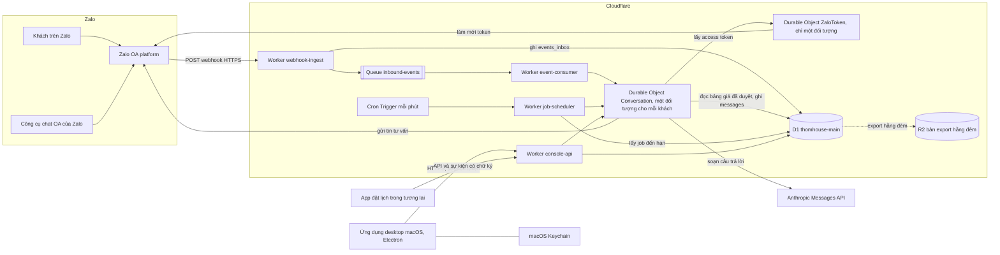
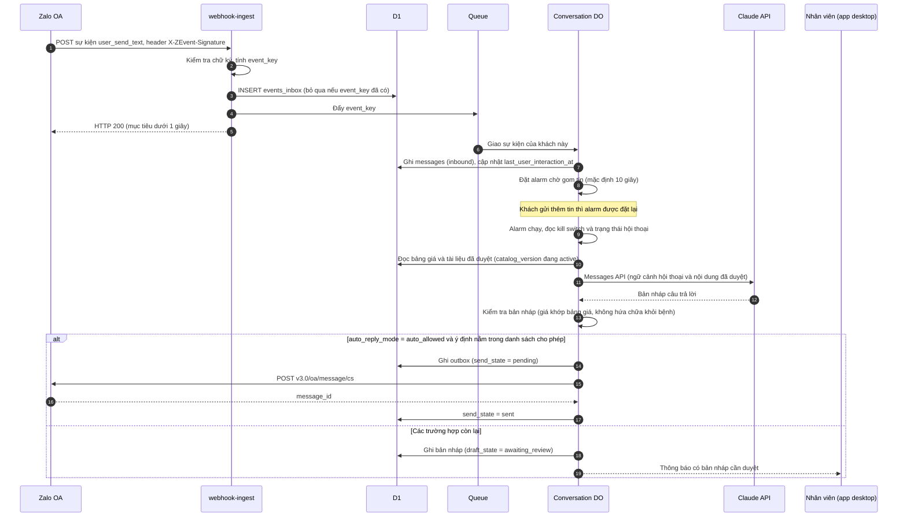
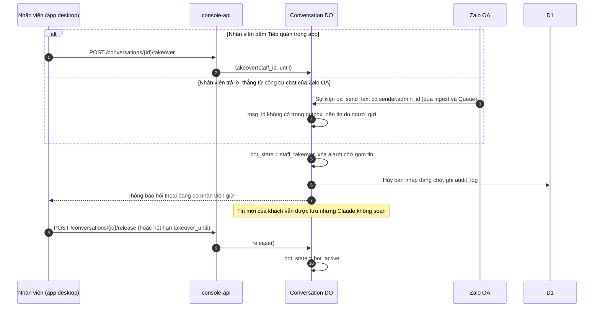
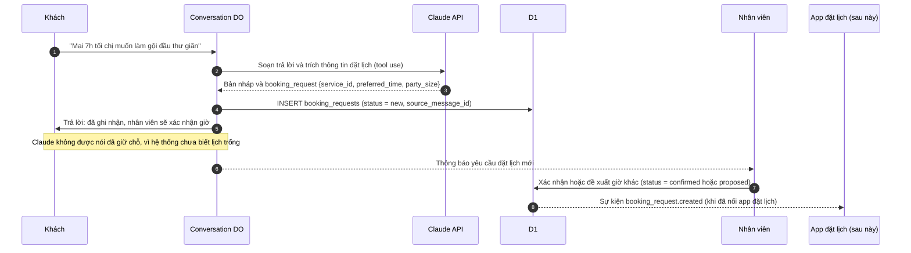
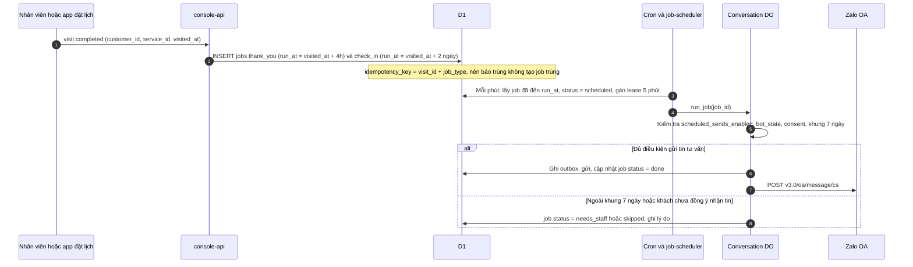
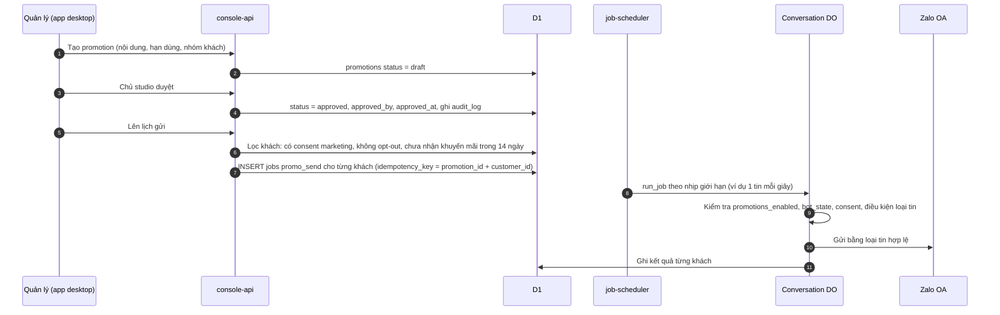

# Kiến trúc chatbot Zalo OA cho thom house: chạy ở đâu và gồm những phần nào

Ngày viết: 2026-11-07. Track: kiến trúc hệ thống. Các claim của báo cáo trước được đối chiếu: C1, C3 (danh sách claim nằm ở `research/00-prior-report-claims.md`).

> Cập nhật ngày 2026-11-07: anh quyết bot gọi model bằng subscription Claude qua `claude -p` trên một máy Mac, không gọi Messages API từ Cloudflare. Phần gọi model theo quyết định này nằm ở [design/subscription-runner.md](../design/subscription-runner.md). Máy Mac này chỉ soạn câu trả lời; webhook, hàng đợi, lịch gửi và việc gửi tin vẫn chạy trên Cloudflare như tài liệu này, nên lý do không chạy cả hệ thống trên Mac vẫn đúng. Ở các sơ đồ bên dưới, bước Durable Object `Conversation` gọi Messages API nay đổi thành: Durable Object tạo việc soạn câu trả lời, máy Mac nhận việc rồi gửi bản nháp về. Bản thiết kế subscription-runner bổ sung một loại việc mới trong bảng `jobs` và cờ `ai_engine`. Các phần khác của tài liệu này giữ nguyên; đường gọi Messages API bằng API key trở thành phương án dự phòng khi bật cờ `ai_engine=api_key`.

## Phần anh cần duyệt

Tôi đề xuất phương án B, với ứng dụng desktop làm client mỏng. Mọi phần phải chạy liên tục được đặt trên Cloudflare: nhận tin từ Zalo, lưu dữ liệu, gọi Claude, gửi tin và chạy lịch hẹn gửi tin. Ứng dụng desktop trên macOS chỉ là màn hình làm việc của nhân viên: đọc hội thoại, duyệt hoặc sửa câu trả lời do Claude soạn, tiếp quản hội thoại, duyệt bảng giá và chương trình khuyến mãi, bật hoặc tắt các kill switch. Kill switch ở đây là các cờ cấu hình cho phép dừng ngay một loại hành động tự động, ví dụ dừng mọi tin tự trả lời.

Lý do chính nằm ở cách Zalo giao tin. Zalo gửi mỗi tin nhắn của khách tới một địa chỉ HTTPS công khai do ứng dụng của mình đăng ký. Cơ chế này gọi là webhook. Tài liệu Zalo yêu cầu webhook trả HTTP 200 trong tối đa 2 giây. Nếu không kết nối được, Zalo gửi lại sau 30 giây, 5 phút, 15 phút, 30 phút và 1 giờ, rồi vô hiệu hóa webhook; khi đó doanh nghiệp phải vào trang cài đặt ứng dụng để xin quyền nhận sự kiện lại. Nếu toàn bộ hệ thống chạy trên một chiếc Mac, chỉ cần Mac ngủ, mất mạng hoặc tắt máy trong khoảng 1 đến 2 giờ là webhook bị Zalo tắt. Từ lúc đó, tin của khách vẫn hiện trên công cụ chat của Zalo OA nhưng chatbot không nhận được. Tin hẹn gửi trong lúc Mac ngủ cũng không chạy.

Chi phí hạ tầng của phương án đề xuất là khoảng 5 USD mỗi tháng cho gói Cloudflare Workers Paid, tức khoảng 129.000đ. Con số này chưa gồm tên miền, phí Apple Developer Program 99 USD mỗi năm (khoảng 2,55 triệu đồng), phí gói Zalo OA và tiền gọi API Claude. Các số tính theo tỷ giá bán USD của Vietcombank lúc 00:20 ngày 7/11/2026 là 25.780đ.

Phương án này có bốn điểm yếu mà anh cần chấp nhận trước khi làm:

1. Dữ liệu khách hàng, kể cả thông tin sức khỏe phụ nữ khách kể trong chat, nằm trên hạ tầng Cloudflare ở nước ngoài. Track pháp lý cần xác nhận việc lưu trữ này có phù hợp luật bảo vệ dữ liệu cá nhân của Việt Nam hay không.
2. Code dùng các dịch vụ riêng của Cloudflare (D1, Durable Objects, Queues). Muốn chuyển sang nhà cung cấp khác thì phải viết lại phần lưu trữ và phần điều phối.
3. Studio không có kỹ sư trực. Nếu hệ thống hỏng ngoài giờ, cần một người được thuê theo hợp đồng bảo trì để xử lý; tài liệu này chỉ giảm số việc vận hành, không xóa được việc vận hành.
4. Ứng dụng desktop cần mạng để làm việc. Khi mất mạng, nhân viên chỉ xem được bản lưu tạm và phải trả lời khách trực tiếp trên công cụ chat của Zalo OA.

Bản MVP đề xuất làm trong 4 đến 6 tuần với một lập trình viên TypeScript (ước tính, xem phần cuối). MVP gồm: nhận tin, Claude soạn nháp, nhân viên duyệt rồi gửi, tiếp quản hội thoại, ghi nhận yêu cầu đặt lịch, duyệt bảng giá có phiên bản, kill switch, nhật ký thao tác và sao lưu. MVP chưa gồm tin khuyến mãi tự động, tin chăm sóc sau buổi làm tự động và kết nối app đặt lịch.

## Thuật ngữ dùng trong tài liệu

| Thuật ngữ | Nghĩa trong tài liệu này |
|---|---|
| Zalo OA | Official Account, tài khoản doanh nghiệp của thom house trên Zalo |
| webhook | Địa chỉ HTTPS công khai mà Zalo gọi tới mỗi khi có sự kiện, ví dụ khách gửi tin |
| sự kiện | Một lần Zalo gọi webhook, kèm dữ liệu JSON như `event_name`, `msg_id` |
| tin tư vấn | Loại tin OA gửi qua API `v3.0/oa/message/cs`; chỉ gửi được cho khách có tương tác với OA trong 7 ngày gần nhất |
| tunnel | Phần mềm mở một đường kết nối từ internet vào một máy trong mạng nội bộ, ví dụ Cloudflare Tunnel, ngrok, Tailscale Funnel |
| Worker | Một đoạn code TypeScript chạy trên hạ tầng Cloudflare Workers, không cần quản lý máy chủ |
| D1 | Cơ sở dữ liệu SQLite do Cloudflare quản lý |
| Durable Object | Một đối tượng có tên duy nhất trên Cloudflare, xử lý từng yêu cầu một và có bộ nhớ riêng; tài liệu này dùng Durable Object để xếp hàng các tin của cùng một khách |
| Queue | Hàng đợi tin nhắn của Cloudflare; Worker đẩy việc vào, Worker khác lấy ra xử lý và được thử lại khi lỗi |
| job | Một việc hẹn giờ, ví dụ gửi tin cảm ơn sau buổi làm |
| outbox | Bảng ghi lại từng tin sắp gửi trước khi gọi API gửi, để biết tin nào đã gửi, chưa gửi hay chưa rõ kết quả |
| idempotent | Tính chất của một thao tác mà khi chạy lại nhiều lần vẫn cho cùng kết quả như chạy một lần, ví dụ nhận cùng một sự kiện hai lần nhưng chỉ xử lý một lần |
| kill switch | Cờ cấu hình cho phép dừng ngay một loại hành động tự động |
| tiếp quản | Nhân viên giành quyền trả lời một hội thoại; trong lúc tiếp quản, Claude không soạn và không gửi tin cho khách đó |
| notarization | Bước Apple quét ứng dụng macOS trước khi phát hành ngoài App Store; ứng dụng chưa qua bước này bị Gatekeeper của macOS chặn hoặc cảnh báo |
| Keychain | Kho bí mật của macOS, dùng để giữ token đăng nhập của nhân viên trên máy |

## Zalo đặt ra những ràng buộc gì cho kiến trúc?

Phần này chỉ ghi các dữ kiện tôi đọc trực tiếp từ tài liệu Zalo ngày 2026-11-07. Trang `developers.zalo.me/docs/...` hiển thị trống khi tải bằng công cụ, nên tôi đọc bản nội dung gốc trên `stc-developers.zdn.vn/docs/v2/...`, là nơi trang chính tải nội dung về.

**Webhook phải luôn sẵn sàng.** Trang giới thiệu webhook ghi yêu cầu phản hồi mọi sự kiện bằng HTTP 200 trong tối đa 2 giây. Trang này cũng ghi lịch gửi lại khi Zalo không mở được kết nối: sau 30 giây, 5 phút, 15 phút, 30 phút và 1 giờ, với header `num_retry`. Nếu webhook vẫn không đáp ứng trong khoảng đó, ứng dụng bị hủy đăng ký nhận sự kiện và phải xin quyền lại. Trang cũng khuyên dùng domain có HTTPS thay cho `host:port`. Nguồn: https://stc-developers.zdn.vn/docs/v2/official-account/webhook/tong-quan (truy cập 2026-11-07). Tài liệu không nói rõ các mốc gửi lại tính từ lần gửi đầu hay cộng dồn, nên khoảng thời gian tối đa trước khi bị tắt là từ khoảng 1 giờ đến khoảng 2 giờ (suy luận từ câu chữ của tài liệu).

**Chữ ký sự kiện.** Trang sự kiện khách gửi tin ghi header `X-ZEvent-Signature` có giá trị `mac = sha256(appId + data + timeStamp + OAsecretKey)`, với `data` là chuỗi JSON của sự kiện. Nguồn: https://stc-developers.zdn.vn/docs/v2/official-account/webhook/tin-nhan/su-kien-nguoi-dung-gui-tin-nhan (truy cập 2026-11-07). Cả hai repo tham khảo lại tính HMAC-SHA256 của body với secret key (`sources/repos/arden-zalo-agent-cli/src/commands/oa-listen.js:120`, `sources/repos/zalo-agent-cli/src/commands/oa-listen.js:33`). Chưa ai thử công thức nào đúng trên một OA thật. Vì vậy, giai đoạn 0 phải đo chữ ký trên OA thật trước khi bật chế độ từ chối sự kiện sai chữ ký (xem phần luồng nhận tin).

**Token.** Access token có hiệu lực 25 giờ. Refresh token có hiệu lực 3 tháng và chỉ dùng được một lần. Khi đổi refresh token thành công, refresh token cũ bị vô hiệu và access token cũ hết hiệu lực ngay. Nguồn: https://stc-developers.zdn.vn/docs/v2/official-account/bat-dau/xac-thuc-va-uy-quyen-cho-ung-dung-new (truy cập 2026-11-07). Hệ quả cho kiến trúc: chỉ được có một tiến trình giữ và làm mới token. Nếu cả Mac và cloud cùng làm mới, tiến trình chậm hơn sẽ dùng refresh token đã bị vô hiệu và hệ thống mất quyền gửi tin cho tới khi chủ OA cấp quyền lại.

**Tin tư vấn.** Điều kiện gửi là khách có tương tác với OA trong vòng 7 ngày; giờ gửi 24/24. API gửi văn bản là `POST https://openapi.zalo.me/v3.0/oa/message/cs`, nội dung tối đa 2.000 ký tự. Body chỉ có `recipient` và `message`, không có trường khóa chống gửi trùng. Phản hồi thành công trả `message_id`. Trang này cũng ghi: từ 1/1/2026, đối tác gửi tin tư vấn miễn phí không giới hạn trong khung 48 giờ. Nguồn: https://stc-developers.zdn.vn/docs/v2/official-account/tin-nhan/tin-tu-van/dieu-kien-gui-tin-tu-van và https://stc-developers.zdn.vn/docs/v2/official-account/tin-nhan/tin-tu-van/gui-tin-tu-van-dang-van-ban (truy cập 2026-11-07). Hệ quả: tin hẹn gửi sau một tháng không đi được bằng tin tư vấn, trừ khi khách vừa nhắn OA. Khách tới studio trực tiếp không được tính là tương tác với OA (suy luận: tài liệu định nghĩa tương tác trên kênh OA). Loại tin thay thế (ZBS Template Message) thuộc track nền tảng Zalo.

**Zalo báo lại tin OA đã gửi.** Khi OA gửi tin qua API hoặc qua công cụ chat của OA, Zalo gọi webhook với sự kiện `oa_send_text` (và các biến thể `oa_send_image`, `oa_send_file`...), kèm `msg_id`. Nếu tin được gửi từ công cụ chat `oa.zalo.me/chatv2`, sự kiện có thêm `sender.admin_id`. Nguồn: https://stc-developers.zdn.vn/docs/v2/official-account/webhook/tin-nhan/su-kien-official-account-gui-tin-nhan-cho-nguoi-dung (truy cập 2026-11-07). Hệ thống dùng sự kiện này vào hai việc: phát hiện nhân viên đang trả lời từ công cụ chat của Zalo để tự chuyển sang tiếp quản, và đối chiếu tin chưa rõ đã gửi hay chưa. Sự kiện `user_received_message` chỉ được gửi khi khách nhận tin trên Zalo Mobile, nên không dùng được làm xác nhận gửi đầy đủ.

## Ba phương án khác nhau ở đâu?

Ba phương án khác nhau ở hai điểm: phần nào phải chạy 24/24, và phần đó được đặt trên Mac hay trên cloud.

**Phương án A: chỉ chạy trên Mac.** Ứng dụng macOS làm mọi việc: nhận webhook qua tunnel, lưu SQLite trên máy, chạy lịch hẹn, gọi Claude và gửi tin. Phương án này rẻ nhất và dễ demo nhất. Điểm yếu là Mac phải thức, có mạng và có ứng dụng đang chạy suốt ngày đêm. API `ProcessInfo.beginActivity` của macOS với tùy chọn `idleSystemSleepDisabled` chỉ ngăn Mac ngủ do không ai dùng; theo hiểu biết trước (chưa xác minh trên trang Apple), gập nắp MacBook không gắn màn hình ngoài vẫn làm máy ngủ. Khi Mac ngủ quá khoảng 1 đến 2 giờ, Zalo tắt webhook như đã nêu ở phần trên.

**Phương án B: cloud nhỏ chạy liên tục, desktop là màn hình làm việc.** Một phần nhỏ trên cloud nhận và kiểm tra webhook, lưu sự kiện, chạy lịch hẹn, gọi Claude và gửi tin. Ứng dụng desktop dùng để làm việc, cấu hình và duyệt nội dung. Cloud có thể là Cloudflare Workers với D1, Queues, Durable Objects, hoặc một VPS nhỏ, hoặc Fly.io hay Railway.

**Phương án C: cloud là chính, desktop chỉ là vỏ.** Giống B, nhưng ứng dụng desktop gần như chỉ mở giao diện web của cloud, có thể là một web app được bọc lại.

Trong thực tế, B và C gần nhau. Tôi đề xuất B theo hướng client mỏng: logic nghiệp vụ nằm hết trên cloud, còn ứng dụng desktop chỉ thêm ba thứ mà trình duyệt làm kém hơn là thông báo hệ thống, giữ token đăng nhập trong Keychain và mở sẵn khi bật máy.

### So sánh ba phương án

| Tiêu chí | A. Chỉ chạy trên Mac | B. Cloud nhỏ (Cloudflare) và desktop làm việc | C. Cloud là chính, desktop là vỏ |
|---|---|---|---|
| Nhận webhook khi Mac ngủ hoặc tắt | Không nhận được; Zalo tắt webhook sau khoảng 1 đến 2 giờ không kết nối được | Nhận được; Mac không tham gia đường nhận tin | Nhận được, giống B |
| Tin hẹn giờ khi Mac ngủ | Không chạy; chạy bù khi Mac thức, có thể đã quá khung 7 ngày | Chạy bằng Cron Trigger mỗi phút trên cloud | Chạy giống B |
| Nhiều nhân viên, nhiều máy | Chỉ một máy giữ dữ liệu; máy khác phải truy cập máy đó | Mọi máy đọc cùng một cơ sở dữ liệu trên cloud | Giống B |
| Chi phí hạ tầng hằng tháng | Khoảng 0 đến 10 USD (0 đến 258.000đ) cho tunnel; chưa tính tiền mua Mac chạy riêng | Khoảng 5 USD (129.000đ) cho Workers Paid; mức dùng của studio nằm trong phần miễn phí đi kèm (ước tính) | Giống B |
| Việc vận hành cho studio | Nhiều: giữ Mac thức, cập nhật macOS không làm gián đoạn, theo dõi tunnel, tự sao lưu ổ đĩa | Ít: không có máy chủ cần vá; vẫn cần người theo dõi cảnh báo và làm mới quyền OA khi hết hạn | Ít nhất ở phía desktop; phía cloud giống B |
| Bảo mật | Toàn bộ dữ liệu khách và token nằm trên một máy ở quầy, dễ bị mất hoặc bị người khác dùng; tunnel mở một cổng từ internet vào máy | Bí mật nằm trong Workers secrets; rủi ro chính là tài khoản Cloudflare bị chiếm, nên bắt buộc bật 2FA | Giống B; thêm rủi ro nếu web console mở công khai mà xác thực yếu |
| Hợp với yêu cầu "ứng dụng desktop" | Đúng nhất về hình thức | Đúng: nhân viên cài app trên Mac | Đúng về hình thức, nhưng app ít giá trị hơn một tab trình duyệt |
| Dùng khi nào | Chỉ để thử nội bộ, không dùng cho khách thật | Đề xuất cho bản chạy thật | Phương án dự phòng nếu không muốn trả phí Apple Developer: dùng web console trong trình duyệt |

### Chi phí tunnel và hosting theo trang giá chính thức

| Dịch vụ | Giá và giới hạn theo trang chính thức (truy cập 2026-11-07) | Đổi ra VND |
|---|---|---|
| Cloudflare Workers Paid | Phí tối thiểu 5 USD/tháng; gồm 10 triệu request và 30 triệu CPU-ms mỗi tháng. Nguồn: https://developers.cloudflare.com/workers/platform/pricing/ | Khoảng 128.900đ/tháng |
| Cloudflare Workers Free | 100.000 request/ngày, 10 ms CPU mỗi lần gọi, 5 Cron Trigger mỗi tài khoản, CPU cho Cron 10 ms. Nguồn: trang pricing ở trên và https://developers.cloudflare.com/workers/platform/limits/ | 0đ; không đủ an toàn cho bản chạy thật vì giới hạn CPU 10 ms |
| D1 trên gói Paid | 25 tỷ row đọc và 50 triệu row ghi mỗi tháng đi kèm; 5 GB đầu miễn phí; tối đa 10 GB mỗi database; mỗi database xử lý từng query một. Nguồn: trang pricing và https://developers.cloudflare.com/d1/platform/limits/ | Nằm trong 5 USD ở quy mô studio (ước tính) |
| D1 Time Travel | Khôi phục về một thời điểm bất kỳ trong 30 ngày (gói Paid) hoặc 7 ngày (gói Free); luôn bật; không tính phí. Nguồn: https://developers.cloudflare.com/d1/reference/time-travel/ | 0đ |
| Queues trên gói Paid | 1 triệu thao tác/tháng đi kèm, sau đó 0,40 USD mỗi triệu; giữ tin mặc định 4 ngày, tối đa 14 ngày | Nằm trong 5 USD ở quy mô studio (ước tính) |
| Durable Objects trên gói Paid | 1 triệu request/tháng và 400.000 GB-s đi kèm; alarm chạy ít nhất một lần và tự thử lại tối đa 6 lần. Nguồn: trang pricing và https://developers.cloudflare.com/durable-objects/api/alarms/ | Nằm trong 5 USD ở quy mô studio (ước tính) |
| Cloudflare Tunnel | Trang chính thức không ghi giá. FAQ ghi Cloudflare không còn bắt mua Argo để tạo Tunnel. Quick Tunnel (`trycloudflare`) chỉ dành cho thử nghiệm, không cam kết uptime, tối đa 200 request đồng thời. Nguồn: https://developers.cloudflare.com/cloudflare-one/faq/cloudflare-tunnels-faq/ và trang Quick Tunnel | Suy luận là 0đ; cần một tên miền đặt DNS trên Cloudflare (giá tên miền chưa xác minh) |
| ngrok | Gói Free: 5 USD dùng một lần, 20.000 request, có trang chặn trung gian. Gói Hobbyist: 10 USD/tháng, 100.000 request. Nguồn: https://ngrok.com/pricing | Hobbyist khoảng 257.800đ/tháng |
| Tailscale Funnel | Có ở mọi gói, đang beta, giới hạn băng thông không cấu hình được, chỉ dùng tên miền `ts.net`. Nguồn: https://tailscale.com/kb/1223/funnel | 0đ; không nên dùng cho kênh khách hàng vì đang beta |
| Fly.io | Không có gói miễn phí cho tổ chức mới; máy `shared-cpu-1x` 256 MB giá 2,19 USD/tháng ở `iad`; 1 GB ở Singapore 8,50 USD/tháng; volume 0,15 USD/GB/tháng; Managed Postgres nhỏ nhất 38 USD/tháng. Nguồn: https://docs.fly.io/about/pricing | 256 MB khoảng 56.500đ; Postgres có quản lý khoảng 979.600đ |
| Railway Hobby | 5 USD/tháng, gồm 5 USD tiền dùng; RAM khoảng 10 USD/GB/tháng; volume khoảng 0,15 USD/GB/tháng. Nguồn: https://railway.com/pricing | Từ khoảng 128.900đ/tháng |
| Hetzner Cloud | Gói Regular Performance từ 6,49 EUR/tháng chưa VAT; có vị trí Singapore. Trang không ghi cấu hình cụ thể, giá USD và giá gói sao lưu. Nguồn: https://www.hetzner.com/cloud/ | Khoảng 190.400đ/tháng theo tỷ giá bán EUR của Vietcombank 29.332đ |

Tôi không chọn VPS (Hetzner) hay Fly.io với Postgres có quản lý cho studio. VPS rẻ nhưng cần người vá hệ điều hành, tự cài Postgres và tự sao lưu. Postgres có quản lý trên Fly.io giá 38 USD/tháng, gấp khoảng bảy lần Workers Paid. Hai lựa chọn này hợp hơn khi đội có kỹ sư trực hoặc khi track pháp lý yêu cầu dữ liệu nằm trên máy chủ do studio kiểm soát.

## Vì sao không chạy tất cả trên Mac, kể cả có tunnel?

Tunnel giải được việc có địa chỉ HTTPS công khai, nhưng không giải được việc Mac phải thức. Cloudflare Tunnel chỉ chuyển request tới `cloudflared` đang chạy trên máy; khi Mac ngủ, request không tới đâu và Zalo coi như webhook không kết nối được. Sau các lần gửi lại trong khoảng 1 đến 2 giờ, Zalo tắt webhook. Từ lúc đó tới khi có người phát hiện và xin quyền lại, mọi tin của khách vẫn tới công cụ chat của Zalo OA nhưng chatbot không biết.

Phương án A còn hai rủi ro ít được để ý. Thứ nhất, token: nếu sau này có thêm bất kỳ tiến trình nào khác làm mới token, như một script thử nghiệm hay máy thứ hai, hai bên sẽ vô hiệu token của nhau. Thứ hai, máy ở quầy lễ tân thường do nhiều người dùng chung, nên dữ liệu sức khỏe của khách nằm trên một máy dễ bị nhìn trộm hoặc bị mất.

Phương án A vẫn có ích ở giai đoạn 0, để thử nhanh chữ ký webhook và cách Claude trả lời trên một OA thử. Khi đó dùng Cloudflare Tunnel có tên miền thật, không dùng Quick Tunnel, vì Zalo khuyên dùng domain và Quick Tunnel đổi URL mỗi lần khởi động.

## Hệ thống đề xuất gồm những phần nào?



Mỗi phần có một việc rõ ràng:

- `webhook-ingest` kiểm tra chữ ký, ghi sự kiện vào bảng `events_inbox` rồi trả 200. Worker này không gọi Claude và không gửi tin, để luôn trả lời trong 2 giây.
- `event-consumer` lấy sự kiện từ Queue và chuyển cho Durable Object của đúng khách.
- Durable Object `Conversation` có tên `oa:<oa_id>:user:<zalo_user_id>`. Đối tượng này xử lý tuần tự mọi việc của một khách: tin đến, soạn trả lời, gửi tin, tiếp quản. Cloudflare ghi rõ Durable Object chạy đơn luồng và mỗi đối tượng có tên duy nhất toàn cầu (https://developers.cloudflare.com/durable-objects/concepts/what-are-durable-objects/, truy cập 2026-11-07).
- Durable Object `ZaloToken` là nơi duy nhất giữ refresh token và làm mới access token.
- `job-scheduler` chạy mỗi phút, lấy các job đến hạn và giao cho Durable Object của từng khách.
- `console-api` là API cho ứng dụng desktop và sau này cho app đặt lịch.
- D1 là nơi lưu dữ liệu chính. Durable Object chỉ giữ trạng thái tạm như khóa, bộ đếm chờ gom tin và alarm. Nếu mất trạng thái của Durable Object, hệ thống dựng lại được từ D1.

Tiền gọi Claude không nằm trong chi phí hạ tầng ở trên. Ứng dụng gọi Messages API bằng API key của Claude Console, lưu trong Workers secrets. Cách tính tiền, hạn mức và việc dùng gói Ultra thuộc track Anthropic.

## Một tin của khách đi qua hệ thống như thế nào?

### Tin đến và câu trả lời của Claude



Thứ tự ở bước 3 đến bước 5 là bắt buộc: sự kiện phải được ghi vào D1 trước khi trả 200. Repo Arden trả 200 trước rồi mới in sự kiện ra màn hình (`sources/repos/arden-zalo-agent-cli/src/commands/oa-listen.js:211-212`). Nếu tiến trình chết ngay sau khi trả 200, sự kiện mất hẳn vì Zalo không gửi lại sự kiện đã nhận 200. Nếu bước đẩy vào Queue lỗi, Worker vẫn trả 200 vì sự kiện đã nằm trong `events_inbox`; một job quét mỗi phút đẩy lại các sự kiện còn ở trạng thái `received` quá 2 phút.

Chữ ký được xử lý theo hai chế độ, điều khiển bằng biến `WEBHOOK_SIGNATURE_MODE`. Khi giá trị là `observe`, sự kiện sai chữ ký vẫn được lưu với `signature_ok = 0` và trả 200, nhưng không được giao cho Claude. Khi giá trị là `enforce`, sự kiện sai chữ ký bị trả 401 và không được lưu. Hệ thống chạy `observe` ở giai đoạn 0 và chỉ chuyển sang `enforce` sau khi đã đo được công thức đúng trên OA thật. Lý do: nếu công thức sai mà bật `enforce` ngay, hệ thống từ chối mọi sự kiện thật, và Zalo sẽ tắt webhook.

Bước chờ gom tin có mặt vì khách thường gửi nhiều tin ngắn liên tiếp. Nếu trả lời từng tin, Claude sẽ trả lời câu hỏi chưa đầy đủ và tốn tiền gọi API nhiều lần. Thời gian chờ 10 giây là giá trị khởi đầu, chưa đo trên khách thật.

### Nhân viên tiếp quản



Thời hạn tiếp quản mặc định là 12 giờ kể từ tin cuối của nhân viên, cấu hình được. Khi khách yêu cầu gặp người thật, Claude không trả lời nội dung mà chuyển hội thoại sang trạng thái `handoff_requested` và báo cho nhân viên.

### Ghi nhận yêu cầu đặt lịch



Ở MVP, yêu cầu đặt lịch chỉ là một dòng trong danh sách để nhân viên xử lý. Hệ thống chưa biết lịch trống của kỹ thuật viên, nên mọi câu trả lời của Claude về đặt lịch chỉ được nói là đã ghi nhận.

### Tin chăm sóc sau buổi làm



Mốc 4 giờ và 2 ngày ở sơ đồ là ví dụ. Tài liệu hành trình khách của studio mới mô tả cách làm: nhắn cảm ơn trong 24 giờ, theo dõi cảm giác của khách sau 2 đến 3 ngày, có thể hỏi thăm nhẹ sau một tháng (`sources/drive/documentation/07-customer-journey.md:180-182`, `:224-226`). Lịch chính thức cần chủ studio duyệt. Nếu khách không nhắn OA trong 7 ngày trước mốc một tháng, tin hỏi thăm không gửi được bằng tin tư vấn và cần loại tin khác do track nền tảng Zalo xác định.

### Chiến dịch khuyến mãi



Nhịp 1 tin mỗi giây và mốc 14 ngày là giá trị khởi đầu do tôi đặt, chưa dựa trên giới hạn đã công bố của Zalo. Loại tin dùng cho khuyến mãi và điều kiện đồng ý nhận tin thuộc track nền tảng Zalo và track pháp lý.

## Dữ liệu được lưu như thế nào?

Tất cả bảng nằm trong một database D1. Cột thời gian lưu dạng số nguyên mili-giây UTC. Cột `*_json` lưu JSON. Danh sách dưới đây chỉ nêu các cột chính.

| Bảng | Cột chính | Ghi chú |
|---|---|---|
| `customers` | `id`, `zalo_user_id` (unique theo `oa_id`), `display_name`, `phone` (có thể rỗng), `preferred_address_form`, `created_at`, `last_user_interaction_at`, `deleted_at` | `last_user_interaction_at` dùng để kiểm tra khung 7 ngày của tin tư vấn |
| `consents` | `id`, `customer_id`, `purpose` (`service_messages`, `marketing`, `health_data`), `status` (`granted`, `withdrawn`), `source` (`chat`, `form`, `staff`), `evidence_message_id`, `recorded_at` | Mỗi lần đổi là một dòng mới; trạng thái hiện tại là dòng mới nhất theo `purpose` |
| `conversations` | `id`, `customer_id`, `bot_state` (`bot_active`, `staff_takeover`, `handoff_requested`, `blocked`), `takeover_by`, `takeover_until`, `last_message_at` | Một khách có một hội thoại với một OA |
| `messages` | `id`, `conversation_id`, `direction` (`inbound`, `outbound`), `author` (`customer`, `claude`, `staff`, `system`), `zalo_msg_id`, `text`, `attachments_json`, `catalog_version_id`, `draft_state` (`none`, `awaiting_review`, `approved`, `rejected`), `send_state` (`not_applicable`, `pending`, `sent`, `unknown`, `failed`), `client_send_id` (unique), `model`, `input_tokens`, `output_tokens`, `created_at`, `sent_at` | Bảng này cũng là outbox: tin đi được ghi trước khi gọi API gửi |
| `events_inbox` | `event_key` (primary key), `event_name`, `zalo_msg_id`, `oa_id`, `zalo_user_id`, `zalo_timestamp`, `num_retry`, `signature_ok`, `raw_body`, `status` (`received`, `dispatched`, `processed`, `ignored`, `failed`), `received_at`, `processed_at`, `error` | `event_key` = `event_name` + `msg_id` khi có `msg_id`; ngược lại là SHA-256 của body. Zalo gửi lại cùng body nên khóa trùng nhau |
| `jobs` | `id`, `job_type` (`thank_you`, `check_in`, `promo_send`, `token_watch`, `inbox_sweep`), `customer_id`, `payload_json`, `run_at`, `status` (`scheduled`, `leased`, `done`, `skipped`, `needs_staff`, `expired`, `failed`), `idempotency_key` (unique), `attempts`, `lease_until`, `max_lateness_ms`, `last_error` | Job quá `run_at + max_lateness_ms` chuyển sang `expired` thay vì gửi muộn |
| `promotions` | `id`, `title`, `body`, `valid_from`, `valid_to`, `audience_rule_json`, `message_kind`, `status` (`draft`, `approved`, `scheduled`, `sending`, `done`, `cancelled`), `created_by`, `approved_by`, `approved_at` | Chỉ trạng thái `approved` mới được lên lịch |
| `catalog_versions` | `id`, `status` (`draft`, `approved`, `active`, `retired`), `source_ref` (đường dẫn file nguồn trong Drive), `created_by`, `approved_by`, `approved_at`, `activated_at`, `notes` | Mỗi lúc chỉ có một phiên bản `active` |
| `services` | `id`, `catalog_version_id`, `code`, `name`, `menu_group` (`relaxation`, `health`, `women`, `skin`, `hair`), `description`, `process_steps_json`, `contraindications`, `is_signature` | Mô tả và quy trình dịch vụ đi theo phiên bản |
| `service_prices` | `id`, `service_id`, `duration_min`, `time_band` (`all_day`, `before_2030`, `after_2030`), `price_vnd`, `notes` | Theo `sources/drive/knowledge-base/03-pricing-structure.md`, có dịch vụ chia giá theo khung giờ trước và sau 20h30, có dịch vụ giá cố định |
| `kb_documents` | `id`, `catalog_version_id`, `topic`, `body`, `allowed_for_auto_reply` | Kiến thức chuyên môn đã duyệt, được đưa vào ngữ cảnh khi gọi Claude |
| `booking_requests` | `id`, `customer_id`, `service_id`, `preferred_time_text`, `preferred_start_at`, `party_size`, `status` (`new`, `proposed`, `confirmed`, `cancelled`, `expired`), `source_message_id`, `external_booking_id`, `handled_by` | `external_booking_id` dành cho app đặt lịch sau này |
| `visits` | `id`, `customer_id`, `service_id`, `visited_at`, `source` (`staff`, `booking_app`), `external_visit_id` (unique) | Sinh job chăm sóc sau buổi làm |
| `flags` | `name` (primary key), `value`, `updated_by`, `updated_at` | Giá trị kill switch, xem phần sau |
| `staff_users` và `staff_devices` | `id`, `name`, `role` (`owner`, `manager`, `staff`); `device_id`, `staff_id`, `token_hash`, `created_at`, `revoked_at`, `last_seen_at` | Chủ studio thu hồi được từng máy |
| `audit_log` | `id`, `at`, `actor_type` (`staff`, `system`, `claude`, `booking_app`), `actor_id`, `action`, `entity`, `entity_id`, `before_json`, `after_json`, `request_id` | Chỉ thêm dòng mới, không sửa và không xóa từ ứng dụng |

Mỗi tin do Claude soạn lưu `catalog_version_id`. Khi khách phản ánh giá sai, nhân viên tra được tin đó dựa trên bảng giá phiên bản nào. Claude chỉ đọc phiên bản `active`; bản `draft` chỉ hiện trong app desktop để duyệt.

## Làm sao giữ đúng thứ tự tin và không trả lời hai lần?

Mọi việc của một khách đi qua cùng một Durable Object `Conversation`, nên tại một thời điểm chỉ có một việc của khách đó được xử lý. Queue của Cloudflare không cam kết giữ thứ tự, vì vậy Durable Object sắp tin theo `zalo_timestamp` rồi theo `received_at` trước khi soạn trả lời. Khi Zalo gửi lại một sự kiện, `events_inbox` đã có `event_key`, nên câu lệnh `INSERT` bị bỏ qua và sự kiện không được giao lần thứ hai.

Một trường hợp cần chú ý: khách gửi tin mới trong lúc Claude đang soạn trả lời tin trước. Durable Object ghi tin mới vào D1 và đánh dấu lượt soạn hiện tại là cũ. Khi Claude trả kết quả, Durable Object kiểm tra lại: nếu đã có tin mới hơn, bản nháp cũ bị bỏ và hệ thống soạn lại một lần với cả tin mới. Cách này tốn thêm một lần gọi Claude, nhưng tránh trả lời câu hỏi đã cũ.

Các việc khác nhau của cùng một khách cũng xếp hàng trong Durable Object đó: tin đến, job hẹn giờ, lệnh tiếp quản. Nhờ vậy, job chăm sóc không gửi tin chen vào giữa lúc nhân viên vừa tiếp quản.

## Khi gọi API gửi tin mà không biết kết quả thì sao?

API gửi tin tư vấn của Zalo không có trường khóa chống gửi trùng. Nếu request gửi đi rồi bị timeout, hệ thống không biết khách đã nhận tin hay chưa. Gửi lại có thể làm khách nhận hai tin giống nhau; không gửi lại có thể làm khách không nhận được gì. Không có cách nào bảo đảm gửi đúng một lần, nên hệ thống chọn cách xử lý theo loại tin.

Trước khi gọi API, Durable Object ghi tin vào `messages` với `send_state = pending` và một `client_send_id` ngẫu nhiên. Sau khi gọi API, có ba khả năng:

1. Zalo trả `error = 0` và `message_id`: hệ thống ghi `send_state = sent` và lưu `zalo_msg_id`.
2. Zalo trả lỗi rõ ràng, ví dụ khách ngoài khung 7 ngày: hệ thống ghi `send_state = failed` kèm mã lỗi và không thử lại tự động.
3. Timeout hoặc mất kết nối: hệ thống ghi `send_state = unknown` và đặt một alarm đối chiếu sau 2 phút.

Khi alarm đối chiếu chạy, hệ thống tìm trong `events_inbox` sự kiện `oa_send_text` gửi tới cùng khách, có nội dung trùng và thời điểm sau lúc gửi. Nếu tìm thấy, tin được coi là đã gửi. Nếu không thấy, cách xử lý tùy loại tin. Với câu trả lời trong hội thoại, hệ thống gửi lại đúng một lần, vì khách đang chờ và một tin trùng ít hại hơn một câu hỏi bị bỏ qua. Với tin khuyến mãi và tin chăm sóc, hệ thống không gửi lại mà chuyển sang `needs_staff`, vì khách nhận hai tin quảng cáo dễ chặn OA. Việc đối chiếu dựa trên sự kiện `oa_send_text`; tôi chưa thử trên OA thật xem tin gửi qua API có luôn tạo sự kiện này hay không.

## Làm mới token mà không tự khóa mình

Durable Object `ZaloToken` là nơi duy nhất giữ refresh token. Mọi phần khác chỉ xin access token từ đối tượng này. Ứng dụng desktop không bao giờ nhận refresh token.

Quy trình làm mới chạy bên trong `ZaloToken`, nên không có hai lần làm mới chạy song song:

1. Khi access token còn dưới 2 giờ hiệu lực, hoặc Zalo trả lỗi token hết hạn, `ZaloToken` gọi `POST https://oauth.zaloapp.com/v4/oa/access_token` với `grant_type=refresh_token`.
2. Nếu thành công, `ZaloToken` ghi cả access token mới, refresh token mới và thời điểm hết hạn vào bộ nhớ của Durable Object trong một lần ghi, rồi mới trả token mới cho bên gọi. Sau đó hệ thống ghi một dòng `audit_log` không chứa token.
3. Nếu request bị timeout, refresh token cũ có thể đã bị Zalo dùng. `ZaloToken` thử lại với refresh token cũ. Nếu Zalo báo token không hợp lệ, hệ thống đặt `zalo_auth_state = reauth_required`, dừng mọi lần gửi và báo chủ studio cấp quyền lại.
4. Một job `token_watch` chạy mỗi ngày. Job này cảnh báo khi refresh token đã hơn 80 ngày tuổi, vì refresh token hết hạn sau 3 tháng nếu hệ thống không làm mới lần nào (ví dụ khi tắt bot lâu ngày).

Việc cấp quyền lại dùng OAuth v4 có PKCE theo tài liệu Zalo. PKCE là cách chống đánh cắp mã cấp quyền bằng một chuỗi bí mật do ứng dụng tự sinh. Callback URL của luồng này nằm trên `console-api`, không nằm trên Mac.

Sao lưu không giúp khôi phục token. Sau khi khôi phục database từ bản cũ, refresh token trong bản sao lưu có thể đã bị dùng, nên quy trình khôi phục luôn kết thúc bằng bước cấp quyền lại.

## Kill switch có những giá trị nào và hệ thống làm gì?

| Cờ | Giá trị | Hệ thống làm gì |
|---|---|---|
| `auto_reply_mode` | `off` | Hệ thống lưu tin của khách và báo nhân viên; Claude không được gọi |
| `auto_reply_mode` | `draft_only` | Claude soạn nháp; nhân viên tự sao chép hoặc gửi bằng nút Gửi trong app |
| `auto_reply_mode` | `approve_each` | Claude soạn nháp; hệ thống chỉ gửi sau khi nhân viên bấm Duyệt cho từng tin |
| `auto_reply_mode` | `auto_allowed` | Hệ thống tự gửi khi ý định của khách nằm trong `auto_reply_intents` và bản nháp qua bước kiểm tra; các trường hợp khác về `approve_each` |
| `auto_reply_intents` | Danh sách, ví dụ `menu_price`, `opening_hours`, `service_process` | Chỉ có tác dụng khi `auto_reply_mode = auto_allowed` |
| `ai_calls_enabled` | `true`, `false` | Khi `false`, hệ thống không gọi Claude ở bất kỳ luồng nào, kể cả soạn nháp |
| `outbound_enabled` | `true`, `false` | Khi `false`, hệ thống không gửi bất kỳ tin nào qua API, kể cả tin nhân viên đã duyệt; nhân viên vẫn trả lời được trên công cụ chat của Zalo OA |
| `scheduled_sends_enabled` | `true`, `false` | Khi `false`, job đến hạn giữ nguyên `scheduled`. Khi bật lại, job đã quá `max_lateness_ms` chuyển sang `expired` thay vì gửi muộn |
| `promotions_enabled` | `true`, `false` | Khi `false`, job `promo_send` bị bỏ qua giống `scheduled_sends_enabled = false`; job chăm sóc vẫn chạy |
| `WEBHOOK_SIGNATURE_MODE` (biến môi trường) | `observe`, `enforce` | Xem phần luồng nhận tin |
| `conversations.bot_state` | `bot_active`, `staff_takeover`, `handoff_requested`, `blocked` | Ba giá trị sau làm Claude không soạn và hệ thống không gửi tin tự động cho khách đó |

Hệ thống đọc cờ ở ba thời điểm: khi tạo job hoặc bản nháp, khi Durable Object bắt đầu xử lý, và ngay trước request HTTP gửi tin. Cờ được đọc từ D1 mỗi lần, không cache, vì số lần đọc ở quy mô studio rất nhỏ. Một tin đã nằm trong request HTTP đang chạy thì không dừng được; khoảng hở này kéo dài bằng thời gian một request tới Zalo.

Báo cáo trước (claim C3) đề xuất ba chế độ và hai cờ `auto_reply_enabled`, `scheduled_sends_enabled` được kiểm tra ngay trước khi gửi. Ý đó làm được và nằm trong thiết kế này. Tuy vậy, chỉ kiểm tra ngay trước khi gửi là chưa đủ: hệ thống còn cần trạng thái tiếp quản theo từng hội thoại, cờ dừng gọi Claude và cờ dừng mọi tin gửi đi. Ngoài ra, cờ phải ghi rõ giá trị và hành vi như bảng trên, không chỉ là bật hoặc tắt.

## Theo dõi hệ thống thế nào khi không có kỹ sư trực?

Hệ thống ghi log có cấu trúc cho mỗi sự kiện, kèm `request_id`, `event_key` và `conversation_id`, không ghi nội dung tin và không ghi token. Các số cần theo dõi và ngưỡng cảnh báo khởi đầu (chưa đo, cần chỉnh sau hai tuần chạy thật):

| Số đo | Cảnh báo khi |
|---|---|
| Thời gian `webhook-ingest` trả 200, p95 | Trên 1 giây trong 5 phút |
| Sự kiện ở trạng thái `received` hoặc `dispatched` lâu | Có sự kiện quá 5 phút |
| Sự kiện sai chữ ký | Có bất kỳ sự kiện nào sau khi đã chuyển sang `enforce` |
| Tin `send_state = unknown` hoặc `failed` | Có tin mới trong ngày |
| Bản nháp chờ duyệt | Có bản nháp chờ quá 15 phút trong giờ mở cửa |
| Job trễ | Có job quá `run_at` 10 phút mà chưa chạy |
| Token | `zalo_auth_state = reauth_required`, hoặc refresh token hơn 80 ngày tuổi |
| Chi phí Claude | Tổng token trong ngày vượt hạn mức chủ studio đặt |
| Webhook im lặng | Không có sự kiện nào trong 24 giờ, trong khi ngày trước có |

Cảnh báo được gửi tới app desktop dưới dạng thông báo hệ thống và tới email của chủ studio. Không nên gửi cảnh báo qua chính OA, vì khi OA có vấn đề thì kênh cảnh báo cũng hỏng. Mục "Webhook im lặng" có mặt vì khi Zalo tắt webhook, hệ thống không nhận được lỗi nào; dấu hiệu duy nhất là không còn sự kiện. Tài liệu Zalo ghi Zalo cũng gửi thông báo về tài khoản Zalo của người quản lý ứng dụng, nên người đó cần bật thông báo Zalo.

App desktop có một màn hình tình trạng: thời điểm nhận sự kiện cuối, số bản nháp đang chờ, trạng thái token, giá trị các kill switch và số tiền Claude đã dùng trong tháng.

## Sao lưu và khôi phục

D1 Time Travel cho phép khôi phục database về một thời điểm bất kỳ trong 30 ngày gần nhất trên gói Paid, luôn bật và không tính phí (nguồn đã dẫn ở bảng chi phí). Ngoài ra, một job hằng đêm export D1 ra R2 (kho lưu file của Cloudflare) và giữ 90 ngày; giá R2 tôi chưa xác minh trong track này. Durable Object không chứa dữ liệu gốc, nên không cần sao lưu riêng, trừ `ZaloToken`, và token thì không khôi phục bằng sao lưu như đã giải thích.

Bí mật gồm App Secret của Zalo, API key của Claude và khóa ký sự kiện cho app đặt lịch. Các bí mật này nằm trong Workers secrets và được chủ studio lưu thêm một bản trong trình quản lý mật khẩu. Chủ studio phải bật xác thực hai lớp cho tài khoản Cloudflare, tài khoản Zalo quản trị OA, tài khoản Apple Developer và tài khoản Claude Console.

Quy trình khôi phục gồm năm bước, cần tập thử mỗi quý:

1. Đặt `outbound_enabled = false` và `ai_calls_enabled = false`.
2. Khôi phục D1 về thời điểm cần thiết bằng Time Travel, hoặc nhập bản export từ R2.
3. Cấp quyền OA lại để có refresh token mới.
4. Chạy job quét `events_inbox` để xử lý các sự kiện nhận được sau thời điểm khôi phục, nếu bản export còn giữ chúng.
5. Bật lại hai cờ ở bước 1 sau khi nhân viên kiểm tra vài hội thoại.

## Ứng dụng desktop nên làm bằng gì?

Tôi đề xuất Electron cho MVP, với giao diện là web app React và TypeScript. Cùng một giao diện chạy được trong Electron và trong trình duyệt. Lý do chính: đội viết TypeScript, và Electron có sẵn API `safeStorage` dùng Keychain của macOS. Điểm yếu là gói cài đặt lớn và bề mặt tấn công rộng hơn, nên phải làm đủ danh sách bảo mật của Electron.

| Tiêu chí | Electron | Tauri 2 | SwiftUI |
|---|---|---|---|
| Kích thước gói cài | Lớn vì kèm Chromium; theo hiểu biết trước, thường từ khoảng 100 MB (chưa xác minh) | Tài liệu Tauri ghi app tối giản có thể dưới 600 KB, vì dùng webview của hệ điều hành (https://v2.tauri.app/start/) | Nhỏ, vì là app native (từ hiểu biết trước, chưa xác minh) |
| Tốc độ làm cho đội TypeScript | Nhanh nhất: cả giao diện và tiến trình chính đều là TypeScript | Giao diện là TypeScript; phần native viết bằng Rust, cần thêm plugin cho Keychain | Chậm nhất: phải viết lại giao diện bằng Swift, không dùng chung với web console |
| Mô hình bảo mật | Tài liệu Electron có 20 mục kiểm tra. Mặc định tắt `nodeIntegration` từ bản 5, bật context isolation từ bản 12, bật sandbox từ bản 20 (https://www.electronjs.org/docs/latest/tutorial/security) | Tài liệu nhắc tới capabilities và permissions; tôi chưa đọc chi tiết | App Sandbox của macOS (từ hiểu biết trước) |
| Tự cập nhật | `autoUpdater` dựa trên Squirrel.Mac; tài liệu ghi app phải được ký thì mới tự cập nhật được trên macOS (https://www.electronjs.org/docs/latest/api/auto-updater) | Plugin updater bắt buộc ký bản cập nhật bằng khóa riêng và không tắt được yêu cầu này (https://v2.tauri.app/plugin/updater/) | Thường dùng thư viện Sparkle (từ hiểu biết trước, chưa xác minh) |
| Ký và notarization | Cần Developer ID và notarization, giống hai cột còn lại | Cần Developer ID và notarization | Cần Developer ID và notarization |
| Keychain | `safeStorage` giữ khóa mã hóa trong Keychain; tài liệu khuyên app phải được ký để hoạt động ổn định (https://www.electronjs.org/docs/latest/api/safe-storage) | Qua plugin (chưa xác minh plugin cụ thể) | Gọi trực tiếp Security framework |

Yêu cầu của Apple áp dụng cho cả ba lựa chọn. Tài liệu notarization ghi: từ macOS 10.15, mọi phần mềm build sau ngày 1/6/2019 và phân phối bằng Developer ID phải được notarize (https://developer.apple.com/documentation/security/notarizing-macos-software-before-distribution, đọc qua bản JSON của trang ngày 2026-11-07). Notarization đòi hardened runtime. Apple Developer Program có phí 99 USD mỗi năm (https://developer.apple.com/programs/, truy cập 2026-11-07), khoảng 2.552.000đ. Tài liệu Electron cũng ghi Squirrel.Mac cần app đã ký thì tự cập nhật mới chạy. Vì vậy, nếu không trả phí này, studio mất cả tự cập nhật lẫn việc mở app không bị cảnh báo.

Tauri hợp lý nếu gói cài nhỏ là ưu tiên, vì client mỏng có rất ít logic native. Tôi vẫn chọn Electron cho MVP vì đội không phải học Rust trong 6 tuần đầu. Quyết định này có thể đổi ở giai đoạn sau mà không ảnh hưởng cloud, vì giao diện là web app.

**Đăng nhập của nhân viên.** Mỗi máy được chủ studio ghép một lần bằng mã ghép dùng một lần, có hạn 10 phút, tạo trong app của chủ studio. Sau khi ghép, `console-api` cấp một device token. Server chỉ lưu bản băm của token trong `staff_devices`. App desktop mã hóa token bằng `safeStorage` (khóa nằm trong Keychain) và gửi token trong mỗi request. Chủ studio thu hồi được từng máy. Mỗi thao tác duyệt, gửi, tiếp quản và đổi cờ đều ghi `audit_log` kèm `staff_id` và `device_id`. Cách này tránh việc nhân viên phải nhớ mật khẩu, nhưng ai ngồi vào máy đã ghép thì dùng được app; vì vậy app nên khóa lại sau 15 phút không dùng và mở bằng Touch ID hoặc mật khẩu máy (cách khóa cụ thể chưa thiết kế).

## App đặt lịch sau này nối vào bằng cách nào?

App đặt lịch là hệ thống riêng. Hai bên trao đổi qua API và sự kiện, không đọc database của nhau. Khách được nhận diện bằng `zalo_user_id` của OA; số điện thoại chỉ dùng khi khách đã đồng ý.

Chatbot gửi sang app đặt lịch các sự kiện `booking_request.created` và `booking_request.cancelled_by_customer`. App đặt lịch gửi sang chatbot các sự kiện `booking.confirmed`, `booking.rescheduled`, `booking.cancelled`, `visit.completed` và `visit.no_show`. Mỗi sự kiện có `event_id` duy nhất. Bên nhận lưu `event_id` để bỏ qua sự kiện trùng, theo cùng cách `events_inbox` xử lý sự kiện Zalo. Bên gửi gửi lại với độ trễ tăng dần cho tới khi nhận HTTP 2xx, tối đa 24 giờ. Chữ ký là HMAC-SHA256 của chuỗi `timestamp + "." + body`, đặt trong header `X-Thomhouse-Signature`; bên nhận từ chối khi `timestamp` lệch quá 5 phút.

```json
{
  "event_id": "evt_01JC9V6Z8K4M2T7Q",
  "event_type": "visit.completed",
  "occurred_at": "2026-12-03T14:05:00+07:00",
  "data": {
    "external_visit_id": "bk-88412",
    "external_booking_id": "bk-88412",
    "booking_request_id": "br_7f3a",
    "customer": { "zalo_user_id": "246845883529197922", "phone": null },
    "service_code": "goi-dau-thu-gian",
    "duration_min": 50,
    "visited_at": "2026-12-03T19:00:00+07:00"
  }
}
```

Chatbot mở thêm ba endpoint cho app đặt lịch: `GET /v1/catalog/active` trả bảng giá và dịch vụ đang dùng, `GET /v1/booking-requests?status=new` trả các yêu cầu chưa xử lý, và `POST /v1/booking-requests/{id}/status` cập nhật trạng thái. Khi app đặt lịch có API trả lịch trống, Claude mới được đề xuất giờ cụ thể; trước lúc đó Claude chỉ ghi nhận yêu cầu.

## Làm theo thứ tự nào và mất bao lâu?

Mọi con số dưới đây là ước tính cho một lập trình viên TypeScript có kinh nghiệm, chưa tính thời gian chủ studio soạn và duyệt nội dung. Theo ước tính của tôi, chủ studio cần khoảng 3 đến 5 giờ mỗi tuần trong MVP để duyệt bảng giá, tài liệu và các câu trả lời mẫu.

| Giai đoạn | Việc chính | Công sức (ước tính) | Điều giai đoạn này chứng minh |
|---|---|---|---|
| 0. Thử nền tảng Zalo | Tạo Zalo App, cấp quyền OAuth v4 PKCE, webhook trên Worker ở chế độ `observe`, đo công thức chữ ký trên OA thật, làm mới token, gửi một tin tư vấn, xác nhận sự kiện `oa_send_text` khi gửi qua API | 1 đến 1,5 tuần-người | Các giả định về Zalo trong tài liệu này đúng trên OA của thom house |
| 1. MVP | `events_inbox`, Queue, `Conversation`, `ZaloToken`; Claude soạn nháp từ bảng giá đã duyệt; app desktop có hộp thư, duyệt và sửa nháp, tiếp quản, danh sách yêu cầu đặt lịch, duyệt bảng giá, kill switch, màn hình tình trạng; `audit_log`; export hằng đêm; ký và notarize app | 3 đến 4,5 tuần-người | Nhân viên trả lời khách nhanh hơn với nháp của Claude mà không gửi sai giá; hệ thống chạy đúng khi Mac tắt |
| 2. Tự trả lời và chăm sóc | Bộ câu hỏi kiểm thử cho `auto_allowed`; bật tự trả lời cho các ý định hẹp như giá, giờ mở cửa và quy trình; job cảm ơn và hỏi thăm trong khung 7 ngày; cảnh báo qua email | 2 đến 3 tuần-người | Tự trả lời đạt tỉ lệ đúng mà chủ studio chấp nhận trên bộ kiểm thử, và job chạy đúng giờ |
| 3. Khuyến mãi | Bảng `promotions`, duyệt, lọc theo consent, giới hạn tần suất, loại tin hợp lệ theo track nền tảng Zalo (có thể là ZBS Template Message) | 2 đến 4 tuần-người | Gửi khuyến mãi đúng người, đúng loại tin, không gửi trùng |
| 4. Nối app đặt lịch | Sự kiện hai chiều, ba endpoint, khớp khách giữa hai hệ thống, đề xuất giờ trống | 1,5 đến 3 tuần-người | Yêu cầu đặt lịch đi thẳng vào app đặt lịch và `visit.completed` sinh job chăm sóc |

Bản MVP 4 đến 6 tuần gồm giai đoạn 0 và giai đoạn 1, tổng khoảng 4 đến 6 tuần-người. Phần cắt ra khỏi MVP: chế độ `auto_allowed` (để mặc định `approve_each`), job chăm sóc tự gửi (MVP chỉ tạo nhắc việc cho nhân viên), khuyến mãi, nối app đặt lịch, nhiều OA và báo cáo thống kê. Nếu giai đoạn 0 cho thấy công thức chữ ký hay sự kiện `oa_send_text` khác tài liệu, giai đoạn 1 có thể chậm thêm khoảng một tuần (ước tính).

## Đối chiếu claim của báo cáo trước

**C1** (đề xuất app macOS bằng Electron và TypeScript cho nhân viên, cộng một server chạy liên tục bằng TypeScript, PostgreSQL và worker chạy job dựa trên database; chạy hết trên Mac chỉ ổn để thử nội bộ). Kết luận: đúng một phần. Hướng chính đúng và có căn cứ: tài liệu webhook của Zalo yêu cầu trả 200 trong 2 giây và tắt webhook sau các lần gửi lại thất bại, nên chạy hết trên Mac chỉ hợp để thử nội bộ. Phần stack cụ thể là lựa chọn thiết kế, không phải dữ kiện. PostgreSQL trên VPS hoặc dịch vụ có quản lý chạy được, nhưng với studio không có kỹ sư trực, tôi đề xuất Cloudflare Workers với D1, Queues và Durable Objects, vì không có máy chủ phải vá và giá khởi điểm khoảng 5 USD/tháng so với 38 USD/tháng cho Postgres có quản lý trên Fly.io.

**C3** (ba chế độ: chỉ soạn nháp, nhân viên duyệt từng tin, tự trả lời cho tình huống được phép; cờ `auto_reply_enabled` và `scheduled_sends_enabled` kiểm tra ngay trước khi gửi). Kết luận: đúng một phần. Ba chế độ làm được và nằm trong bảng kill switch ở trên. Phần còn thiếu đã nêu ở cuối phần kill switch: trạng thái tiếp quản theo hội thoại, cờ dừng gọi Claude, cờ dừng mọi tin gửi đi, và giá trị cụ thể cho từng cờ.

## Những gì chưa xác minh

- Công thức chữ ký `X-ZEvent-Signature` và việc tin gửi qua API có luôn sinh sự kiện `oa_send_text` hay không: mới đọc tài liệu, chưa thử trên OA thật.
- Việc Zalo có yêu cầu xác thực domain cho webhook hay không: hai repo có tùy chọn `--verify-domain` phục vụ file `zalo_verifier<code>.html` (`sources/repos/arden-zalo-agent-cli/src/commands/oa-listen.js:138`), nhưng tôi chưa tìm thấy yêu cầu này trên trang tài liệu Zalo đã đọc.
- Giá Cloudflare Tunnel, giá R2, giá tên miền, giá Hetzner ở Singapore và giá gói sao lưu Hetzner: chưa đọc được trên trang chính thức.
- Hành vi ngủ khi gập nắp MacBook và kích thước gói Electron: lấy từ hiểu biết trước, chưa đối chiếu trang Apple hay số đo thực tế.
- Luật bảo vệ dữ liệu cá nhân của Việt Nam (theo hiểu biết trước là Luật số 91/2025/QH15, hiệu lực từ 1/1/2026; chưa xác minh) có hạn chế việc lưu dữ liệu sức khỏe của khách trên hạ tầng ở nước ngoài hay không: thuộc track pháp lý.
- Các ngưỡng vận hành trong tài liệu (chờ gom tin 10 giây, tiếp quản 12 giờ, nhịp khuyến mãi 1 tin mỗi giây, cảnh báo token ở 80 ngày) là giá trị khởi đầu do tôi đặt, chưa đo.

## Nói ngắn gọn nhất

Zalo chỉ giao tin của khách tới một địa chỉ HTTPS luôn bật và sẽ tắt webhook nếu địa chỉ đó im lặng khoảng một đến hai giờ. Một chiếc Mac ở quầy không giữ được cam kết đó, và tin hẹn gửi lúc Mac ngủ cũng không chạy. Vì vậy, phần nhận tin, gọi Claude, gửi tin và hẹn giờ nên chạy trên Cloudflare với chi phí hạ tầng khoảng 5 USD mỗi tháng. Ứng dụng desktop trên Mac là nơi nhân viên đọc, duyệt, tiếp quản và bật tắt kill switch. Cái giá phải trả là dữ liệu khách nằm ở nước ngoài, code gắn với Cloudflare và vẫn cần một người được thuê để xử lý sự cố. MVP 4 đến 6 tuần nên dừng ở mức Claude soạn nháp và nhân viên duyệt, sau khi đã thử chữ ký webhook và token trên OA thật.
